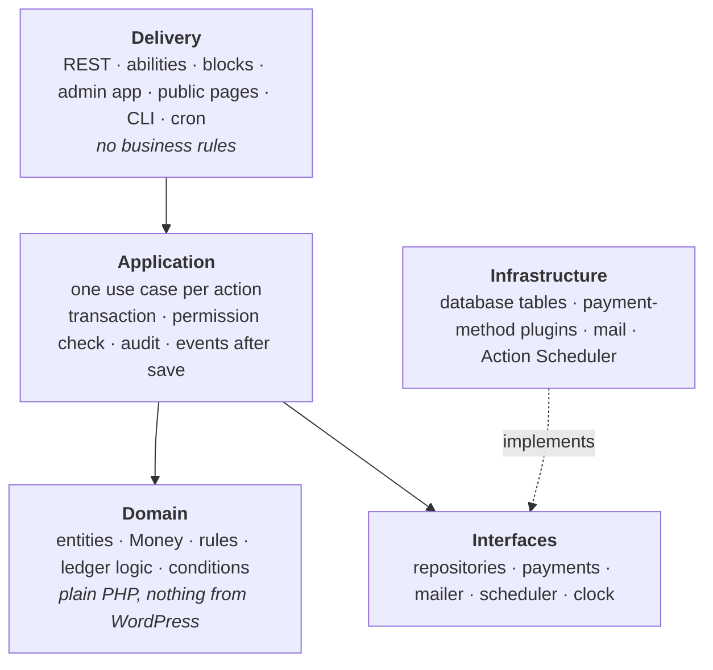
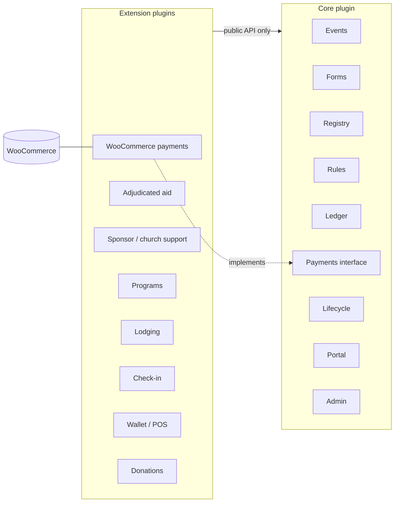
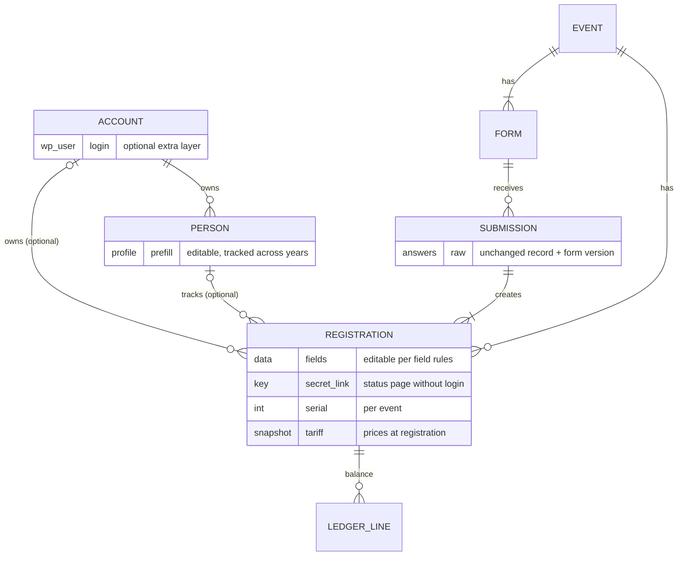
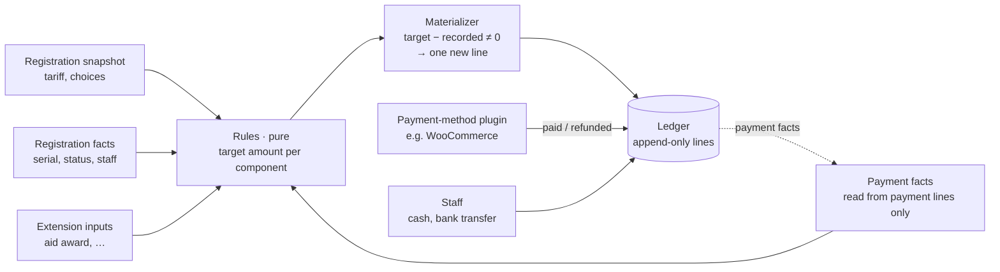
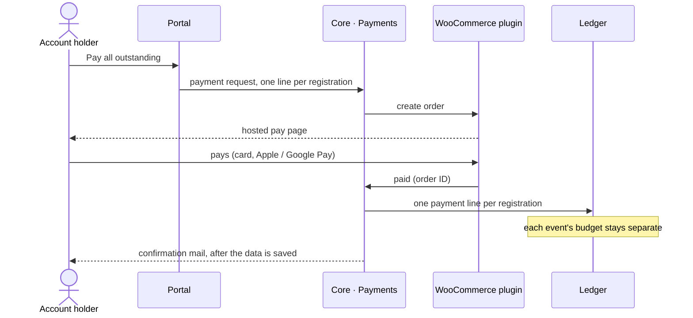
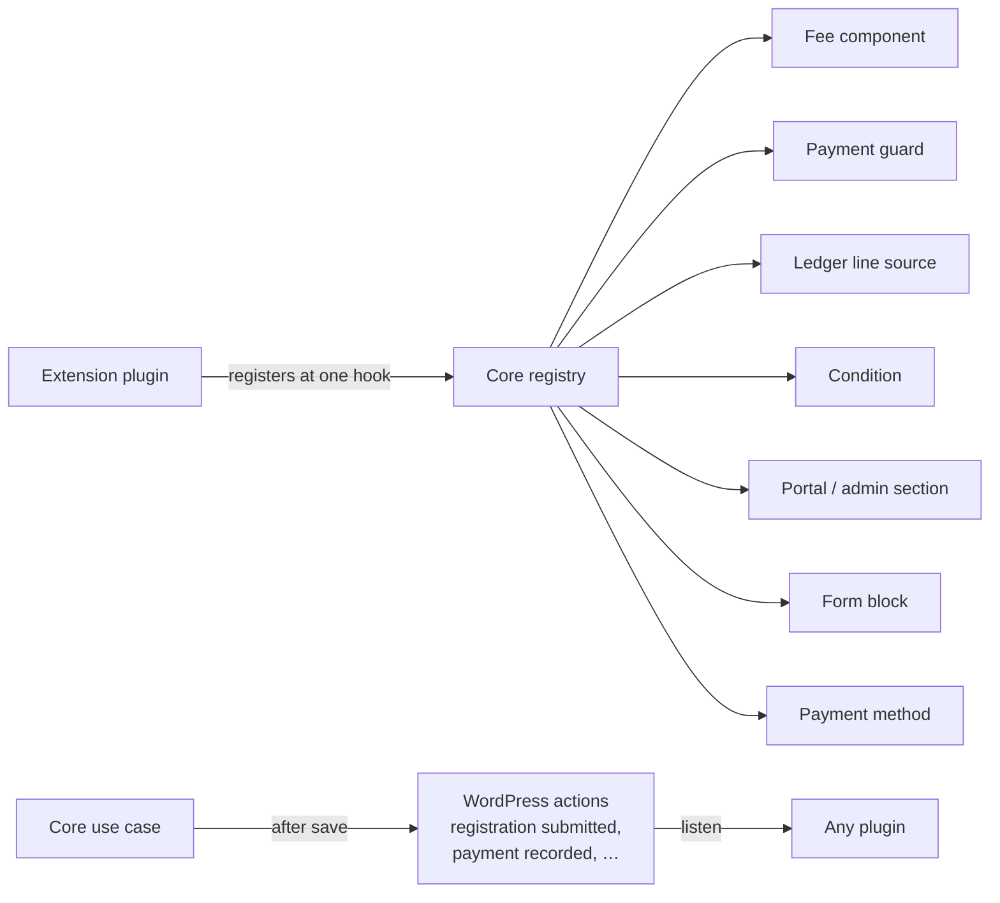

# Core architecture

Status: **decided architecture as of 2026-10-23**, built together with the
owner. Every decision referenced as D-nnn is in the [decision log](decisions.md).
Names of plugins, modules, hooks and code identifiers are **placeholders**.
Items marked *open* are deliberately left for later.

---

## 1. Fixed inputs

What this architecture must satisfy, from the decision log:

| Area | Decided | Ref |
|---|---|---|
| Base | WordPress + WooCommerce, one plugin codebase, one install per org, no shared data | D-007, D-008, D-009 |
| Shape | Layered, strict separations, publishable part by part, lean on WP core | D-012 |
| Domain | Event is the top-level unit; a form belongs to exactly one event; registration = participant × one event, separate budgets | D-010, D-030, D-031 |
| Money | Tariff snapshot per registration; config changes only via explicit re-price with adjustment lines | D-013 |
| Storage | Own tables for the domain; posts only for forms and mail templates | D-015 |
| Schema | dbDelta + upgrade steps later; drop-and-recreate + fixtures during development | D-016 |
| Writes | One transaction per use case; serial counter; side effects after commit | D-017 |
| Payments | Payments port in core; WooCommerce as our own extension plugin (WC data API only, hidden carrier product, idempotent ledger lines); staff-recorded cash/transfer; pluggable payment methods; WooCommerce-compatible money shapes | D-018, D-034, D-037 |
| API | REST in core conventions, consumed as core-data entities by DataViews/DataForm | D-019 |
| Forms | Own blocks + Interactivity API, server validation from parsed blocks; one form per event (an event may have several, e.g. staff) | D-014, D-020, D-031 |
| Actions | Admin use cases also registered as abilities | D-021 |
| Platform | WordPress 7.0+, PHP 8.2+ | D-022 |
| Language | Hungarian only, hard-coded, no translation layer | D-023 |
| Behavior | Today's system is the reference; deviations decided explicitly | D-024 |
| Scale | Good on low-end shared hosting to 500 registrants, functional to 1,000 | D-015 |

## 2. Layers

Every plugin we ship has the same four layers. Dependencies point downward
only:

Rules:

1. **Domain is pure.** No WordPress functions, no globals, no I/O. It is unit-tested
   without WordPress.
2. **Use cases are the only entry point for writes.** REST controllers,
   abilities, WP-CLI commands, cron jobs and form submissions all call a use
   case. Nothing writes a table directly.
3. **One use case = one transaction.** Mail, WooCommerce calls with side
   effects and third-party hooks run after commit, via queued jobs (D-017).
4. **Infrastructure is swappable behind interfaces.** Repositories hide
   storage, and only the WooCommerce adapter touches WooCommerce.
5. **Boundaries are checked in CI** (layer rules and cross-plugin rules),
   not left to discipline.

## 3. Packaging (D-025, D-026, D-034)

One repository, one version number, one CI pipeline that builds a zip per
plugin. Plugin names are placeholders (D-014).

| Core module | Responsibility |
|---|---|
| Events | events, tier ladders, policies, dates, capacities |
| Forms | form documents, field blocks, intake |
| Registry | accounts ↔ persons, submissions, registrations, serials, waitlist |
| Rules | fees, deposits, deadlines, late fees, phases (pure domain) |
| Ledger | lines, balances, materializer, staff-recorded payments |
| Payments | payment interface, payment-method registry |
| Lifecycle | phase tracking, mail state machine, scheduler tick |
| Portal | status page (secret link), account area (WordPress login) |
| Admin | data grid, detail views, notes, audit, settings |

- **Inside core, modules follow the same rule as plugins:** a module uses
  another module only through that module's public interfaces. CI checks
  this. A module can therefore be lifted out into its own plugin later
  without rewriting its neighbors.
- **Payments is a port.** Core defines what it needs from a payment provider:
  - create a payment request for N registration lines;
  - return the pay URL;
  - reuse an open request;
  - report paid, refunded and failed.

  The **WooCommerce integration is its own extension plugin** implementing
  that port (D-018, D-034). Core has no WooCommerce dependency at all. Without
  a payment plugin, online payment is unavailable and staff-recorded payments
  (cash, bank transfer) still work. Other automatic methods (another gateway,
  bank-statement import…) are further plugins on the same port (D-037).
- **Features plug into core's extension points** (§6): fee components,
  payment guards, ledger line sources, conditions, portal sections, admin
  tabs, form blocks.

## 4. Identity: accounts, persons, registrations (D-028 … D-030, D-035, D-036)

- **Account** = an optional WordPress user who owns registrations and, optionally, people.
- **Person** = a stable identity across years, owned by an account. Guests never get one.
- **Registration** = one participant × one event, with its own serial, status, secret link and ledger.

Rules:

1. **One registration = one participant × one event** (D-030). Attending two
   events means two registrations, fully separate: serial, status, link,
   balance. An account reuses its saved person to prefill the second one.
2. **Field-level editability** (D-035). The original submission is kept
   unchanged as the record. The registration's values can change, field by
   field:
   - each form field defines whether registrants may edit it after submit;
   - a field can be locked from a date/time, or manually by organizers;
   - registrants (secret link or owner account) see all submitted data and
     edit the fields open to them;
   - organizers with the capability correct any field at any time;
   - every edit is audited.

   Editing a person profile never changes existing registrations.
3. **Untracked unless linked to a person** (D-029, D-036). Guest registrations
   create no person and are never matched to anyone. Under an account, a
   registration may be linked to a person (tracked year to year) or stay
   independent. A youth leader can register a group without creating persons.
4. **Access to a registration** is granted by either its secret key (bearer
   link, long random, regenerable) or being logged in as its owner account.
   Organizers use capabilities.
5. **Attaching:** a guest can attach their registration to an account from the
   secret-link page. The account then owns it and may link it to one of its
   persons.
6. **Accounts aggregate:** the account area lists all owned registrations,
   across events and persons, with balances, and offers one combined payment.
   Each registration's ledger stays separate. The account view is a sum, and
   one payment order carries one line per registration.
7. **Persons are not WordPress users.** Only accounts are. A person is a record
   owned by an account.
8. **Default flows are seamless** (D-036). The two common paths must feel
   simple and hide the model:
   - guest registration;
   - first-time account user: create account → their person is created
     automatically → register.

   Multi-person and multi-registration account flows may ask more of the
   user, with short explanations (e.g. tooltips) of the concepts.

*Open*, decided later: the registration flow when an account is involved
(inline vs before the form), and the minimum age for holding an account.

## 5. Money: ledger and materializer (D-013, D-037)

### 5.1 Ledger

- **One ledger per registration**, so per participant × event. Budgets and
  accounting are separate per event by construction (D-030).
- **Amounts use WooCommerce-compatible shapes** (D-037):
  - every monetary record carries a currency code (ISO 4217);
  - stored as `DECIMAL(26,8)` like WooCommerce's order tables;
  - decimals and rounding follow WooCommerce's conventions for that currency.

  In the domain, a `Money` value object holds an exact amount plus currency,
  never a float. Each org runs one currency today. Multi-currency is
  possible by shape but not built.
- **Sign convention:** a positive amount increases what the participant owes,
  a negative amount decreases it. Balance = Σ lines; > 0 means due, < 0 means
  overpaid.
- **Lines are append-only.** Every change is a new line with a source reference
  (rule run, WooCommerce order/refund, admin action, feature plugin) and an
  idempotency key.

| Kind | Sign | Written by |
|---|---|---|
| `charge` (per component: base tier, late fee, staff discount…) | ± | materializer |
| `payment` (online or other automatic method) | − | Payments, from payment-method plugin events |
| `refund` | + | Payments, from payment-method plugin events |
| `manual_payment` (bank transfer, cash) | − | staff use case |
| `adjustment` (correction with reason) | ± | admin use case |
| feature lines (aid award, sponsor support, wallet…) | ± | feature plugins via extension point |

### 5.2 Materializer

- **Triggers:**
  - after any use case that changes facts (submit, payment, award, status change);
  - the daily tick (deadlines, late fees);
  - the explicit **re-price** action, which replaces the tariff snapshot and
    then materializes (D-013).
- **Rules never read charge lines**, only payment facts. That avoids a
  feedback loop.

### 5.3 Paying several registrations at once

An account holder pays everything outstanding, e.g. two children in two
camps, in one payment. Each event's money still lands in its own ledger
(D-029, D-030).

## 6. Extension surface (D-032)

- **Typed points** are interfaces in core's public namespace, versioned with
  core. A feature plugin implements them and is unit-testable without
  WordPress.
- **Actions** fire only after the transaction commits, never inside it
  (D-017). A listener's failure can't corrupt core data. Heavy listeners
  queue their own jobs.
- **The list is closed:** a new extension point is added deliberately when a
  feature needs it, not speculatively. The names above are working names.

## 7. Cross-cutting concerns

| Concern | Approach |
|---|---|
| **Transactions** | One per use case. No WordPress APIs that fire third-party hooks inside one. Side effects are queued after commit (D-017). |
| **Audit** | Every use case writes one audit entry (D-033) (who, what, which records, before/after of changed fields) in the same transaction. Ledger lines are their own audit. |
| **Permissions** | Fine-grained capabilities per use case (e.g. "record manual payment", "re-price event", "edit registration"). Roles are bundles of capabilities. Core ships default roles; **the role set is defined with the owner later** (D-004). Abilities use the same capabilities (D-021). |
| **Secret links** | ≥128-bit random key per registration, **stored readable** so every email can carry the link (D-038); never logged, masked in exports; regenerable by organizers (old link stops working). Rate-limited "resend my link" goes only to the registration's own contact email. |
| **Mail** | Only the Lifecycle module sends mail: templates as block documents, conditions from the condition registry, send-once log, kill switch, queued and retried via Action Scheduler. |
| **Time** | Stored in UTC; displayed and computed in Europe/Budapest. Deadlines are dates in the event's time zone. A clock interface in the domain keeps rules testable. |
| **Money** | WooCommerce-compatible shapes: currency code everywhere, `DECIMAL(26,8)` storage, WooCommerce decimals/rounding; exact `Money` value object in the domain, no floats (D-037). |
| **Language** | Hungarian strings directly in code; no translation layer (D-023). Code identifiers and comments in English. |
| **Personal data** | Minors' data only in our tables. WordPress privacy export/erase hooks registered for accounts and their persons. Guest registrations are erased by retention policy (to be defined). No personal data in logs. |
| **Testing** | Domain: PHPUnit without WordPress, one named test per behavioral rule. Use cases + adapters: integration tests on wp-env. Fixtures: users per role + anonymized data; schema dropped and recreated freely until production (D-016). |
| **Boundaries in CI** | A layer checker (domain imports nothing from WordPress/WooCommerce; modules and plugins use only public APIs) runs on every push and fails the build on violations. |
