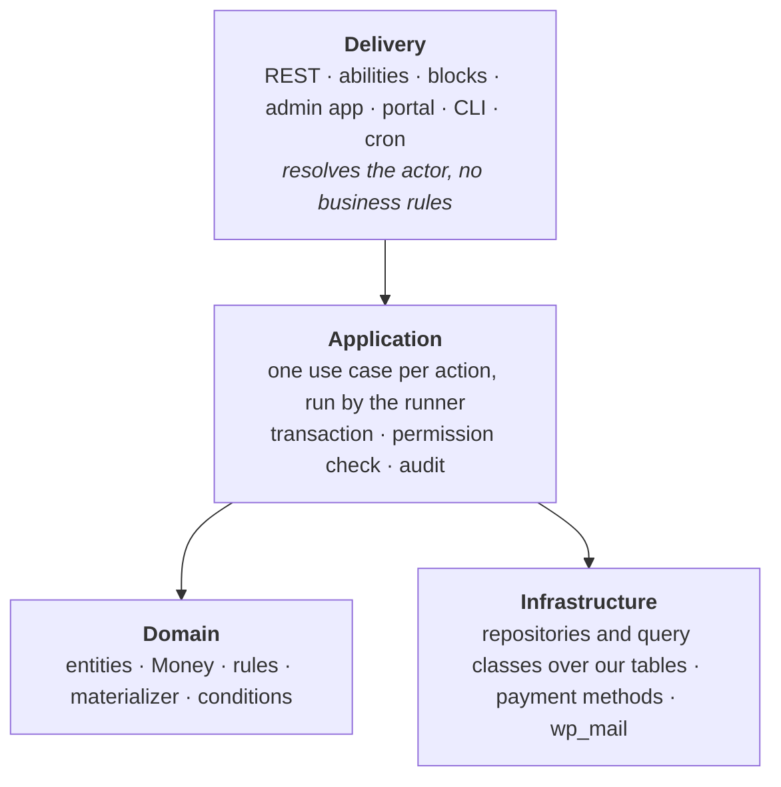
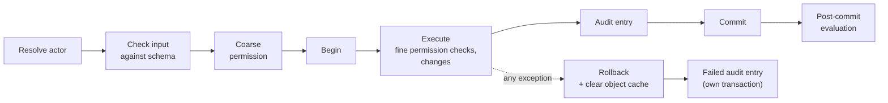
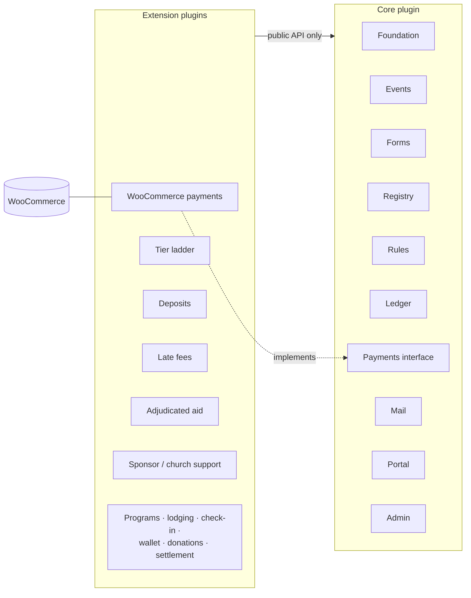
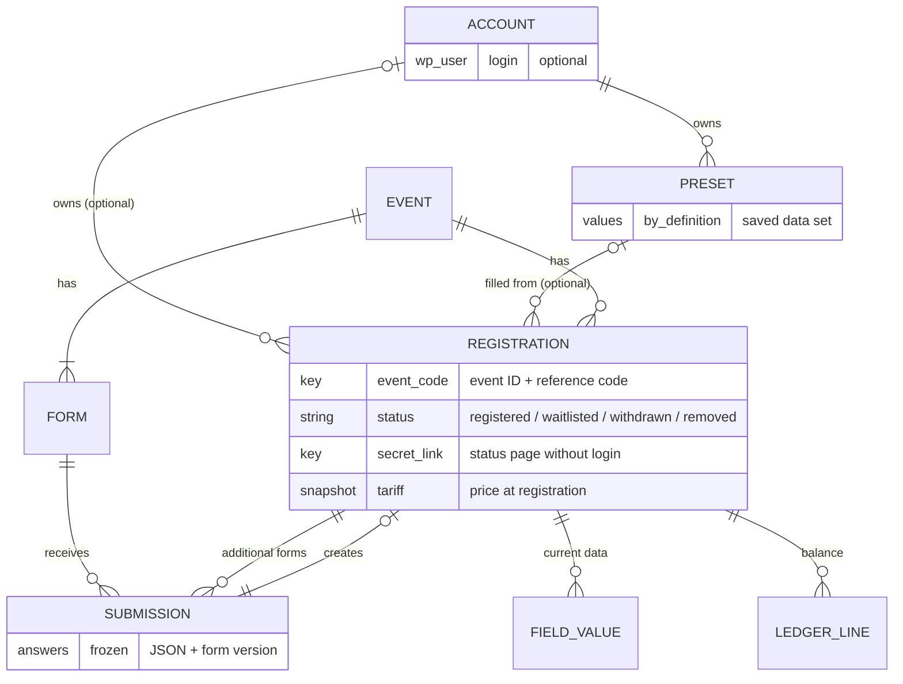
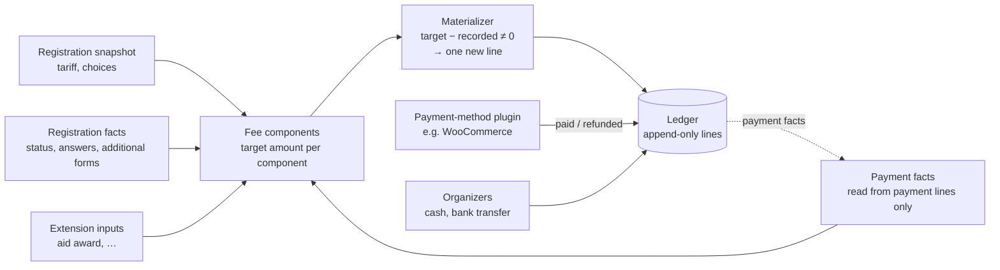
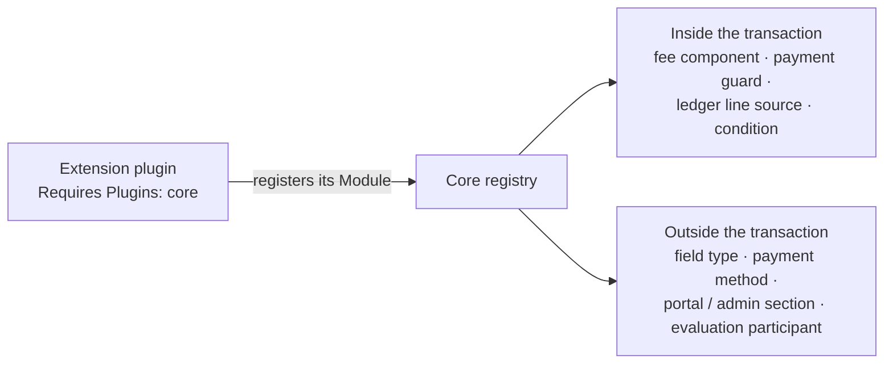

# Core architecture

Status: **decided architecture as of 2026-10-25**, built together with the
owner. Every decision referenced as D-nnn is in the [decision log](decisions.md).
The product name is **Kaláka** (D-040) and code identifiers follow D-079;
module names are **placeholders**. Items marked *open* are deliberately
left for later. Items marked **To discuss** are working arrangements or
proposals the owner has not confirmed yet: they are not decisions.

---

## 1. Fixed inputs

What this architecture must satisfy, from the decision log:

| Area | Decided | Ref |
|---|---|---|
| Base | WordPress + WooCommerce, one plugin codebase, one install per org, no shared data | D-007, D-008, D-009 |
| Shape | Layered, strict module boundaries, publishable part by part, lean on WordPress core; domain code may use WordPress | D-012, D-041 |
| Domain | Event is the top-level unit; a registration is one participant × one event, separate budgets | D-010, D-030 |
| Identity | Registration-centric: no person records; accounts own registrations and presets | D-048, D-049 |
| Money | Core: fixed price + full payment; everything else is a plugin. Tariff snapshot; changes only via explicit re-price | D-013, D-074 |
| Storage | Own tables for the domain; posts only for block-edited documents (forms, field definitions, mail bodies) | D-015, D-054 |
| Schema | dbDelta + upgrade steps later; drop-and-recreate + fixtures during development | D-016 |
| Writes | One transaction per use case; any database error rolls back; effects after commit | D-055 |
| Deferred work | No job queue: the materializer converges money, a send log delivers mail, one shared trigger | D-057 |
| Payments | Payments port in core; WooCommerce as our own extension plugin; organizer-recorded cash/transfer; pluggable payment methods | D-018, D-034, D-037 |
| API | REST in core conventions, consumed as core-data entities by DataViews/DataForm | D-019 |
| Forms | Own blocks + Interactivity API, server validation; registration slot; field types, definitions and form fields | D-020, D-054, D-075 |
| Actions | Admin use cases also registered as abilities | D-021 |
| Database | MySQL is the target; never built for SQLite | D-042, D-064 |
| Performance | Per-event cost does not grow with the number of events | D-039 |
| Platform | WordPress 7.0+, PHP 8.2+ | D-022 |
| Language | Hungarian only, hard-coded, no translation layer | D-023 |
| Behavior | Today's system is the reference; deviations decided explicitly | D-024 |
| Scale | Good on low-end shared hosting to 500 registrants, functional to 1,000 | D-015 |

## 2. Layers and the use-case runner

Every plugin we ship has the same layers. Dependencies point downward only.
**To discuss:** this rewrite merged the old "Interfaces" layer (repositories, payments,
mailer, scheduler, clock) into Application and Infrastructure and dropped its
"infrastructure is swappable behind interfaces" rule; the owner only dropped
domain purity (D-041).

Rules:

1. **Domain code may use WordPress** where that makes sense (D-041). The plugin
   does not need to be portable. WordPress primitives are preferred wherever
   they fit.
2. **Use cases are the only entry point for writes.** REST controllers,
   abilities, WP-CLI commands, the periodic run and form submissions all call
   a use case. Nothing writes a table directly.
3. **Two sides, one machinery** (D-047). Admin side: the actor is a WordPress
   user, WP-CLI or the system. Portal side: the actor is access to a
   registration (§5). Both sides use the same runner but have separate action
   catalogues, authorization and REST namespaces. Use cases never read the
   current user themselves.
4. **Module and plugin boundaries are checked in CI** (D-065), not left to
   discipline.

### The runner (D-055)

- **Any** database error rolls back the whole use case; code never continues
  after catching one. Only errors marked retryable (e.g. a reference-code
  collision, a deadlock) are retried, about 3 times, each attempt from scratch.
- **Nested use cases** join the outer transaction and write their own audit
  entry, linked to the parent. Effects are released after the outermost
  commit.
- **Inside a transaction only our own tables are written:** no WordPress
  functions that fire hooks or fill WordPress caches. Changes to
  WordPress-owned data run after commit, in the same request (*to discuss*,
  D-055).
- **Errors** (D-046): use cases throw exceptions carrying a `WP_Error` (code,
  Hungarian message, HTTP status), so REST, abilities and WP-CLI show them
  correctly. Each exception class has its own default Hungarian text; the
  place that throws can add context.
- **Domain events are not part of the initial shape** (D-062): everything our
  own plugins do in response to a change happens inside the use case.

### Entities, repositories and queries (D-059)

- Entities are objects that carry their own ID. A reference to another record
  holds that record's ID; a helper loads it through a per-request object cache
  when needed, and the loaded object is never stored on the entity or
  serialized. Lists preload in one query.
- Entities record their own field changes; the runner turns them into the
  audit diff.
- Repositories offer `find(id)` (null when missing), `upsert()` for entities
  (with a version check against concurrent edits) and `insert()` for
  append-only records.
- **To discuss:** the version check, entities tracking their own changes and list
  preloading (D-059).
- Lists and the evaluation runs use separate **query classes** built on
  indexes. Every per-event table has indexes that start with the event ID, and
  a MySQL test checks each per-event query's plan (D-039).

## 3. Packaging (D-025, D-034, D-060, D-074)

One repository, one version number, one CI pipeline that builds a zip per
plugin.

**To discuss:** the module split below is a working arrangement made while rewriting:
the Foundation module, renaming Lifecycle to Mail, and where each
responsibility sits. The participant phase tracker (D-072) has no module yet.

| Core module | Responsibility |
|---|---|
| Foundation | runner, audit, clock, evaluation trigger, module registry |
| Events | events, states, timeline points, capacity and the "full" latch |
| Forms | forms, the registration slot, field types, field definitions, conditions, invitations |
| Registry | registrations, field values, submissions, presets, statuses, waitlist, reference codes |
| Rules | fixed price, fee-component framework, date types, materializer |
| Ledger | lines, balances, organizer-recorded payments |
| Payments | payment interface, payment-method registry |
| Mail | mails, deliveries, the sender |
| Portal | registration access by secret link or account, account area |
| Admin | data grid, detail views, notes, audit, settings |

- **One `Module` interface for core modules and extension plugins** (D-060). A
  module declares its tables, capabilities and extension-point contributions,
  and wires itself into WordPress in `boot()`. An extension plugin is a module
  that lives in another plugin, so a core module can later move into its own
  plugin unchanged.
- **Core money is minimal** (D-074): a fixed price per registration and full
  payment. Deposits, the tier ladder, aid, church support and late fees are
  plugins; core keeps full support for extending it in these ways.
- **Payments is a port.** Core defines what it needs from a payment provider:
  - create a payment request for N registration lines;
  - return the pay URL;
  - reuse an open request;
  - report paid, refunded and failed.

  The **WooCommerce integration is its own extension plugin** implementing that
  port (D-018, D-034). Core has no WooCommerce dependency at all. Without a
  payment plugin, online payment is unavailable and organizer-recorded payments
  (cash, bank transfer) still work. Other automatic methods (another gateway,
  bank-statement import, …) are further plugins on the same port (D-037).

## 4. Events and forms

### 4.1 Event lifecycle (D-072, D-073)

- **States** are admin acts: draft → published ⇄ unpublished → archived.
  Unpublishing pauses all of the event's public interfaces. Archived is
  read-only and starts the retention clock. The "full" latch (§5.3) is the
  other stored event state.
- **Timeline points:** registration opens, registration closes, start, end,
  plus named points admins add. Points are absolute dates only.
- **"Open", "closed" and phases are derived** by comparing the current time
  with the points. They are never stored, and nothing fires at those moments.
  The same holds for every form's date window.
- **Date references:** wherever a date can be set (mail schedules, field
  locks, fee rules, …) it can be a fixed date, an event point, or a **date
  type** declared by core or an extension. A date type may differ per
  registration (e.g. 14 days after registering or a fixed date, whichever is
  earlier); it is computed only from registration facts and absolute points.
  Core declares **payment due**.
- *Open:* the participant phase tracker, a modular subsystem (core default
  phases, configurable, extensions add phases).

### 4.2 Forms and the registration slot (D-075, D-076, D-077)

- An event has a **registration slot** holding one or more forms, plus
  **additional forms** that attach extra data to an existing registration
  (e.g. a staff form whose answers give a discount).
- Each form has its own requirements: a date window, a password (WordPress's
  own post password) and a required WordPress role. The slot adds two rules:
  every form in it must contain the required fields (e.g. a contact email),
  and the slot's date range applies on top of each form's own requirements.
- **Invitation links:** an admin can create a one-time link for one form and
  one person. It bypasses the form's requirements, the slot's date range and
  the event's capacity and "full" latch, so the registration lands as `registered`. It is spent
  on a successful submit, stored hashed and audited. Admins can also fill in
  any form themselves regardless of its criteria.

### 4.3 Fields (D-054, D-066)

| Concept | What it is |
|---|---|
| **Field type** | Code (a block type from core or an extension): data shape, validation, editor and front-end UI, admin display and filtering. Core ships the basic shapes (name, email, phone, date, text, choice, …) |
| **Field definition** | Optional organization configuration in its own post type, edited in the block editor and limited to one field block. Holds the complete field including its settings. Created by a single switch on a form field. Never changes its type |
| **Form field** | A block in a form, standalone or copied from a definition (keeping the definition's ID and version) |

- Changing a definition never changes forms automatically: admins are offered
  an update per form (a new form version), and registration data is never
  touched.
- Only definition-linked fields are prefilled from presets (*to discuss*,
  D-054). Types may refuse to
  be definitions and may refuse prefill.
- The contact email (exactly one per form in the registration slot) and the
  display name are explicit markings.
- Money-relevance is a type capability (supplied by plugins; core ships no
  money field types): values are stored like any other and changed only
  through use cases that re-materialize the money. Locked after submit by
  default: *to discuss* (D-054).
- **One condition format** serves form field visibility and mail bodies
  (D-071); forms evaluate it in the browser over form answers only.

## 5. Registrations and identity (D-048 … D-053, D-061, D-063)

### 5.1 Identity

- **No person records** (D-048). Each registration holds its own personal
  data; the same real person's data may differ between events. Year-to-year
  tracking is a later, heuristic add-on built from preset links.
- **Accounts** are optional WordPress users. An account owns registrations
  and **presets**: saved data sets, like a webshop's saved addresses, stored
  by field definition (D-049).
- **Presets are saved by default**, with an info box that offers to cancel:
  both a new preset (when an account is created, or a guest registration is
  attached to an account) and changes saved back to an existing one.
  Attaching a guest registration triggers the same side effects as
  registering with a new account. Editing a preset never changes existing
  registrations.

### 5.2 Submissions and values

- A **submission** is the frozen original: answers as JSON plus the form
  version, never changed (D-050). It creates zero or one registration, never
  more; additional forms attach further submissions to a registration.
- At submit the answers are **copied** into the registration's field values,
  which hold the current state. Values are stored one row per field, each row
  carrying the event ID (D-061).
- **Field-level editability** (D-035): each form field defines whether
  registrants may edit it after submit; a field can be locked from a date or
  manually; organizers with the capability correct any field at any time;
  every edit is audited.

### 5.3 Status, capacity and waitlist (D-051, D-076)

- Status is stored: `registered`, `waitlisted`, `withdrawn` (by the
  participant), `removed` (by an admin). It is set at registration by
  capacity, then changes only by explicit acts (withdraw, remove, admit from
  the waitlist, restore). A withdrawal never automatically admits anyone.
- **One capacity per event.** Every form in the registration slot counts
  toward it. The first registration that does not fit sets the event's
  **"full" latch**; from then on new registrations are waitlisted until an
  admin reopens the event. The capacity check locks the event row inside the
  submit transaction.
- The **sorszám** (order within `registered`, and within `waitlisted`) is
  derived.

### 5.4 Reference codes, keys and access (D-052, D-053, D-063, D-038)

- Every registration gets a **reference code**: digit, digit, letter, digit,
  letters `A K B E G J T Z F L R S X I`, valid when
  `(9·d1 + 5·d2 + 9·L + 9·d4) mod 14 < 5` (5,000 codes per event). Unique
  per event; carried over from the preset's previous registration when free,
  otherwise random, avoiding codes used in previous events where possible.
  Codes are extended by appending digits when an event runs out, and
  admins get a warning. The code
  grants no access.
- Registrations are **keyed by event and reference code**, and every per-event
  table refers to a registration by that pair. The code never changes. The
  auto-increment ID stays as a secondary key for generic references.
- **Access to a registration** is granted by its secret link (that one
  registration) or by being logged in as its owner account (all owned
  registrations, plus the combined list, paying all at once and presets).
  Organizers use capabilities.
- **The contact email is not unique.** "Resend my link" mails the links of
  every registration with that address. A second guest registration with the
  same email for the same event shows a soft notice.
- **Default flows are seamless** (D-036): guest registration, and "create
  account → register". Multi-registration account flows may ask more of the
  user, with short explanations.

*Open*, decided later: the registration flow when an account is involved
(inline vs before the form), and the minimum age for holding an account.

## 6. Money: ledger and materializer (D-013, D-037, D-044, D-057, D-074)

### 6.1 Ledger

- **One ledger per registration**, so per participant × event. Budgets and
  accounting are separate per event by construction (D-030).
- **Amounts use WooCommerce-compatible shapes:**
  - every monetary record carries a currency code (ISO 4217);
  - stored as `DECIMAL(26,8)` like WooCommerce's order tables;
  - arithmetic uses brick/math, never floats (D-044).
- **Sign convention:** a positive amount increases what the participant owes,
  a negative amount decreases it. Balance = Σ lines; > 0 means due, < 0 means
  overpaid.
- **Lines are append-only.** Every change is a new line with a source reference
  and an idempotency key.

| Kind | Sign | Written by |
|---|---|---|
| `charge` (per fee component: the fixed price; plugin components such as a late fee or staff discount) | ± | materializer |
| `payment` (online or other automatic method) | − | Payments, from payment-method plugin events |
| `refund` | + | Payments, from payment-method plugin events |
| `manual_payment` (bank transfer, cash) | − | organizer use case |
| `adjustment` (correction with reason) | ± | admin use case |
| feature lines (aid award, sponsor support, wallet…) | ± | feature plugins via extension point |

### 6.2 Materializer

- **It converges:** it writes only the difference between target and recorded,
  so it can run any number of times.
- **Changes caused by an action** are materialized inside that action's
  transaction. **Changes caused by time passing** (e.g. a late fee) are applied
  by the periodic run, one transaction per registration, under a
  per-registration lock. Opening a registration in the portal or admin also
  re-evaluates it.
- The explicit **re-price** action replaces the tariff snapshot and then
  materializes (D-013). Saving event settings never touches existing
  registrations.
- **Rules never read charge lines**, only payment facts. That avoids a
  feedback loop.

### 6.3 Paying several registrations at once

An account holder pays everything outstanding, e.g. two children in two
camps, in one payment. Each event's money still lands in its own ledger
(D-030).

## 7. Mail (D-068 … D-071)

**Five kinds of mail, by what causes them.** Deciding that a mail is due always
means inserting a pending **delivery** into the send log, whose unique key
(event, mail, registration, occurrence) makes it once-only.

| Kind | Caused by | Decided by |
|---|---|---|
| **Action** | an act on one registration (registered, waitlisted, payment recorded, a plugin's act such as a wallet top-up) | the use case, inside its transaction |
| **Scheduled** | a point on the event's calendar, for an audience | the periodic run |
| **Reminder** | time passing while a condition holds; repeats | the periodic run |
| **Manual** | an admin sends to a selection, now or scheduled | the admin's action |
| **Self-sent** | the registrant asks in the portal (e.g. resend my link) | the portal action, rate-limited |

- **One sender delivers everything, and no web request sends mail** (D-078),
  not even an admin's manual mail. A commit that inserted deliveries nudges a
  one-off sender run; a sender that stops with deliveries left nudges itself;
  the 5-minute periodic run retries the rest. It sends with a throttle. It renders the body at send time from current data
  and records the mail's version and send time, not the content. No archive
  copy. *To discuss:* the throttle (D-069).
- **Failures:** a definite failure (`wp_mail` returns false) is retried with
  increasing delays up to a limit, then left for an admin; an unknown outcome
  (a crash, a row stuck in "sending") is left for an admin. The latest error
  stays on the delivery (D-067).
- **Sending can be paused:** deliveries pile up and can be cleared.
  Unpublishing an event is a separate action, placed next to it. Later, not
  first version: a manual requeue of action mails that should have been sent
  but were not.
- **Configuration:** a **mail** is trigger settings plus a **body**, one to
  one, and belongs to one event; bodies are reused by copying, with
  unsupported values flagged. Action mails are defined in code and switched on
  or off per event. Scheduled mails are defined freely by admins, at a fixed
  date or relative to an event point, cannot be activated after their time,
  and choose whether late registrants receive them. Reminders are defined in
  code by their module; admins set the time base and interval. An event-wide
  layout is optional per mail.
- **Content:** block-edited; blocks only for layouts (e.g. the payment table).
  Dynamic values go inline into text and custom HTML, or into block attributes
  via Block Bindings, with the same choice of values in both. Conditional
  if / else-if / else blocks compare values or use an extension's condition.
  *Open:* the inline value syntax.

## 8. Extension surface (D-032, D-062, D-065)

- **To discuss:** extensions declare date types (D-073); whether that is a point of
  this registry, and on which side of the transaction, is undecided.
- Extension plugins declare core in their `Requires Plugins` header, so
  WordPress refuses to activate them without it.
- They contribute through a **typed registry** with a closed list of extension
  points; a new point is added only when a feature needs it.
- Points marked **inside the transaction** may only touch our tables and fire
  no WordPress hooks.
- Other modules and plugins use only a module's `Api` namespace, checked in
  CI.
- Public after-save WordPress actions for third-party plugins are a later
  nice-to-have (D-062).

## 9. Cross-cutting concerns

| Concern | Approach |
|---|---|
| **Transactions** | One per use case; only our tables inside; any database error rolls back; effects after commit (D-055). |
| **Deferred work** | No job queue (D-057). One shared trigger runs the evaluation right after commit for the touched registrations, periodically (every 5 minutes, D-078), when a registration is opened, and manually. Mail is never sent in a web request: the sender runs only from a nudge (a one-off WP-Cron event scheduled after commit) or the periodic run (D-078). A Site Health check recommends a real system cron. |
| **Bulk changes** | One transaction per item, a result report with links to failed records, retry or skip, and a preview where one exists (D-058). |
| **Audit** | One entry per use case in `kalaka_audit_entries` (D-056, D-079): time, correlation ID, parent, side, actor, action, IP address, user agent, optional reason, changed fields before and after (secrets masked), outcome. `kalaka_audit_subjects` lists every record touched. Failed use cases are audited too; plain validation failures are not (D-067). How the failed entry is written (own transaction, no input values, error-log fallback): *to discuss*. |
| **Failures** | Kept on the record they concern: the delivery, the refund request, or an "evaluation failed" flag on the registration shown to admins. PHP's error log is the last fallback (D-067). |
| **Permissions** | Fine-grained capabilities per use case. Roles are bundles of capabilities. Core ships default roles; **the role set is defined with the owner later** (D-004). Abilities use the same capabilities (D-021). |
| **Secret links** | ≥128-bit random key per registration, stored readable so every email can carry it (D-038); never logged, masked in exports; regenerable by organizers. |
| **Time** | Stored in UTC; displayed and computed in Europe/Budapest. A PSR-20 clock keeps rules testable (D-043). Dates are set through date references (D-073). |
| **Money** | `DECIMAL(26,8)`, currency code everywhere, brick/math, no floats (D-037, D-044). |
| **Sorting** | `utf8mb4_hungarian_ci` on our text columns (D-045). |
| **Language** | Hungarian strings directly in code; no translation layer (D-023). Code identifiers and comments in English. Prefixes and names per D-040 and D-079. |
| **Personal data** | Personal data only in our tables. WordPress privacy export and erase cover registrations, presets, and audit diffs. IP address and user agent in the audit are declared through WordPress's privacy tools. Retention for guest data and audit: *open*. |
| **Performance** | Per-event cost does not grow with the number of events; checked by an `EXPLAIN`-based MySQL test (D-039). |
| **Testing** | Most tests run with WordPress loaded; plain PHPUnit stays where code is naturally free of WordPress (e.g. money arithmetic) (D-041). The full test suite runs on MySQL; a SQLite run only checks that Playground starts and loads the seed (D-042, D-064). Fixtures: users per role + anonymized data; schema dropped and recreated freely until production (D-016). |
| **Boundaries in CI** | A checker enforces module and plugin boundaries (each module's `Api` namespace) on every push (D-041, D-065). |
