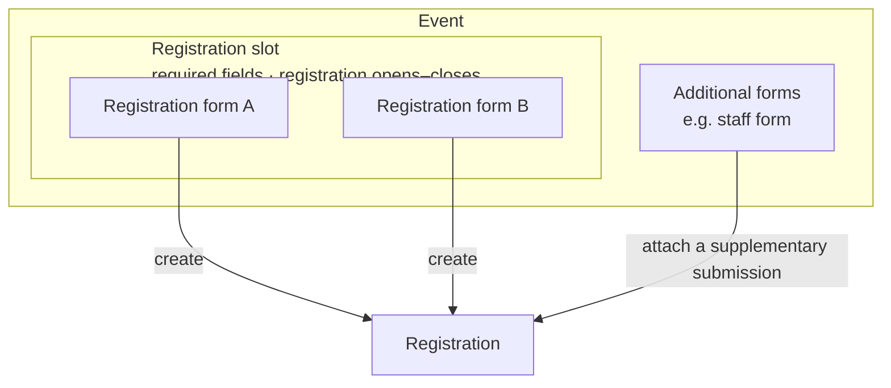

# Events and forms

## Events

- **The event is the top-level unit.** A form belongs to exactly one event,
  and the event is fixed by which form is opened. Seasons are grouped by
  dates, labels and filters, not by a layer above events.
- **Budgets and accounting are completely separate per event.** Linking
  events (e.g. REFISZ's two camps) is not part of the lifecycle.

## Event lifecycle

- **States are admin acts:** draft → published ⇄ unpublished → archived.
  - **Unpublished** pauses all of the event's public interfaces: forms, the
    portal, payments. It also stops the event's **mail decisions and
    sending**: the periodic run creates no scheduled or reminder deliveries
    for it, and no delivery is sent. Action mails from admin acts still pile
    up; on republishing, the admin sees the pending count and can clear
    them. This follows from a sound
    unpublish; the control stays separate from the global mail pause, which
    only pauses sending ([Mail](mail.md#pausing)).
  - **Archived** is read-only and starts the retention clock.
- **The "full" latch** is the other stored event state
  ([Registrations](registrations-and-identity.md#status-capacity-and-waitlist)).
- **A failed load treats every event as unpublished** without changing the
  stored state ([Modules](modules-and-extensions.md#failure-isolation)).
- **Timeline points:** core has **registration opens, registration closes,
  start, end**; admins can add their own named points, which mails can use.
  Points are **absolute dates only**, never relative to each other (that
  would allow cycles).
- **"Open", "closed" and phases are derived** by comparing the current time
  with the points. They are never stored, and nothing fires at those moments.
  The same holds for every form's date window. Registration therefore opens
  and closes automatically at its points; to reopen it, an admin edits the
  date (which does not clear the "full" latch).
- **The participant phase tracker** (today's F1–F5) stays, as a modular
  subsystem in the Events module: core default phases, configurable,
  extensions add phases. Designed later ([Deferred](deferred.md)).
- Today's reclassification is dropped; late fees replace it. Post-camp
  settlement is a deferred extension.

## Date references

Wherever a date can be set (mail schedules, field locks, fee rules, …) it can
be:

- a fixed date;
- an event point (core or custom);
- a **date type** declared by core or an extension.

A date type **may differ per registration** (e.g. 14 days after registering or
a fixed date, whichever is earlier). It is computed only from registration
facts and absolute points, never from another derived date. Core declares
**payment due**. Date types are an extension point that runs inside the
transaction and takes one immutable context; the periodic run computes them
in PHP for registrations in published events. If that ever becomes slow, the
computed date is cached in a column on the registration.

## Forms and the registration slot

- An event has a **registration slot** holding one or more forms, plus
  **additional forms** that attach extra data to an existing registration
  (e.g. a staff form). A form's purpose follows from where it sits.
- **Every form has its own access requirements,** kept minimal: a date window,
  a password (WordPress's own post password) and a required WordPress role.
- **The slot adds two rules:** every form in it must contain the required
  fields and functionality (e.g. exactly one contact email), and the slot's
  date range (registration opens and closes) applies on top of each form's own
  requirements. Otherwise all forms share the same primitives.
- **Capacity is the event's only** ([Registrations](registrations-and-identity.md#status-capacity-and-waitlist)).
  There are no registration categories and no per-form capacity.
- **Staff work as today:** they register through the normal registration form
  (taking a place), then fill in the staff form, an additional form whose
  answers give the discount. Staff is not a core concept; it is built on
  supplementary submissions.
- Workshops and modules are a later plugin that may reuse the form
  primitives; they do not shape form requirements.

## Invitations and admin submissions

- **One-time invitation link:** an admin creates it for **one form and one
  person**. It bypasses the form's requirements, the slot's date range and the
  event's capacity and "full" latch, so the registration lands as
  `registered`. It is **spent on a successful submit** (not on opening),
  stored hashed (shown only once) and audited when created and when used.
- A late staff member gets one invitation for the registration form and, if
  needed, a second one for the staff form.
- **Admins can fill in any form themselves** regardless of its criteria; the
  audit records it.
- Invitations complement password-protected forms.

## Forms implementation

- **Our own implementation on WordPress's building blocks; no form plugin.**
- Forms are **block documents** (`kalaka_form` posts) built from our own
  field blocks.
- The public page uses WordPress's **Interactivity API** and renders correctly
  before any script runs.
- **The server validates against the same form definition:** only declared,
  visible fields are accepted.
- **Each submission stores the form and its version**
  ([Registrations](registrations-and-identity.md#submissions-and-values)).
- Still to build within forms: spam protection and file upload
  ([Deferred](deferred.md)).

## Fields

| Concept | What it is |
|---|---|
| **Field type** | Code: a block type from core or an extension. It defines the data shape, validation, editor and front-end UI, admin display and filtering. Core ships the basic shapes (name, email, phone, date, text, choice, …) |
| **Field definition** | Optional organization configuration in its own post type (`kalaka_field`), edited in the block editor and limited to one field block. Holds the complete field including its settings, with no override layer. Created by a single switch on a form field |
| **Form field** | A block in a form, standalone or copied from a definition (keeping the definition's ID and version) |

- **Definition, its copies in forms and its data are three separate things.**
  Changing a definition never changes forms automatically: admins are offered
  an update per form (a new form version), and registration data is never
  touched.
- **A definition never changes its type.** Presets store values in the type's
  shape; a different type means a new definition.
- **Prefill:** only fields linked to a definition are prefilled, because
  presets store values by definition ID. A copy edited after it was taken
  still prefills whenever the preset value is valid for the field's current
  settings (e.g. a removed choice option is not); otherwise it stays empty.
  How prefill looks is approved with the UI.
- **Types may refuse** to be definitions and may refuse prefill.
- **Explicit markings:** the contact email (exactly one per form in the
  registration slot) and the display name.
- **Money-relevance is a type capability** supplied by plugins; core ships no
  money field types. Values are stored like any other, **locked after submit
  by default** (an organizer can unlock per field), and changed only through
  use cases that re-materialize the money.

### Editability after submit

- Each form field defines whether registrants may edit it after submit, with
  locks by date (a date reference) or set manually.
- Registrants (by secret link or owner account) see all their submitted data
  and can edit the editable fields.
- Organizers with the capability can correct any field at any time.
- The original submission stays unchanged, and every edit is audited.

## Conditions

**One condition format** serves form field visibility and mail bodies. Forms
evaluate it in the browser over form answers only; mails evaluate it on the
server over any value.

- **Operators:** equals, less than, less or equal, greater than, greater or
  equal, contains, empty.
- **A "not" switch** on each condition, instead of separate negated
  operators.
- **Typed comparison:** values compare as number, date, text or choice.
- **Combining:** all / any; a condition can be a group, one level deep.
- **Extension conditions** can be used alongside comparisons.
- Examples: status equals waitlisted; balance greater than 0; a multi-choice
  answer contains X; date of birth less or equal to a date.
