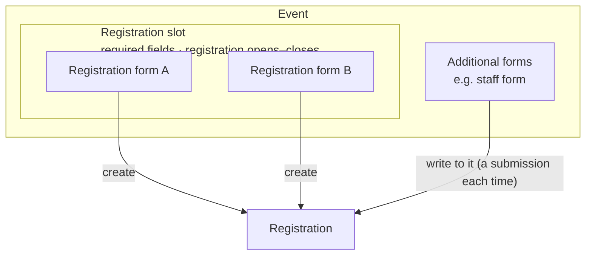

# Events and forms

## Events

- **The event is the top-level unit.** A form belongs to exactly one event,
  fixed once the form has fields or submissions. Seasons are grouped by dates,
  labels and filters, not by a layer above events.
- **Budgets and accounting are completely separate per event.** Linking events
  (e.g. REFISZ's two camps) is not part of the lifecycle.
- **An event carries its own settings:** capacity, timeline points, the
  account mode, the payment-due days, the bank-transfer texts, the mail layout
  and each money plugin's settings.
- **An event has one status-page slot** (a post ID) and a table for per-device
  push subscriptions. The status-page app is parked; nothing uses either yet.

## Event lifecycle

- **States are admin acts:** draft → published ⇄ unpublished → archived.
  - **Unpublished** pauses all the event's public interfaces (forms, the
    participant blocks, payments) and its mail: nothing is sent, and no
    scheduled or reminder deliveries are added. Action mails are still queued,
    so none is forgotten; on republishing the admin sees the pending count and
    can clear them. This is separate from the global mail pause, which only
    pauses sending ([Mail](mail.md#pausing)).
  - **Archived** is read-only and starts the retention clock.
- **Publishing needs a name, the four core points and a capacity.**
  [UNAPPROVED R391] Capacity may be empty only in a draft; 0 is allowed (every
  counted registration is then waitlisted); there is no unlimited capacity.
- **The "full" latch** is the other stored event state
  ([Registrations](registrations-and-identity.md#status-capacity-and-waitlist)).
- **A failed load treats every event as unpublished** without changing the
  stored state ([Modules](modules-and-extensions.md#failure-isolation)).
- **Timeline points:** core has **registration opens, registration closes,
  start, end**; admins add their own named points. Points are **absolute
  instants only**, entered as a day and time in the site time zone and stored
  in UTC, never relative to each other (that would allow cycles). Registration
  is open from "opens" up to, but not including, "closes".
- **"Open", "closed" and phases are derived** from the points and the current
  time, never stored, and nothing fires at those moments; the same holds for
  every form's open period. To change when registration opens or closes, an
  admin edits the points (which does not clear the "full" latch).
- **The participant phase tracker** (today's F1–F5) stays, as a modular
  subsystem of Events: core default phases, configurable, extensions add
  phases. Designed later ([Deferred](deferred.md)).
- Today's reclassification is dropped; late fees replace it. Post-camp
  settlement is a deferred extension.

**What follows:** nothing happens "at" a point. A rule that depends on time
compares with the clock when it runs (a form at render and at submit, a mail
in the periodic run), so moving a point moves every rule that reads it.

## Date references

Wherever a date can be set (mail schedules, an additional form's open period,
fee rules, …) it can be a fixed date, an event point, or a **date type**,
which may differ per registration and is computed only from registration facts
and absolute points, never from another derived date.

Core declares **payment due**: N days, set per event, after the later of the
moment the registration last became `registered` and its last changed answer
to a request, and none while a request awaits an answer
([Money](money.md#core-money-scope)). It is computed on every read, never
stored; if that ever becomes slow, it is cached in a column on the
registration. Extension date types are a foreseen point
([Modules](modules-and-extensions.md#the-extension-surface)).

**Deadlines are compared as instants.** A deadline set as a day ends at
midnight in the site time zone. A stored deadline's instant is fixed when
stored, so a later time-zone change does not move it; a computed date's day
ends at midnight in the site time zone at the time of computing.

## Forms and the registration slot

- An event has a **registration slot** holding one or more **registration
  forms**, plus **additional forms** that write to an existing registration
  (e.g. a staff form, or one holding only the module ranking). A form's
  purpose follows from where it sits; otherwise all forms share the same
  primitives.
- **Every form has its own access requirements,** kept minimal: a password
  (WordPress's post password) and a required WordPress role.
- **When a form is open:** a registration form is open while the slot is, with
  no period of its own. **Each additional form has its own open period** (each
  end a date reference; an end not set does not limit it), which a form link
  can bypass ([below](#form-links-and-admin-submissions)).
- **The slot's rule:** every form in it holds exactly one contact email, one
  display name, the account block in an event with accounts, and every field
  an extension requires (the ladder's `price_tier`), required and outside any
  condition. A form that lacks one is closed until fixed.
- **An additional form never creates a registration** and never counts toward
  capacity. It writes to the active registration
  ([Registrations](registrations-and-identity.md#access)) or to the one its
  form link targets, and **only a `registered` registration may submit it**
  (owner ruling): a waitlisted, withdrawn or removed one's link shows it
  closed.
- **The event's capacity is the only capacity on registrations.** There are no
  registration categories and no per-form capacity; limited choices (set
  options, tiers, offers) have their own pools, which limit only that choice.
- **Staff work as today:** they register through the normal registration form
  (taking a place), then fill in the staff form, an additional form whose
  answers give the discount. Staff is not a core concept.
- Workshops, modules, groups, rooms and meal turns are **assignment sets**
  ([Modules](modules-and-extensions.md#assignment-sets)). **Re-choosing later
  is an additional form** holding the choice; there is no separate portal
  edit.
- **Form texts read amounts, quotas, places left and deadlines from the
  event's values,** so they cannot drift from the rules
  ([Values and conditions](#values-and-conditions)).

**What follows:** a new "kind" of registration (staff, a helper, a child) is
fields and conditions on the same forms, plus an additional form for what
comes later, never a new form type.

## Prefill from a link

- **Public prefill comes as a guest draft.** A request to a page placing one
  registration form may carry answers as `kalaka[<field key>]` (the quiz's
  POST, or a static GET link). They are untrusted: each is cleaned by its field
  type's prefill rules and checked alone; what fails is dropped silently. The
  rest is kept as a guest draft
  ([Submissions and values](registrations-and-identity.md#submissions-and-values))
  under a claim token in a cookie, in every account mode, and the request is
  answered with a 303 to the page without them. **Nothing of the request is
  logged.**
- **A handover never overwrites what the browser holds:** it waits in a draft
  of its own until the next page load, which makes it the browser's draft or,
  when the person's own typing would change, lets them choose: merge (the
  link's answers win), keep the draft, or keep the link.
- **Forms start from the active registration**
  ([Registrations](registrations-and-identity.md#access)): an additional form
  opens with the current field values, as editable values. A type may refuse
  prefill: its field opens empty and, left blank, keeps its value.
- **A form link prefills from its record** (below), locked or editable; a
  link-only field never takes public prefill. **Prefill from a preset** is
  separate ([Fields](#fields)). Neither is built yet.
- **Form links created from public pages** come from a portal or system use
  case with its own rate limit.

**What follows:** a prefilled answer can be forged, so it is a suggestion,
never an authority; what only staff or a partner may set comes from a form
link's record, a staff write or an extension's act.

## Form links and admin submissions

**One form-link mechanism replaces the one-time invitation.** None of it is
built yet.

- **A form link has:** its form; optionally a **target registration** for an
  additional form (a registration is never identified by a typed reference
  code, [Registrations](registrations-and-identity.md#reference-codes)); the
  field values it sets, each locked (read-only or hidden) or editable; uses,
  unlimited or at most N (a single-use link is today's invitation; a use is
  spent on a successful submit, not on opening); bypasses, each off by default
  (the form's requirements, the slot's dates or an additional form's period,
  the event's capacity and latch; an invitation has them all on); an expiry
  and revocation. Expired links are cleaned up.
- **Creation, revocation and use are audited;** the link a registration came
  through is stored on it as a fact.
- **Link-only fields** are set only by a link, never by the registrant;
  **link-only options** show only when a link sets them. **Secret sections**
  are ordinary conditional sections on a link-only field, re-checked at
  submit.
- **Tokens:** 128 random bits, never logged by our code
  ([Foundation](foundation.md#the-error-log)), masked in exports, sent with
  no-referrer; stored readable, single-use ones included, so admins can
  re-send them.
- **An association** (e.g. a partner church) is either chosen by the
  registrant from public options or set and locked by a partner's link; the
  stored fact records which. It is not partner confirmation: that is a
  separate field, which a link may set secretly or the partner sets in its
  view.
- A late staff member gets one link for the registration form and, if needed,
  a second one for the staff form.
- **Admins can fill in any form themselves** regardless of its criteria; the
  audit records it.
- Form links complement password-protected forms.

## Forms implementation

- **Our own implementation on WordPress's building blocks; no form plugin.**
  Forms are **block documents** (`kalaka_form` posts) built from our own field
  blocks, and **the block editor is the form builder** (no separate builder;
  no polish, but the basics work). Only full access edits forms.
- **Placing a form:** an **embed block** in block-editor pages and a
  `[kalaka_form id="…"]` **shortcode** for page builders that cannot hold
  blocks, such as Divi 4's Builder; both use the same renderer. A page that
  places a form is never cached.
- **The public page uses WordPress's Interactivity API, and forms need
  JavaScript** (without it a form cannot be sent and says so). The one React
  part is the draft-claim popup, a `@wordpress/components` Modal loaded only
  with a pending claim ([Engineering](engineering.md#wordpress-surfaces)).
- **Forms are rendered by the server; the page's script holds no condition.**
  It keeps every answer while the page is open, sends only what shows, and asks
  the server again whenever a held condition may change
  ([Conditions](#conditions)). One request is in flight per form; a click on
  Next or Send meanwhile is queued, not lost.
- **The server validates against the same form definition** the page was built
  from, and only the form's latest version: only declared fields that show are
  accepted.
- **A published form never goes from working to broken through an edit:** a
  live save runs the full definition check and refuses a broken form. A form
  broken another way (an extension turned off, a clashing key) stays closed and
  is named in a site warning ([Foundation](foundation.md#site-warnings)).
- **Each submission stores the form and its version,** a revision. Revisions of
  forms are never pruned, and a form submissions refer to is never deleted for
  good, so a submission always resolves to the definition it was checked
  against.
- **Accounts:** in an event with accounts, every registration form holds the
  account block. Logged out, it says what an account gives and opens
  WordPress's login page in a window of its own; afterwards the form shows the
  account in place, keeping what was typed. In mandatory mode the send is
  refused without an account
  ([Registrations](registrations-and-identity.md#accounts-on-the-registration-form)).
  **Changing an event's account mode** to one with accounts is refused while a
  published registration form lacks the block, or while the "registered" mail
  is off or lacks the set-password link ([Mail](mail.md#configuration)).
- **Multi-page forms:** no pages, or all content in top-level **page blocks**,
  each with an optional title, an optional condition (none on the first page)
  and an optional **terminal** mark. A page's condition reads earlier pages and
  the event's values; a page that does not show is skipped both ways and its
  answers dropped. Unlike a branch, a page is never withheld: every page is sent
  hidden and shown when it holds. Next checks the page on the server; Back
  needs no request. A terminal page holds no fields and cannot be sent past.
  The contact email and display name never sit on a conditional page.
- **Answers survive a reload,** in the person's draft or guest draft
  ([Submissions and values](registrations-and-identity.md#submissions-and-values)).
- **After a successful submit** the form is replaced by its **after-submit
  section** (the thank-you message), one top-level block of the form with no
  fields, rendered with the event's values and the new registration's code and
  status, which its conditions read. Without it, a short default per status
  shows.
- **Required fields** show a bold asterisk after the title, in the error
  colour. The look follows the site's theme
  ([Engineering](engineering.md#wordpress-surfaces)).
- **Spam protection:** the submit route counts every attempt per client (an
  account, or a guest's address) and refuses those over the limit in a short
  window, with `Retry-After`. It runs before the submit, outside any use case,
  so the count is a WordPress transient; **it stores no address,** only a keyed
  hash per window. Account creation is guarded by a CAPTCHA plugin on
  WordPress's registration page, which Kaláka never bypasses.
- **Stable field keys;** condition pickers come later (conditions are JSON
  until then, [Deferred](deferred.md#design-decisions)). File upload is still
  to build ([Deferred](deferred.md)).

## Fields

| Concept | What it is |
|---|---|
| **Participant field** | One thing the event knows about each participant: a **key**, a field type, its settings, a title and, for a choice, its options. It belongs to the event, and every form, mail, view, condition and fee component reads it by key |
| **Field type** | Code: a block type from core or an extension, defining the data shape, validation, editor and front-end UI, admin display and filtering. Core ships the basic shapes (name, email, phone, date, text, number, choice, scale, consent, …) |
| **Field definition** | Optional organization configuration in its own post type (`kalaka_field`), limited to one field block, holding the complete field with no override layer; created by a single switch on a form field. Not built yet |
| **Form field** | A block in a form that asks for one participant field, standalone or copied from a definition (keeping its ID and version) |

- **Words:** a **submission** is what one submit sends, kept frozen; an
  **answer** is one field's entry in it; a **field value** is a participant
  field's current value for one registration
  ([Registrations](registrations-and-identity.md#submissions-and-values)).
- **Each event has one list of participant fields,** a table, not derived from
  forms. Each field's **source** decides who writes it:
  - **form:** created by a form field (most are); forms write it, staff may
    correct it;
  - **staff:** a column no participant fills in; staff write it through views,
    and it may also appear in an additional form;
  - **extension:** declared by an extension's code (the tier, an extra charge,
    the donation, share and support answers, aid) and written only by that
    code, unless declared form-writable; only then may a form hold its key and
    staff correct it. A form joining an extension's choice offers only options
    the extension declared, never one of its own;
  - **system:** read-only, it only **declares** a decision (e.g. confirmation)
    for mails, views and conditions to name; no value is ever written for it
    ([Foundation](foundation.md#facts-decisions-and-computed-values)). A
    registration's own state (status, awaiting an answer) is a `registration.*`
    fact instead.
- **Designing a form designs participant fields.** A new form field creates a
  new participant field; joining an existing one is explicit, by taking its
  key, so **several forms writing one field is never accidental** (the editor
  asks when a pasted block carries a key the event has).
- **Keys and option values come from the visible text** (no diacritics,
  snake_case, `_1`, `_2`, … on a collision). A derived key is **unique across
  the event's fields, retired ones included,** so it is never reused. Both are
  set when created and **never change on a rename,** so stored data keeps its
  meaning.
- **A typed key may match on purpose:** that form field is the same field, and
  its type must be the same (another type is refused on save); a retired key
  revives the field with its values. A choice's options are the union over the
  forms holding it; an option no form offers is retired with its label, so
  stored values still read.
- **A field's title and option labels are its own,** set when first declared,
  never overwritten by a form's label, changed only on request (the editor asks
  whether to carry a changed label over, or staff rename it). Forms show their
  own labels, and the field's where they leave one empty; mails, views and the
  participant blocks show the field's.
- **A field no form holds stays in the list, retired,** with its values; no
  field is ever deleted.
- **Who defines a field:** one that only holds data is created by the first
  form field asking for it. **One that code acts on is defined by that code**
  (`extension` source) when its setting is saved; forms join it by key and
  never create it, and a declared key no form holds does nothing. A form field
  already holding the key with the same type is adopted, with its values; a
  staff or system field, another type or another declarer's key refuses the
  declaration.
- **Explicit markings:** the contact email (exactly one per registration form)
  and the display name stay on the registration form's blocks. An additional
  form holds neither; a "change my e-mail" form waits for its own design.
- **Money-relevance is a field's capability,** from a plugin's field type or an
  extension's declaration; core ships no money field types. **A money-relevant
  value is locked after its first write** (an organizer can unlock per field):
  an additional form may set it once; a staff correction through views is
  allowed and re-materializes the money.
- **Hidden fields** hold values the registrant does not see (an attribution
  key), from a link's record or a public prefill, never from typing; a
  prefilled one can be forged, so it is attribution only.
- **Field definitions** (not built yet): a definition, its copies in forms and
  their data are three separate things: changing a definition offers an update
  per form and never touches registration data; a definition never changes its
  type; **prefill from a preset** works only for fields linked to a definition
  (presets store values by definition ID), and only when the value is valid for
  the field's current settings. Types may refuse to be definitions and may
  refuse prefill.
- Extensions add field types, e.g. the congregation picker
  ([Money](money.md#sponsor-and-church-support)) and the module ranking.

**What follows:** renaming a question is free and changes no data; reusing a
key is a deliberate join that keeps the type. Money and rules read the event's
field, so a form can change only whether it asks, never what a price, a
condition or a mail means.

### Changing participant fields after submit

**A participant changes field values by submitting an additional form** that
holds them. There is no other participant-side edit.

- **Every submit appends a submission;** the latest write wins in the field
  values, and each change is audited.
- **Only fields the form shows are written,** plus hidden fields its link or a
  public prefill sets; fields it does not hold, or in branches or pages that do
  not show, keep their values. **A shown, prefilled field left blank clears its
  value** (blank is the answer); a shown consent left unticked stores `0`; a
  field whose type refuses prefill keeps its value when left blank.
- **It may take and free seats** of limited choices, under the one seat rule
  ([Foundation](foundation.md#facts-decisions-and-computed-values)); a full
  pool refuses it as it does the registration form.
- **It sends no action mail;** the page shows its after-submit text.
- **Locked fields** (money-relevant by default): the first write is allowed
  (e.g. the staff form setting staff status); an overwrite is refused unless
  an organizer unlocked the field.
- **Admins correct a form or staff field at any time, an extension field only
  when form-writable,** through views. An admin edit and a later submit are
  both writes: the last wins, both are audited. To freeze a field, an admin
  closes the form's open period and revokes links that bypass it.
- A resubmit never re-decides "not counted"
  ([Registrations](registrations-and-identity.md#status-capacity-and-waitlist)).

## Values and conditions

**One value API** serves mails, participant blocks and forms.

- **Each document kind declares its context;** a saved placeholder must name
  one of its keys:
  - **mail:** the recipient, the registration and its event (`event.*`), plus
    the mail's own keys ([Mail](mail.md#content));
  - **a participant block:** the active registration
    ([Registrations](registrations-and-identity.md#access));
  - **a form, for conditions:** earlier answers and the event's values; for
    an additional form also its registration's facts (`registration.*`) and
    the current values of fields it does not hold; whether someone is logged in
    (`account.logged_in`, none where the form has no account step); places
    left, the event's (`event.seats_left`) and each limited choice's
    (`seats_left.<field key>.<option value>`; no value is unlimited, a removed
    pool reads 0); and the event's points. **Whatever decides what a form
    shows is such a value;** the backend keeps no rule of its own on who sees
    what.
- **Placeholders** are typed as `{{key}}` in text and attributes; whole
  attributes may use Block Bindings with the one source `kalaka/value`. **A save
  is refused while a placeholder names an undeclared key.** The server replaces
  them with WordPress's HTML API, escaping text. **A key that cannot be resolved
  at render fails that act:** a mail is failed, never sent with the raw
  placeholder; a page fails to render. On ordinary pages only Kaláka blocks are
  filled, checked when the page goes live.
- **Storage** is plain block markup in `post_content`; a friendlier editor
  later changes only the UI. (WordPress 7.0 had no core way to bind part of a
  text when checked on 2026-10-31; re-check, and use one if it appears.)

**What follows:** a new value a document can show is a new key in a declared
context, never text assembled in a template; removing a key documents use makes
them fail loudly, not render blank.

### Conditions

- **Container blocks** `kalaka/if`, `kalaka/else-if` and `kalaka/else` hold the
  branches, in the one format below.
- **One availability base:** whatever is shown or selectable (fields,
  branches, pages, sections, a choice's options, a ranking's set options) is
  decided by one condition through **one evaluator in PHP** over a **fact
  source**. **Set options, tiers, offers, extra charges and aid carry no
  condition of their own:** the form decides, and the server re-walks it at
  submit. The backend keeps only the hard rules: seats, windows and locked
  fields.
- **The evaluator is pure** (no database, hook, user, request or clock); its
  caller fills the fact source, "now" included, and it never runs the
  materializer on a draft. JavaScript never evaluates a condition.
- **What the browser receives:** a branch reading only the form's own answers
  (or whether someone is logged in) is sent hidden and shown when it holds. **A
  branch reading anything else** (event values, places left, registration
  facts, the time) **is sent only when it holds,** so a browser never receives
  a branch it does not qualify for; the page re-fetches it when it may change.
- **The submit judges:** the server walks the form with values as they are
  then, and keeps only answers of fields that show and options offered.
  Mid-form availability is advisory; places are taken only under the lock.
- **An unanswered field reads as empty; no chain waits:** the "empty" branch
  (often `else`) shows until an answer comes. A required field that shows and is
  blank refuses the submit.

**The condition format:**

- **Operators:** equals, less than, less or equal, greater than, greater or
  equal, contains, empty, with a **"not" switch** on each.
- **A missing value is unknown, never false:** only `empty` reads it, `not`
  leaves it unknown ("not equals X" excludes those who never answered; "empty or
  not equals X" includes them), groups follow the same three values, and
  unknown counts as not matched.
- **Typed comparison:** number, date, datetime, text or choice. Datetimes
  compare as instants; a date against a datetime compares on the site-time-zone
  day. The registration's opening and closing are datetimes, the event's start
  and end dates. A path (the congregation field) is only asked whether it
  contains a node, never whether it equals one.
- **A date reference** is another date key moved by whole years and days (the
  event's start minus 16 years for "under 16 at the start"; 29 February moves to
  28 February), a datetime literal in the site's offset, or **"now"** (the
  clock at render while filling in, at submit, and at read time after),
  moved the same way. The editor and the server check them by the same rules.
- **Combining:** all / any, one group level deep. **Extension conditions**
  beside comparisons are foreseen (not built yet).
- Examples: status equals waitlisted; balance greater than 0; a multi-choice
  answer contains X; date of birth less or equal to a date.

**What follows:** who may pick a tier, an offer or a module is authored on the
form, so two forms may offer different choices and a wrong offer is fixed by a
form edit. A rule a forged post must never break (a seat, a window, a locked
field) must be a backend rule, not only a condition.
