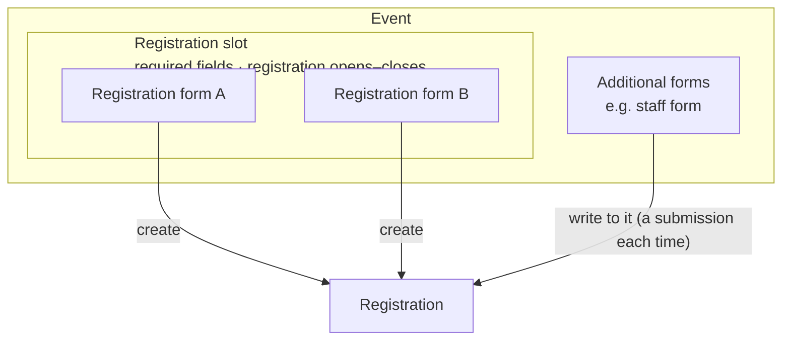

# Events and forms

## Events

- **The event is the top-level unit.** A form belongs to exactly one event,
  fixed when the form is created: changing the event is refused once the form
  has fields or submissions. Seasons are grouped by dates, labels and
  filters, not by a layer above events.
- **Budgets and accounting are completely separate per event.** Linking
  events (e.g. REFISZ's two camps) is not part of the lifecycle.
- **An event carries its own settings** for what its forms, mails and money
  need: capacity, timeline points, the account mode, the payment-due days,
  the bank-transfer texts, the mail layout, and each money plugin's settings.
- **An event has one status-page slot,** a WordPress post ID, and a table for
  per-device push subscriptions. The status-page app is parked; nothing reads
  or writes either yet.

## Event lifecycle

- **States are admin acts:** draft → published ⇄ unpublished → archived.
  - **Unpublished** pauses all of the event's public interfaces: forms, the
    participant blocks, payments. It also stops the event's mail: no delivery
    is sent, and the periodic run adds no scheduled or reminder deliveries for
    it. Action mails are still queued, so none is forgotten. On republishing,
    the admin sees the pending count and can clear them. The control stays
    separate from the global mail pause, which only pauses sending
    ([Mail](mail.md#pausing)).
  - **Archived** is read-only and starts the retention clock.
- **Publishing needs a name, the four core points and a capacity.** Capacity
  may be empty only while the event is a draft. 0 is allowed, and then every
  counted registration is waitlisted. There is no unlimited capacity.
- **The "full" latch** is the other stored event state
  ([Registrations](registrations-and-identity.md#status-capacity-and-waitlist)).
- **A failed load treats every event as unpublished** without changing the
  stored state ([Modules](modules-and-extensions.md#failure-isolation)).
- **Timeline points:** core has **registration opens, registration closes,
  start, end**; admins can add their own named points, which mails and forms
  can use. Points are **absolute instants only**: an admin enters a day and a
  time in the site time zone, and the point is stored in UTC. Points are never
  relative to each other (that would allow cycles). Registration is open from
  the "registration opens" instant up to, but not including, the
  "registration closes" instant. A removed custom point's ID is never reused.
- **"Open", "closed" and phases are derived** by comparing the current time
  with the points. They are never stored, and nothing fires at those moments.
  The same holds for every form's open period. Registration therefore opens
  and closes automatically at its points; to change that, an admin edits the
  points (which does not clear the "full" latch).
- **The participant phase tracker** (today's F1–F5) stays, as a modular
  subsystem in the Events module: core default phases, configurable,
  extensions add phases. Designed later ([Deferred](deferred.md)).
- Today's reclassification is dropped; late fees replace it. Post-camp
  settlement is a deferred extension.

**What follows:** nothing in Kaláka happens "at" a point. A rule that depends
on time compares with the clock when it runs: a form at render and again at
submit, a mail in the periodic run. Moving a point moves every rule that
reads it at once.

## Date references

Wherever a date can be set (mail schedules, an additional form's open period,
fee rules, …) it can be:

- a fixed date;
- an event point (core or custom);
- a **date type**, which may differ per registration.

A date type is computed only from registration facts and absolute points,
never from another derived date. Core declares **payment due**: N days,
configured per event, after the later of the moment the registration last
became `registered` and its last changed answer to a request, and none while
a request awaits an answer ([Money](money.md#core-money-scope)). It is
computed on every read, never stored; if that ever becomes slow, the computed
date is cached in a column on the registration. Extension date types are
foreseen as an inside point (not built yet,
[Modules](modules-and-extensions.md#the-extension-surface)).

**Deadlines are compared as instants.** A deadline set as a day ends at
midnight in the site time zone at the end of that day. For a stored deadline
that instant is fixed when it is stored, so a later change of the site time
zone does not move it. A computed date, such as payment due, is not stored:
its day ends at midnight in the site time zone at the time of computing.

## Forms and the registration slot

- An event has a **registration slot** holding one or more **registration
  forms**, plus **additional forms** that write to an existing registration
  (e.g. a staff form, or a form holding only the module ranking). A form's
  purpose follows from where it sits; otherwise all forms share the same
  primitives.
- **Every form has its own access requirements,** kept minimal: a password
  (WordPress's own post password) and a required WordPress role.
- **When a form is open:** a registration form is open while the slot is,
  from "registration opens" up to "registration closes", with no period of
  its own. **Each additional form has its own open period,** each end a date
  reference (an end not set does not limit it), which a form link can bypass
  ([below](#form-links-and-admin-submissions)).
- **The slot adds one more rule:** every form in it must hold the required
  fields: exactly one contact email, one display name, the account block in
  an event with accounts, and any field an extension requires (the price
  ladder's `price_tier`), required and outside any condition. A form that
  lacks one is closed until fixed.
- **An additional form never creates a registration** and never counts
  toward capacity. It writes to the active registration
  ([Registrations](registrations-and-identity.md#access)) or to the one its
  form link targets, and **only a `registered` registration may submit it**
  (owner ruling): a waitlisted, withdrawn or removed
  registration's link shows the form closed.
- **The event's capacity is the only capacity on registrations**
  ([Registrations](registrations-and-identity.md#status-capacity-and-waitlist)).
  There are no registration categories and no per-form capacity. Limited
  choices (set options, price tiers, support offers) have their own pools,
  which limit only that choice.
- **Staff work as today:** they register through the normal registration form
  (taking a place), then fill in the staff form, an additional form whose
  answers give the discount. Staff is not a core concept.
- Workshops, modules, groups, rooms and meal turns are **assignment sets**
  ([Modules](modules-and-extensions.md#assignment-sets)). **Re-choosing later
  is an additional form** holding that choice, open while that form is;
  there is no separate portal edit.
- **Form texts read amounts, quotas, places left and deadlines from the
  event's values,** so they cannot drift from the rules
  ([Values and conditions](#values-and-conditions)).

**What follows:** a new "kind" of registration (staff, a helper, a child) is
never a new form type: it is fields and conditions on the same forms, and an
additional form for what comes later. Anything every registration must have
is a slot requirement, checked when a form is saved live and when it is
served.

## Prefill from a link

- **Public prefill comes as a guest draft.** A request to a page that places
  one registration form may carry answers as `kalaka[<field key>]` (the quiz's
  POST body, or a static GET link). They are untrusted: each is cleaned by its
  field type's prefill rules and checked alone with its type; an unknown key
  or an answer that does not pass is dropped, silently. What is left is kept
  as a guest draft
  ([Submissions and values](registrations-and-identity.md#submissions-and-values))
  under a claim token in a cookie, in every account mode, and the request is
  answered with a 303 to the page without them. **Nothing of the request is
  logged.**
- **The handed-over answers never overwrite what the browser already holds.**
  They wait in a guest draft of their own; the next page load settles them:
  they become the browser's draft, or, when that draft holds the person's own
  typing that the link would change, the person chooses: merge (the link's
  answers win), keep the draft, or keep the link. The form then opens with
  them, as editable values.
- **Forms start from the active registration**
  ([Registrations](registrations-and-identity.md#access)): an additional form
  opens with its current field values, as editable values. A type may refuse
  prefill: its field then opens empty, and left blank it keeps the current
  value
  ([Changing participant fields after submit](#changing-participant-fields-after-submit)).
- **A form link prefills from its record** (below): the server sets the
  values, either locked or as editable prefilled values. A link-only field
  never takes public prefill. Not built yet.
- **Prefill from a preset** is separate ([Fields](#fields)). Not built yet.
- **Form links created from public pages** (e.g. "register for the other
  camp too") come from a portal or system use case with its own rate limit.

**What follows:** anything that arrives in a link can be forged, so a
prefilled answer is a suggestion, never an authority. What only staff or a
partner may set must come from a form link's record, a staff write or an
extension's own act.

## Form links and admin submissions

**One form-link mechanism replaces the one-time invitation.** None of it is
built yet.

- **A form link has:**
  - its form;
  - optionally, a **target registration**, the registration an additional
    form writes to. A registration is never identified by a typed reference
    code ([Registrations](registrations-and-identity.md#reference-codes));
  - the field values it sets, each either locked (read-only or hidden) or an
    editable prefilled value;
  - uses: unlimited or at most N (a single-use link is today's invitation); a
    use is spent on a successful submit, not on opening;
  - bypasses, each off by default: the form's requirements, the slot's date
    range or an additional form's open period, the event's capacity and
    "full" latch (an invitation has them all on, so the registration lands as
    `registered`);
  - an expiry, and revocation.
- **Creation, revocation and use are audited.** The link a registration came
  through is stored on it as a fact.
- **Link-only fields** can be set only by a link, never by the registrant.
  **Link-only options** are choice options shown only when a link sets them.
- **Secret sections** are ordinary conditional sections whose condition reads
  a link-only field. The server re-checks conditions at submit.
- **Tokens:** 128 random bits, never written into a log line by our own code
  ([Foundation](foundation.md#the-error-log)), masked in exports, sent with
  no-referrer. Links are stored readable, so admins can always re-send them.
- **An association** (e.g. a partner church) is either chosen by the
  registrant from public options, or set and locked by a partner's link; the
  stored fact records which. A link-set association is not partner
  confirmation: that is a separate field, which a link may set secretly, or
  which the partner sets in its view.
- A late staff member gets one link for the registration form and, if needed,
  a second one for the staff form.
- **Admins can fill in any form themselves** regardless of its criteria; the
  audit records it.
- Form links complement password-protected forms.

## Forms implementation

- **Our own implementation on WordPress's building blocks; no form plugin.**
  Forms are **block documents** (`kalaka_form` posts) built from our own field
  blocks. **The block editor is the form builder;** there is no separate
  visual builder. Its experience must be good: no polish, but the basics
  work. Forms are edited by full access only.
- **Placing a form:** an **embed block** for block-editor pages, and a
  `[kalaka_form id="…"]` **shortcode** for page builders that cannot hold
  blocks, such as Divi 4's Builder. Both use the same renderer. A form is
  never edited from the page builder. A page that places a form is never
  cached.
- **The public page uses WordPress's Interactivity API,** and forms need
  JavaScript: without it the form cannot be sent and shows a warning. The one
  React part is the draft-claim popup, a `@wordpress/components` Modal loaded
  only on a page with a pending claim
  ([Engineering](engineering.md#wordpress-surfaces)).
- **Forms are rendered by the server; the page's script holds no
  condition.** The script keeps every answer while the page is open, sends
  only the answers of what shows, and asks the server whenever the outcome of
  a held condition may change ([Conditions](#conditions)). One request is in
  flight per form: changes made meanwhile coalesce into one follow-up, and a
  click on Next or Send is queued, not lost.
- **The server validates against the same form definition** the page was
  built from: only declared fields that show are accepted, and only the
  form's latest version.
- **A published form never goes from working to broken through an edit.** A
  live save runs the full definition check and refuses a broken form; a form
  broken some other way (an extension turned off, a clashing key) stays
  closed and is named in a site warning
  ([Foundation](foundation.md#site-warnings)). A scheduled form is checked
  again when WordPress publishes it.
- **Each submission stores the form and its version,** a revision ID;
  revisions of forms are never pruned, and a form that submissions refer to
  is never deleted permanently, so a submission always resolves to the
  definition it was checked against
  ([Registrations](registrations-and-identity.md#submissions-and-values)).
- **Accounts:** in the event's mandatory and optional account mode, every
  registration form holds the account block; where it sits is the author's
  choice. Logged out, it says what an account gives and opens WordPress's own
  login page in a window of its own; after the login the window closes and
  the form shows the account in place, keeping what was typed. In mandatory
  mode the send is refused without an account. In off mode, and on additional
  forms, the block renders nothing
  ([Registrations](registrations-and-identity.md#accounts-on-the-registration-form)).
  **Changing an event's account mode** to one with accounts is refused while a
  published registration form lacks the block, or while the event's
  "registered" mail is off or lacks the set-password link
  ([Mail](mail.md#configuration)).
- **Multi-page forms** (Google Forms style): a form has no pages or all its
  content in top-level **page blocks**, each with an optional title, an
  optional condition (none on the first page) and an optional **terminal**
  mark. A page's condition reads earlier pages and the event's values; a page
  that does not show is skipped both ways and its answers are dropped. Unlike
  a branch, a page is never withheld: every page is sent hidden and shown
  when it holds. Next checks the current page on the server; Back needs no
  request. A terminal page holds no fields, shows its content and cannot be
  sent past. The contact email and the display name never sit on a
  conditional page. There is no progress indicator.
- **Answers survive a reload:** a guest's in their guest draft, a logged-in
  person's in their draft, which the autosave keeps
  ([Submissions and values](registrations-and-identity.md#submissions-and-values)).
- **After a successful submit** the form is replaced by its **after-submit
  section** (the thank-you message), part of the form document: one block at
  the top level, holding no fields, rendered at submit with the event's
  values and the new registration's reference code and status, which its
  conditions read. Without it, a short default text per status shows.
- **Required fields** show a bold asterisk after the field's title, in the
  error colour. The form's look follows the site's theme
  ([Engineering](engineering.md#wordpress-surfaces)).
- **Spam protection:** the submit route counts every attempt per client (a
  logged-in person by account, a guest by address) and refuses the attempt
  over the limit in a short window with a `Retry-After` time. It runs before
  the submit, outside any use case, so the count is WordPress-owned data (a
  transient), never our tables; **it stores no address,** only a keyed hash
  per window that expires with it. The address is the request's own unless
  the site names its reverse proxies. Account creation is guarded by a
  CAPTCHA plugin on WordPress's registration page, which Kaláka never
  bypasses.
- **Stable field keys;** pickers for conditions come later (conditions are
  written as JSON until then, [Deferred](deferred.md#design-decisions)).
- Still to build within forms: file upload ([Deferred](deferred.md)).

## Fields

| Concept | What it is |
|---|---|
| **Participant field** | One thing the event knows about each of its participants: a **key**, a field type, its type's settings, a title and, for a choice, its options. It belongs to the event, and every form, mail, view, condition and fee component of the event reads it by its key |
| **Field type** | Code: a block type from core or an extension. It defines the data shape, validation, editor and front-end UI, admin display and filtering. Core ships the basic shapes (name, email, phone, date, text, number, choice, consent, …) |
| **Field definition** | Optional organization configuration in its own post type (`kalaka_field`), edited in the block editor and limited to one field block. Holds the complete field including its settings, with no override layer. Not built yet |
| **Form field** | A block in a form that asks for one participant field |

- **Words.** A **submission** is what one submit sends, kept frozen; an
  **answer** is one field's entry in it; a **field value** is a participant
  field's current value for one registration
  ([Registrations](registrations-and-identity.md#submissions-and-values)).
- **Each event has one list of participant fields,** stored as a table, not
  derived from the forms. Each field records its **source**, which decides
  who may write it:
  - **form:** created by a form field; most fields are. Forms write it, and
    staff may correct it;
  - **staff:** a column admins add that no participant fills in; staff write
    it through views, and it may also appear in an additional form;
  - **extension:** declared by an extension's code (the price tier, an extra
    charge, the donation, a share or support answer, aid) and written only by
    that code, unless the extension declares the field form-writable; only
    then may a form hold its key, and only then may staff correct it. A form
    that joins an extension's choice field offers only options the extension
    declared, any subset of them, and never adds one;
  - **system:** a read-only field that only **declares** a system decision
    (e.g. confirmation) so that mails, views and conditions can name it. No
    field value is ever written for it
    ([Foundation](foundation.md#facts-decisions-and-computed-values)). A
    registration's own state (its status, whether it awaits an answer) is no
    such field: it is a `registration.*` fact.
- **Designing a form designs participant fields.** A new form field creates a
  new participant field. A form field joins an existing one only explicitly,
  by taking its key; **several forms writing one field is never
  accidental.** The editor asks when a pasted block carries a key the event
  already has, and never joins silently.
- **Keys and option values come from the visible text.** A field's key is
  derived from its title and a choice option's value from its label: no
  diacritics, snake_case, and `_1`, `_2`, … on a collision. A derived key is
  **unique across the event's participant fields, retired ones included,** so
  a key is never reused. Both are set when created and **never change when the
  text is renamed,** so stored data keeps its meaning.
- **A typed key may match on purpose:** a form field given an existing key is
  that same field, and its type must be the same; another type is refused on
  save. A typed key that matches a retired field revives it, with its values.
  A choice field's options are the union over the forms that hold it; an
  option no form offers any more is retired, keeping its label, so stored
  values still read.
- **A participant field's title and option labels are its own,** separate
  from the labels forms show. Each is set when first declared and is never
  overwritten by a form's label; it changes only on an explicit request (the
  form editor asks whether to carry a changed label over, or staff rename it
  in the field list). A form shows its own labels, and the participant field's
  only where it leaves a label empty; mails, views and the participant blocks
  show the participant field's.
- **A field that no form holds any more stays in the list, retired.** Its
  values stay, and its key is never given to another field. No field is ever
  deleted.
- **Who defines a participant field.** A field that only holds data is
  created by the form field that first asks for it. **A field that code acts
  on is defined by that code** (`extension` source), declared with its key
  and type when its setting is saved; a form field joins it by key and never
  creates it. A declared key no form holds does nothing. When a form field
  already holds the key with the same type, the declaration adopts it, with
  its values. A key a staff or system field holds, a field of another type,
  or a key another declarer holds refuses the declaration.
- **Explicit markings:** the contact email (exactly one per registration
  form) and the display name stay on the registration form's blocks. An
  additional form holds neither; a "change my e-mail" form waits for its own
  design.
- **Money-relevance is a field's capability,** supplied by a plugin's field
  type or declared by an extension for a field it declares; core ships no
  money field types. **A money-relevant value is locked after its first
  write** (an organizer can unlock per field): an additional form may set it
  once, and a later overwrite is refused. A staff correction through views is
  allowed and re-materializes the money.
- **Hidden fields** hold values the registrant does not see, such as an
  attribution key, from a form link's record or a public prefill, never from
  the registrant's typing; a prefilled one can be forged, so it is
  attribution only.
- **Field definitions** (not built yet): changing a definition never changes
  forms automatically (admins are offered an update per form) and never
  touches registration data; a definition never changes its type; **prefill
  from a preset** works only for fields linked to a definition, because
  presets store values by definition ID, and only when the stored value is
  valid for the field's current settings. Types may refuse to be definitions
  and may refuse prefill.
- Extensions add field types, e.g. the congregation picker
  ([Money](money.md#sponsor-and-church-support)) and the module ranking.

**What follows:** renaming a question on a form is free and changes no
data. Reusing a key is a deliberate join and must keep the type. Money and
rules always read the event's participant field, so a form can never change
what a price, a condition or a mail means, only whether it asks.

### Changing participant fields after submit

**A participant changes field values by submitting an additional form** that
holds those fields, e.g. a form holding only the module ranking. There is no
other participant-side edit.

- **Every submit appends a submission;** earlier submissions stay as they
  are. The latest write wins in the field values, and each change is
  audited.
- **Only fields the form shows are written,** plus hidden fields that get a
  value from its form link or a public prefill. Fields the form does not hold,
  and fields in branches or pages that do not show, keep their values. **A
  shown field that was prefilled and is left blank clears its value:** the
  form showed the current value, so blank is the answer. A shown consent left
  unticked is the answer no, stored as `0`. A field whose type refuses
  prefill opens empty, so left blank it keeps the current value.
- **An additional form may take and free seats** of limited choices, under
  the one seat rule
  ([Foundation](foundation.md#facts-decisions-and-computed-values)); a full
  pool refuses it as it does the registration form.
- **An additional form's submit sends no action mail;** the page shows the
  form's after-submit text.
- **Locked fields, money-relevant ones by default:** the first write is
  allowed (e.g. the staff form setting staff status); an overwrite is refused
  unless an organizer unlocked the field.
- **Admins can correct a form or staff field at any time, and an extension
  field only when it is form-writable,** through views. An admin edit and a
  later participant submit are both writes: the last one wins and both are
  audited. To freeze a field, an admin closes the form's open period and
  revokes the form's links that bypass it.
- A resubmit never re-decides "not counted"
  ([Registrations](registrations-and-identity.md#status-capacity-and-waitlist)).

## Values and conditions

**One value API** serves mails, participant blocks and forms.

- **Each document kind declares its context,** and a saved placeholder must
  name one of that context's keys:
  - **mail:** the recipient, the registration and its event's values
    (`event.*`), and the mail's own keys ([Mail](mail.md#content));
  - **a participant block:** the active registration
    ([Registrations](registrations-and-identity.md#access));
  - **a form, for conditions:** the answers of earlier fields and the event's
    values, plus, for an additional form, its registration's facts
    (`registration.*`) and the current values of participant fields the form
    does not hold (e.g. a staff form branching on the camp chosen at
    registration). A registration form may read whether someone is logged in
    (`account.logged_in`), which is none where the form has no account step.
    Every form may read the places left: the event's (`event.seats_left`) and
    each limited choice's (`seats_left.<field key>.<option value>`; no value
    means unlimited, a removed pool reads 0), and the event's own points.
    **Whatever decides what a form shows is such a value;** the backend keeps
    no rule of its own on who sees what.
- **Placeholders** are typed by hand as `{{key}}` in the text, and inside
  attributes such as a link URL; whole attributes may also use Block Bindings
  with the one source `kalaka/value`. **A save is refused while a placeholder
  names a key its context does not declare.** The server replaces them with
  WordPress's HTML API: a known key with no value gives an empty text, text is
  escaped, and a URL attribute takes a fitting URL. **A key that cannot be
  resolved when the document renders fails that act:** a mail is failed,
  never sent with the raw placeholder; a page fails to render. A value's text
  is never read for placeholders. On ordinary posts and pages, only Kaláka
  blocks are filled, and they are checked when the page goes live.
- **Storage** is plain block markup in `post_content`. A friendlier editor
  later changes only the UI. (WordPress 7.0 had no core way to bind part of a
  text when checked on 2026-10-31; re-check, and use a core mechanism if one
  appears.)

**What follows:** a new value a form, mail or block can show is a new key in
a declared context, never text assembled in a template. Removing a key that
saved documents use makes them fail loudly, not render blank.

### Conditions

- **Container blocks** `kalaka/if`, `kalaka/else-if` and `kalaka/else` hold
  the branches, using the one condition format below.
- **One availability base.** Whatever is shown or selectable is decided by
  one condition in this format, through **one evaluator in PHP** that reads a
  **fact source**: form fields and branches, pages and sections, and a choice
  field's options (the options a ranking takes from an assignment set
  included). **Set options, price tiers, support offers, extra charges and
  aid carry no condition of their own:** the form decides what is shown and
  offered, and the server re-walks the form at submit. The backend keeps only
  the hard rules: seats, windows and locked fields.
- **The evaluator is pure:** no database, hook, current user, request or
  clock. Whoever evaluates fills the fact source, "now" included; the
  evaluator never runs the materializer on a draft. JavaScript never
  evaluates a condition (the editor only checks one against the server's
  rules to show problems).
- **What the browser receives.** A branch whose conditions read only the
  form's own answers (or whether someone is logged in) is sent hidden and
  shown when it holds. **A branch whose condition reads anything else** (an
  event value, places left, a registration fact, the time) **is sent only
  when it holds,** so a browser never receives a branch it does not qualify
  for; when its outcome may change, the page re-fetches it.
- **The submit judges.** At submit the server walks the form the same way,
  with values as they are then (the time, the places left, the registration's
  status), and keeps only answers of fields that show and options that are
  offered. Mid-form availability is advisory; places are taken only under the
  lock, by the rules that own them.
- **An unanswered field reads as empty; no chain waits.** An unanswered
  choice reads as empty like an empty text, so the branch for "empty" (often
  `else`) shows until an answer is given. Validation follows what shows: a
  required field that shows and is left blank refuses the submit.

**The condition format:**

- **Operators:** equals, less than, less or equal, greater than, greater or
  equal, contains, empty, with a **"not" switch** on each condition instead
  of negated operators.
- **A missing value is unknown, never false.** A comparison on a value never
  answered is neither true nor false; only `empty` reads a missing value, and
  `not` leaves unknown unknown, so "not equals X" does not include someone who
  never answered ("empty or not equals X" does). Groups follow the same three
  values, and unknown counts as not matched.
- **Typed comparison:** values compare as number, date, datetime, text or
  choice. Two datetimes compare as instants; a date against a datetime
  compares on the site-time-zone day. The registration's opening and closing
  are datetimes, the event's start and end dates. A choice that is a path
  (the congregation field) is only asked whether it contains a node, never
  whether it equals one.
- **A date reference** is another date key moved by whole years and days
  (e.g. the event's start minus 16 years for "under 16 at the start"; 29
  February moves to 28 February), a datetime literal in the site's offset, or
  **"now"**, the clock's time (at render while filling in, at submit for the
  submit, and at read time for mails and blocks), moved by whole years and
  days.
- **Combining:** all / any; a condition can be a group, one level deep.
- **Extension conditions** alongside comparisons are foreseen (not built
  yet).
- Examples: status equals waitlisted; balance greater than 0; a multi-choice
  answer contains X; date of birth less or equal to a date.

**What follows:** who may pick a tier, an offer or a module is authored on the
form, so two forms of one event may offer different choices, and fixing a
wrong offer is a form edit, not a money setting. A rule that must never be
broken by a forged post (a seat, a window, a locked field) must be a backend
rule, not only a condition.
