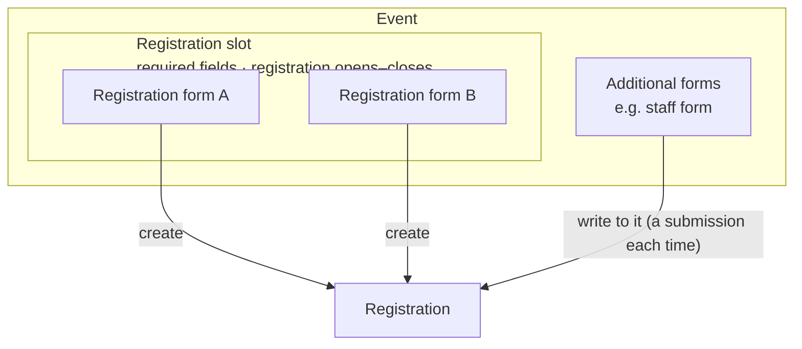

# Events and forms

## Events

- **The event is the top-level unit.** A form belongs to exactly one event,
  fixed when the form is created: a form is created from its event, and
  changing the event is refused once the form has fields or submissions.
  Opening a form therefore fixes the event. Seasons are grouped by
  dates, labels and filters, not by a layer above events.
- **Budgets and accounting are completely separate per event.** Linking
  events (e.g. REFISZ's two camps) is not part of the lifecycle.

## Event lifecycle

- **States are admin acts:** draft → published ⇄ unpublished → archived.
  - **Unpublished** pauses all of the event's public interfaces: forms, the
    participant blocks, payments. It also stops the event's mail: no delivery is
    sent, and the periodic run adds no scheduled or reminder deliveries for
    it. Action mails are still queued, so none is forgotten.
    The participant blocks are closed too, including "resend my link"; self-sent mails
    requested before unpublishing stay queued. On republishing, the admin sees the pending count and can clear them.
    This follows from a sound unpublish; the control stays separate from the global mail pause, which
    only pauses sending ([Mail](mail.md#pausing)).
  - **Archived** is read-only and starts the retention clock.
- **Publishing needs a capacity.** It may be empty only while the event is a
  draft. 0 is allowed, and then every counted registration is waitlisted.
  There is no unlimited capacity.
- **The "full" latch** is the other stored event state
  ([Registrations](registrations-and-identity.md#status-capacity-and-waitlist)).
- **A failed load treats every event as unpublished** without changing the
  stored state ([Modules](modules-and-extensions.md#failure-isolation)).
- **Timeline points:** core has **registration opens, registration closes,
  start, end**; admins can add their own named points, which mails can use.
  Points are **absolute instants only**: an admin enters a day and a time in
the site time zone, and the point is stored in UTC. Points are never
relative to each other (that would allow cycles). Registration is open from
the "registration opens" instant up to, but not including, the
"registration closes" instant.
- **"Open", "closed" and phases are derived** by comparing the current time
  with the points. They are never stored, and nothing fires at those moments.
  The same holds for every form's open period. Registration therefore opens
  and closes automatically at its points; to change that, an admin edits the
points (which does not clear the "full" latch).
- **The participant phase tracker** (today's F1–F5) stays, as a modular
  subsystem in the Events module: core default phases, configurable,
  extensions add phases. Designed later ([Deferred](deferred.md)).
- Today's reclassification is dropped; late fees replace it. Post-camp
  settlement is a deferred extension.

## Date references

Wherever a date can be set (mail schedules, an additional form's open
period, fee rules, …) it can
be:

- a fixed date;
- an event point (core or custom);
- a **date type** declared by core or an extension.

A date type **may differ per registration** (e.g. 14 days after
registering). It is computed only from registration facts and absolute points, never from another derived date. Core declares
**payment due**: N days, configured per event, after the registration last
became `registered` ([Money](money.md#core-money-scope)). Date types are an extension point that runs inside the
transaction and takes one immutable input; the periodic run computes them
in PHP for registrations in published events. If that ever becomes slow, the
computed date is cached in a column on the registration.

**Deadlines are compared as instants.** A deadline set as a day ends at
midnight in the site time zone at the end of that day. For a stored
deadline that instant is fixed when it is stored, not when it is used, so a
later change of the site time zone does not move it. A date type that is
computed, such as payment due, is not stored: its day ends at midnight in
the site time zone at the time of computing.

## Forms and the registration slot

- An event has a **registration slot** holding one or more **registration
  forms**, plus **additional forms** that write to an existing registration
  (e.g. a staff form, or a form holding only the module ranking). A form's
  purpose follows from where it sits.
- **Every form has its own access requirements,** kept minimal: a password
  (WordPress's own post password) and a required WordPress role.
- **When a form is open:**
  - a registration form is open while the slot is: from "registration
    opens" up to "registration closes". It has no period of its own;
  - **each additional form has its own open period**, which a form link can
    bypass ([below](#form-links-and-admin-submissions));
  - an additional form that writes an assignment set's choice follows that
    set's choice window instead
    ([Modules](modules-and-extensions.md#assignment-sets)).
- **The slot adds one more rule:** every form in it must contain the
  required fields and functionality (e.g. exactly one contact email).
  Otherwise all forms share the same primitives.
- **An additional form never creates a registration** and never counts
  toward capacity. It writes to the active registration
  ([Registrations](registrations-and-identity.md#access)) or to the one its
  form link targets, and only a `registered` or `waitlisted` registration
  may submit it
  ([Changing participant fields after submit](#changing-participant-fields-after-submit)).
- **The event's capacity is the only capacity on registrations**
  ([Registrations](registrations-and-identity.md#status-capacity-and-waitlist)).
  There are no registration categories and no per-form capacity. Options of
  an assignment set have their own capacity, which limits only that choice.
- **Staff work as today:** they register through the normal registration form
  (taking a place), then fill in the staff form, an additional form whose
  answers give the discount. Staff is not a core concept; it is built on
  additional forms.
- Workshops, modules, groups, rooms and meal turns are **assignment sets**
  ([Modules](modules-and-extensions.md#assignment-sets)). A choice field in a
  form writes a set's direct choice or a request. **Re-choosing later is an
  additional form** holding that choice, in both access modes, open while
  the set's choice window is; there is no separate portal edit.
- **Form texts read amounts, quotas and deadlines from the event's settings,**
  so they cannot drift from the rules
  ([Values and conditions](#values-and-conditions)).

## Prefill from a link

- **There is no public prefill:** no URL argument other than the link token
  affects a form.
- **Forms start from the active registration**
  ([Registrations](registrations-and-identity.md#access)): an additional
  form is prefilled from its current field values, as editable values; a
  registration form may prefill from it too. A type may refuse prefill: its
  field then opens empty, and left blank it keeps the current value
  ([Changing participant fields after submit](#changing-participant-fields-after-submit)).
- **A form link prefills from its record** (below): the server sets the
  values, either locked or as editable prefilled values. Prefill from a
  preset is separate ([Fields](#fields)).
- **Form links created from public pages** (e.g. the module recommender, or
  "register for the other camp too") come from a portal or system use case
  with its own rate limit.

## Form links and admin submissions

**One form-link mechanism replaces the one-time invitation.**

- **A form link has:**
  - its form;
  - optionally, a **target registration**: the registration an additional
    form writes to. A registration is never identified by a typed reference
    code ([Registrations](registrations-and-identity.md#reference-codes));
  - the field values it sets, each either locked (read-only or hidden) or an
    editable prefilled value;
  - uses: unlimited or at most N (a single-use link, max 1, is today's
    invitation); a use is spent on a successful submit, not on opening;
  - bypasses, each off by default: the form's requirements, the slot's date
    range or an additional form's open period, the event's capacity and
    "full" latch (an invitation has them all on, so the registration lands
    as `registered`);
  - an expiry, and revocation. Expired links are cleaned up.
- **Creation, revocation and use are audited.** The link a registration came
  through is stored on it as a fact.
- **Link-only fields** can be set only by a link, never by the registrant. **Link-only options** are choice options shown only when a
  link sets them (e.g. an invitation-only track or partner).
- **Secret sections** are ordinary conditional sections whose condition reads
  a link-only field. The server re-checks conditions at submit
  ([Conditions](#conditions)).
- **Tokens:** 128 random bits, never written into a log line by our own code
  ([Foundation](foundation.md#the-error-log)), masked in exports, sent with
  no-referrer. Links are stored readable, single-use ones included, so admins
  can always re-send them.
- **An association** (e.g. a partner church) is either chosen by the
  registrant from public options, or set and locked by a partner's link; the
  stored fact records which. A link-set association is not partner
  confirmation: that is a separate field, which a link may set secretly, or
  which the partner sets in its view.
- A late staff member gets one link for the registration form and, if needed,
  a second one for the staff form.
- **Admins can fill in any form themselves** regardless of its criteria; the
  audit records it.
- Form links complement password-protected forms.

## Forms implementation

- **Our own implementation on WordPress's building blocks; no form plugin.**
- Forms are **block documents** (`kalaka_form` posts) built from our own
  field blocks.
- The public page uses WordPress's **Interactivity API**.
- **Forms need JavaScript.** Conditional sections are hidden by default, and
  the form shows a warning when JavaScript is off (UI text approved when
  built).
- **The server validates against the same form definition:** only declared,
  visible fields are accepted.
- **Each submission stores the form and its version**
  ([Registrations](registrations-and-identity.md#submissions-and-values)).
- **Stable field keys** and pickers for conditions.
- **The block editor is the form builder.** Organizers build and edit forms
  in it directly, with Kaláka's field and condition blocks; there is no
  separate visual builder. Its experience must be good: no polish, but the
  basics work.
- **Placing a form:** an **embed block** for block-editor pages, and a
  `[kalaka_form id="…"]` **shortcode** for page builders that cannot hold
  blocks, such as Divi 4's Builder. Both use the same renderer. A form is
  never edited from the page builder.
- **Multi-page forms** (Google Forms style): a form has no pages (one
  page) or all its content in **page blocks** at the top level, each with
  an optional title, an optional condition (none on the first page) and an
  optional **terminal** mark. A page's condition reads earlier pages and
  the event's values; a page that does not show is skipped both ways and
  its answers are dropped like those of a hidden branch. Next checks the
  current page on the server first (the re-fetch with the page); Back needs
  no request. A terminal page holds no fields and has a condition: it shows
  its content and cannot be sent, and the server refuses a submit while one
  shows. The contact email and the display name never sit on a conditional
  page. Answers are not kept across a reload.
- **After a successful submit** the form is replaced by its **after-submit
  section**, part of the form document and edited with it (the thank-you
  message): one block per form, at the top level outside any branch or
  page, holding no fields. It
  never shows in the form; it is rendered at submit with the event's values
  and the new registration's reference code and status, and its conditions
  read only those. Without it, a short default text per status shows.
- **Required fields** show a bold asterisk after the field's title, in the
  error colour. The form's look follows the site's theme
  ([Engineering](engineering.md#wordpress-surfaces)).
- Still to build within forms: spam protection and file upload
  ([Deferred](deferred.md)).

## Fields

| Concept | What it is |
|---|---|
| **Participant field** | One thing the event knows about each of its participants: a **key**, a field type, a title and, for a choice, its options. It belongs to the event, and every form, mail, view, condition and fee component of the event reads it by its key |
| **Field type** | Code: a block type from core or an extension. It defines the data shape, validation, editor and front-end UI, admin display and filtering. Core ships the basic shapes (name, email, phone, date, text, choice, …) |
| **Field definition** | Optional organization configuration in its own post type (`kalaka_field`), edited in the block editor and limited to one field block. Holds the complete field including its settings, with no override layer. Created by a single switch on a form field |
| **Form field** | A block in a form that asks for one participant field, standalone or copied from a definition (keeping the definition's ID and version) |

- **Words.** A **submission** is what one submit sends, kept frozen; an
  **answer** is one field's entry in it; a **field value** is a participant
  field's current value for one registration
  ([Registrations](registrations-and-identity.md#submissions-and-values)).
  A field definition is not a participant field.
- **Each event has one list of participant fields,** stored as a table, not
  derived from the forms. Each field records its **source**:
  - **form:** created by a form field; most fields are;
  - **staff:** a column admins add that no participant fills in; staff
    write it through views, and it may also appear in an additional form;
  - **extension:** written only by an extension's own use case, e.g. the
    award of adjudicated aid ([Money](money.md#core-money-scope)), unless
    the extension declares the field form-writable (off by default); only
    then may a form hold its key;
  - **system:** a read-only field that only **declares** a system decision
    (e.g. confirmation) so that mails, views and conditions can name it. The
    decision record stays the source of truth
    ([Foundation](foundation.md#facts-decisions-and-computed-values)); no
    field value is ever written for it, so nothing can shadow the decision.
- **A participant field's title and option labels are its own,** separate
  from the labels the forms show. Each is set when it is first declared (an
  option is matched by its value) and is never overwritten by a form's label,
  including a form that joins the field. It changes only on an explicit
  request: the form editor asks the organizer whether to carry a changed
  label over, or staff edit it in the field list (`form` and `staff` fields;
  a `system` or `extension` field's texts are its declarer's). A form shows
  its own labels; mails, views and the participant blocks show the
  participant field's.
- **Designing a form designs participant fields.** A new form field creates
  a new participant field. A form field joins an existing participant field
  only explicitly, by taking its key (below); several forms writing one
  field is never accidental.
- **A field that no form holds any more stays in the list, retired.** Its
  values stay, and its key is never given to another field.
- **Definition, its copies in forms and its data are three separate things.**
  Changing a definition never changes forms automatically: admins are offered
  an update per form (a new form version), and registration data is never
  touched.
- **A definition never changes its type.** Presets store values in the type's
  shape; a different type means a new definition.
- **Prefill from a preset:** only fields linked to a definition are
  prefilled, because presets store values by definition ID. A copy edited after it was taken
  still prefills whenever the preset value is valid for the field's current
  settings (e.g. a removed choice option is not); otherwise it stays empty.
  How prefill looks is approved with the UI. Prefill from a link is
  separate ([Prefill from a link](#prefill-from-a-link)).
- **Types may refuse** to be definitions and may refuse prefill.
- **Hidden fields** hold values the registrant does not see, such as an
  attribution key. They get their values only from the form link record;
  values the browser sends for them are rejected.
- Extensions add field types, e.g. the congregation picker
  ([Money](money.md#sponsor-and-church-support)) and the module ranking.
- **Keys and option values come from the visible text.** A field's key is
  derived from its title and a choice option's value from its label: no
  diacritics, snake_case, and `_1`, `_2`, … on a collision. A derived key is
  **unique across the event's participant fields, retired ones included,**
  so a key is never reused; an option value is unique within its field.
  Both are set when the field or option is created and stay the same when
  the text is renamed later, so stored data keeps its meaning. The editor
  hides them unless asked.
- **A typed key may match on purpose.** A form field given the key of an
  existing participant field is that same field: its answers write the same
  field value. Its field type must be the same; saving a form that gives a
  key another type is refused. A typed key that matches a **retired**
  participant field revives that same field, with its key and its values,
  when the type is the same; with another type the save is refused.
  Derivation never picks a retired key. A choice field's options are the union over
  the forms that hold it; an option no form offers any more is retired,
  keeping its label, so stored values still read.
- **Explicit markings:** the contact email (exactly one per form in the
  registration slot) and the display name.
- **Money-relevance is a type capability** supplied by plugins; core ships no
  money field types. Values are stored like any other, **locked after their
  first write by default** (an organizer can unlock per field), and changed
  only through use cases that re-materialize the money.

### Changing participant fields after submit

**A participant changes field values by submitting an additional form**
that holds those fields, e.g. a form holding only the module ranking. There
is no other participant-side edit.

- **Every submit appends a submission;** earlier submissions stay as they
  are. The latest write wins in the field values, and each change is
  audited.
- **Only fields the form shows are written,** plus hidden fields its form
  link sets. Fields the form does not hold,
  and fields in branches or pages that do not show, keep their values. A
  shown field that was prefilled and is left blank clears its value: the
  form showed the current value, so blank is the answer. A field whose type
  refuses prefill opens empty, so left blank it keeps the current value:
  the form never showed it.
- **The form opens with the current values** of the registration, as
  editable prefilled values ([Prefill from a link](#prefill-from-a-link)).
- **Locked fields, money-relevant ones by default:** the first write is
  allowed (e.g. the staff form setting staff status); an overwrite is
  refused unless an organizer unlocked the field.
- **Staff fields may appear in an additional form.**
- **Admins can correct any field at any time,** through views. An admin
  edit and a later participant submit are both writes: the last one wins
  and both are audited. To freeze a field, an admin closes the form's open
  period and revokes the form's links that bypass it.
- A resubmit never re-decides "not counted"
  ([Registrations](registrations-and-identity.md#status-capacity-and-waitlist)).

## Values and conditions

**One value API** serves mails, participant blocks and forms.

- **Each document kind declares its context,** and pickers offer only that
  context's keys:
  - mail: the recipient and the registration;
  - a participant block: the active registration
    ([Registrations](registrations-and-identity.md#access));
  - form, for conditions: the answers of earlier fields and the event's
    values (`event.*`), plus the current field values of the registration it
    writes to for participant fields the form does not hold (e.g. a staff
    form branching on the camp chosen at registration). Fields the form holds
    are always read from its answers. Event values are also rendered at page
    load.
- **Whole attributes** use Block Bindings with one source, `kalaka/value`,
  with a `key` argument.
- **Inline values** are a rich-text format stored as
  `Label`. Editors insert one from a
  toolbar picker, and it shows as a chip. The server replaces it using the
  HTML API. The same span works in custom HTML.
- **Storage** is plain block markup in `post_content`. A friendlier editor
  later changes only the UI.
- **WordPress 7.0 was checked on 2026-10-31:** no core way to bind part of a
  text was found, since bindings replace whole attributes. Re-check at
  implementation, and use a core mechanism if one exists.

### Conditions

- **Container blocks** `kalaka/if`, `kalaka/else-if` and `kalaka/else` hold
  the branches, using the one condition format below.
- **The server renders them** in mails and participant blocks.
- **One availability base.** Whatever is shown or selectable is decided by
  one condition in this format, through one evaluator in PHP that reads a
  **fact source**: form fields and branches, pages and sections, a choice
  field's options, the options of an assignment set, price-ladder tiers,
  offers and the adjudicated aid. In a form it reads the draft answers and
  the event's values, on every render and again at submit; in the fee
  components and the materializer it reads the registration's facts. It
  never runs the materializer on a draft. Computed facts such as a
  congregation's ancestors or free seats are put into the fact source by the
  caller.
- **Forms are rendered by the server; the page's script holds no
  condition.** A branch whose conditions read only the form's own answers
  is sent hidden and shown when it holds for the current answers. A branch
  whose condition reads anything else (an event value, a link-only or other
  held fact) is sent only when it holds, so a browser never receives a
  branch it does not qualify for; when its outcome changes, the page
  re-fetches it. At submit the server walks the form the same way and keeps
  only answers of fields that show, including only the options that are
  offered; whatever the browser still holds for a hidden field is dropped.
- **An unanswered field reads as empty; no chain waits.** An unanswered
  choice, required or optional, reads as empty like an unticked box or an
  empty text, so the branch for "empty" (often `else`) shows until an
  answer is given. Validation follows what shows: at submit a required
  choice left unanswered has its own required error, and the fields of the
  branch shown at that moment (an `else`, say) are checked like any shown
  field.
- **Mid-form availability is advisory.** Seats and capacity are decided only
  at submit, under the lock; the texts say so (approved when built).

**The condition format:**

- **Operators:** equals, less than, less or equal, greater than, greater or
  equal, contains, empty.
- **A "not" switch** on each condition, instead of separate negated
  operators.
- **Typed comparison:** values compare as number, date, text or choice.
- **A date can be compared with a date reference:** another date key of the
  fact source moved by whole years and days, e.g. the event's start minus 16
  years for "under 16 at the event's start". A day the moved month does not
  have becomes its last day (29 February to 28 February), so the age rule
  holds for an event starting on 29 February.
- **Combining:** all / any; a condition can be a group, one level deep.
- **Extension conditions** can be used alongside comparisons.
- Examples: status equals waitlisted; balance greater than 0; a multi-choice
  answer contains X; date of birth less or equal to a date.
