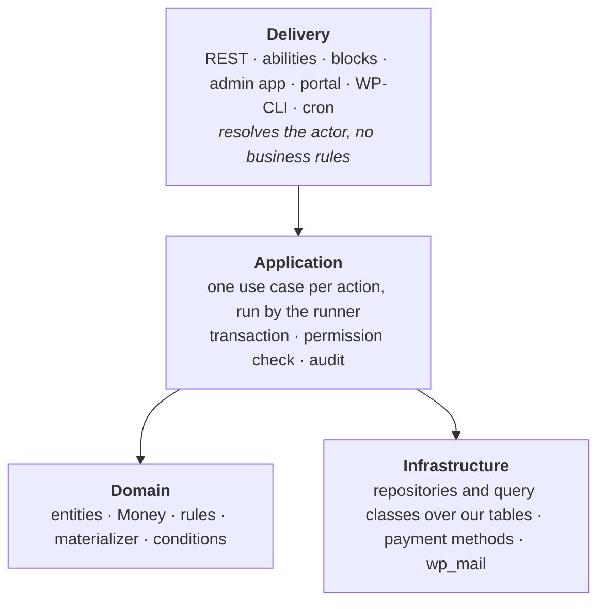
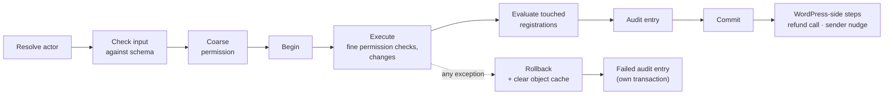

# Foundation

How every write happens, how failures are kept, and the rules that cut across
all modules.

## Layers

Every plugin we ship has the same layers. Dependencies point downward only.



1. **Domain code may use WordPress** where that makes sense. There is no
   "pure domain" rule: this is a WordPress plugin and need not be portable.
2. **An interface exists only where there really are several
   implementations** (payment methods, the clock). There is no general
   "infrastructure is swappable" layer.
3. **Use cases are the only entry point for writes.** REST controllers,
   abilities, WP-CLI commands, the periodic run and form submissions all call
   a use case. Nothing writes a table directly.
4. **Module and plugin boundaries are checked in CI**
   ([Engineering](engineering.md#static-checks)), not left to discipline.

## Two sides, one machinery

- **Admin side:** the actor is a WordPress user, WP-CLI or the system. A
  user reaches registration data through the views granted to them
  ([Views and grants](#views-and-grants)).
- **Portal side:** the actor is access to a registration. A secret link
  grants that one registration; an account grants every registration it
  owns, plus account-level actions (the combined list, paying all at once,
  presets). The delivery layer resolves the active registration (a cookie
  set from a secret link, or the account's pick) into this actor. See
  [Registrations](registrations-and-identity.md#access).

Both sides use the same use-case runner (transaction, evaluation, audit,
errors) but have **separate action catalogues, authorization and
REST namespaces** (`kalaka-admin/v1`, `kalaka-portal/v1`). Use cases never
read the current user themselves: the delivery layer resolves the actor once
and passes it in.

## Views and grants

Organizers, module leaders and outside partners (e.g. a church body confirming
its own people) are all admin-side users. **The view defines which data can be
reached; the grant defines who holds the view.**

- **A view** belongs to one event: a row filter plus a column set, each column
  read or read-write. It is the only place where permissions on data are
  defined.
  - The master grid is a view with every column and no filter. A read-only
    variant is simply another view.
  - Admins define subset views; extensions define special-case views and
    contribute columns and filterable facts.
  - Filters and sorts use only stored facts and decisions
    ([Facts and decisions](#facts-decisions-and-computed-values)), so they
    stay per-event indexed queries under the `EXPLAIN` test. A tree or map
    lookup is expanded in SQL ("congregation in the descendants of X", "lunch
    option in the mapped options"). PHP computes only display and export
    columns.
  - A filter may take **one parameter bound at grant time** (e.g. "program
    roster, program = ?"), so twelve module leaders need one view.
  - View definitions are copied to the next event, optionally with their
    grants.
- **A grant** is (WordPress user, event, view, optional bound value, set of
  actions). A user may hold several grants for the same event. There are no
  grants across all events. Grants and changes to a view's columns or filter
  are audited.
- **A grant never lists registrations.** It covers whatever the view's filter
  matches when access is checked, so the set grows and shrinks as
  registrations come and change.
- **Full access** is one separate site-wide capability: every view, every
  column read-write, every action, every event including future ones. It is
  for the people running the system.
  - It is given **per user, never to a role**: administrators do not get it
    by their role. The user who activates the plugin gets it while nobody
    holds it; after that a holder gives or takes it on the user's profile screen, or WP-CLI does
    (`wp kalaka full-access grant|revoke`), both through audited use cases.
    The last holder cannot lose it. On multisite, super admins pass every
    check.
- **Actions that are not a column** (withdraw, remove, admit, record payment,
  refund, regenerate link, notes, audit history) are carried by the grant,
  not by WordPress roles. An action is usable only on registrations inside
  the filter of the same grant's view. Modules declare the actions they
  offer ([Modules](modules-and-extensions.md#the-module-interface)). A grant
  lists its actions one by one; there are no default bundles yet.
- **A grant holds a use case only by name:** the use case names an action
  the grant carries, or it is a field change with at least one target; in
  both cases every target is inside the grant's view. An event use case with
  neither is for full access only.
- **A view edit never widens access silently:** while a grant binds a value
  to a view's parameter, the parameter cannot be removed or moved to another
  column. A grant whose bound value no longer fits its view holds nothing.
- Core ships a **minimal WordPress role** that only opens the Kaláka admin
  app, for outside grantees.
- **Enforced in one place:** on the admin side, registration data is read
  only through the view query (grids, detail page, export, search) or through
  full access, checked in CI like module boundaries. A use case changes a
  field only if it is a read-write column of a view the user holds, for a
  registration inside that view's filter.

## The use-case runner



- **One transaction per use case.** The audit entry is written in the same
  transaction as the changes, so neither exists without the other. The
  [evaluation](#evaluation) of the touched registrations runs in it too,
  before the audit entry.
- **Any database error rolls back the whole use case;** code never continues
  after catching one. After one, the context refuses every further write, so
  code that catches it cannot go on writing. (This also matches how SQLite
  aborts a transaction on a failed statement.) A rollback also clears the
  per-request object cache.
- **Isolation:** each run's transaction is READ COMMITTED, set for that
  transaction only, and waits at most 5 seconds for a row lock. If the
  server logs binary with `binlog_format=STATEMENT`, writes under READ
  COMMITTED fail, so the runner refuses every use case, and a site warning
  shows the problem ([Failures](#site-warnings)).
- **Retries:** only errors marked retryable (a reference-code collision, a
  deadlock, a lock-wait timeout, a version conflict hit by a system run, a
  reconnect detected inside a run) are retried, about three times, each
  attempt from scratch.
- **Nested use cases** join the outer transaction and write their own audit
  entry, linked to the parent. Effects are released after the outermost
  commit.
- **Inside a transaction only our own tables are written:** no WordPress
  functions that fire hooks or fill WordPress caches.
- **WordPress-owned data is changed before or after our transaction, never
  inside it,** ordered so that a failure leaves a harmless state:
  - Creating a WordPress account, when the person opts in on the form, runs
    *before* the transaction. If the registration then fails, the account
    simply exists, as after a plain sign-up. The set-password mail that
    activates it is queued by the registration itself
    ([Registrations](registrations-and-identity.md#accounts-on-the-registration-form)).
  - Steps *after* commit run in the same request and must be safe to repeat.
    A step is one of two kinds:
    - **A nudge** (schedule a run now, such as the sender nudge). Its failure
      is only logged: the periodic run does the same work within 5 minutes.
      Scheduling counts an event already scheduled as success.
    - **A call to an outside system whose outcome matters** (the
      admin-started WooCommerce refund, [Money](money.md#refunds)). It keeps
      its outcome on its own record ([Failures](#failures)) and writes that
      record through its own use cases. A timeout or unknown outcome leaves
      the record in the state it had before the call.

    The runner catches anything that still escapes a step, logs it and runs
    the remaining steps. The person sees the use case's own result: it
    committed, so a step failure is never shown as an error.
- **The shapes** (in `Kalaka\Foundation\Api\UseCase`; actors in
  `Api\Actor`, errors in `Api\Error`):

  ```php
  interface UseCase {
      public static function name(): string;   // 'kalaka/withdraw-registration'
      public function inputSchema(): array;    // JSON Schema, WordPress REST/abilities dialect
      public function execute(array $input, Context $context): mixed;
  }
  interface AdminUseCase extends UseCase {
      public function action(): ?string;             // per-event action; null for a field change only
      public function event(array $input): ?int;     // null for site-level use cases
      public function targets(array $input): array;  // list<RegistrationKey> this call acts on
  }
  interface PortalUseCase extends UseCase { public function registrations(array $input): array; }
  interface PublicUseCase extends PortalUseCase {}  // acts on no existing registration, e.g. a submit

  Runner::run(UseCase $useCase, array $input, Actor $actor): mixed
  ```

  - Input is an array checked with WordPress's
    `rest_validate_value_from_schema`, so one schema serves REST, abilities
    and the runner.
  - **The coarse permission check on the admin side:** full access passes.
    Otherwise the user needs a grant for the event that carries the action
    (any grant for a field change), and every target must be inside that
    grant's view filter as it is now. A site-level use case (events, site
    settings, views and grants) needs full access. `SystemActor` and
    `CliActor` without `--user` have full access; with `--user` the CLI is
    checked as that user.
  - **The fine check** runs inside `execute`: a field change needs a
    read-write column of a held view whose filter contains the registration.
  - On the portal side the coarse check is access to the registrations the
    input names. A public use case names none and passes for any
    portal-side actor, a guest included.
  - `Context` is what a running use case gets: `actor()`, `now()`, `run()`
    for a nested use case, and `afterCommit()` for WordPress-side steps.
  - **Actors:** admin side `UserActor`, `CliActor` (optional `--user`),
    `SystemActor`; portal side `SecretLinkActor` (the registration key, never
    the secret), `AccountActor` and `GuestActor` (no identity; it runs only
    public use cases).
- **No domain events in the initial shape.** Everything our own plugins do in
  response to a change must be consistent with it, so it happens inside the
  use case. Public after-save actions for third parties come later
  ([Modules and extensions](modules-and-extensions.md#after-save-actions)).

### Lock order

Every use case takes its locks in one order, so two transactions never wait
on each other in a circle:

1. the event row;
2. quota rows (price tiers and support offers), by key;
3. registration rows, by (event, code);
4. everything else.

- **A use case that touches several registrations locks them all first,**
  before it changes any of them.
- **The registration row is locked `FOR UPDATE` before its payments are
  read,** so the evaluation never decides on payments that change under it.
- **The runner enforces it.** Every repository read `FOR UPDATE`, insert,
  update and delete declares its level and key. A lower level after a higher
  one ends the use case. So does a lower key within the event, quota or
  registration level, compared by table name and then by key. A row the
  transaction already holds is no new lock, and a newly inserted row is
  checked for its level only. An inserted row does not raise the key the next
  lock is compared with, and a locking read that finds no row holds nothing.
- The evaluation locks a touched registration it does not hold yet, and a
  ledger line is recorded only for a registration the run holds.

## Errors

**Where errors happen.** An error falls in one of five places, each with one
way of being handled:

1. **Inside a use case:** the runner rolls back, retries what is retryable,
   writes the failed audit entry ([Audit](#audit)), and the caller shows the
   error's text and status.
2. **Our code outside a use case:** see the rule below. When a person's
   action causes the error, it is shown the same way as a use-case error.
3. **A failure kept on a record:** the record holds the status and the error
   ([Failures](#failures)).
4. **A standing condition:** the site cannot work correctly until something
   changes. It is shown as a site warning ([Site warnings](#site-warnings)).
5. **A PHP fatal:** WordPress's own fatal handling. Locks are freed only when
   their expiry passes.

**Outside a use case, nothing is consistency-critical.** Code outside the
runner may only (a) read, (b) write WordPress-owned data (options, cron,
posts, users), before or after a use case, as [the runner](#the-use-case-runner)
requires, or (c) run development-only tools. It never writes our own tables. A
failure there must leave a state that the next use case either accepts or
refuses; it must never leave our tables in a state no use case would produce,
or a change without its audit entry. **The one exception is the schema
upgrade.** It writes our tables, and when it fails the load fails
([Modules](modules-and-extensions.md#failure-isolation)), and the runner
refuses every use case until the upgrade succeeds.

**One error boundary at every entry point.** REST callbacks (permission
callbacks included), WP-CLI commands, background hooks (cron) and rendered
pages and blocks run inside Foundation's error boundary
(`Kalaka\Foundation\Api\Entry\Boundary`). It catches anything thrown:

- a `KalakaException` is shown as it is (the runner has audited it already,
  or it is a deliberate refusal);
- anything else is wrapped as a `SystemFailure`, logged as one line of PHP's
  error log, and shown as a `SystemFailure`.

REST routes are registered through the boundary, and each WP-CLI command
method runs its body through it, so no entry point shows WordPress's own
"critical error" or a raw PHP error. A WP-CLI command's own refusal (a bad
argument, a file it cannot read, a run it cannot start) is a
`CommandFailure`: its English message is shown as it is and not logged. On
the participant side, a form whose field fails to render fails as a whole and
shows the `SystemFailure` text in place of the form.

**The correlation ID reaches the person.** Every error response carries the
request's correlation ID ([Audit](#audit)) in its data. A 500 error also shows
it, as a separate, less pronounced line under the text: `Hibaazonosító:`
followed by the ID's first 8 hex digits, which find the audit entries and log
lines by prefix. Other statuses do not show it: the person can act on them.
WP-CLI shows it the same way, on 500s only.

- Use cases throw exceptions; the throw triggers the rollback.
- An exception carries a `WP_Error` (code, Hungarian message, HTTP status), so
  REST, abilities and WP-CLI show it correctly.
- Each exception class has its own default Hungarian text, and the place that
  throws can add Hungarian context. There is no result type and no separate
  code-to-text mapping.
- **A 500 never shows its context to the person.** Its context is technical:
  REST, rendered output and the admin show only the default text and the
  `Hibaazonosító` line, while the error log and the audit keep the full
  message. WP-CLI, the operator's console, prints the context too. Below 500
  the context is meant for the person and is shown.
- **The classes:** an abstract `KalakaException` (with `toWpError()`,
  `status()`, `isRetryable()`, `isAudited()`; the constructor takes optional
  Hungarian context) and, to start with:

  | Class | Status | Default text |
  |---|---|---|
  | `InvalidInput` (not audited) | 400 | Hibás vagy hiányzó adat. |
  | `PermissionDenied` | 403 | Ehhez nincs jogosultságod. |
  | `NotFound` | 404 | A keresett elem nem található. |
  | `VersionConflict` | 409 | Valaki időközben módosította ezeket az adatokat. Töltsd újra az oldalt, és próbáld újra. |
  | `RuleViolation` | 422 | A művelet nem hajtható végre. |
  | `SystemFailure` | 500 | Váratlan hiba történt. Próbáld újra később. |
  | `RetryableFailure` (a `SystemFailure`, retried) | 500 | as `SystemFailure` |
  | `SiteClosed` (a `SystemFailure`; the load failed, no `Hibaazonosító` line) | 503 | as `SystemFailure` |

- **The UI addresses everyone with tegezés,** in the admin and the portal.

## Entities, repositories and queries

- **Entities** are plain objects that carry their own key. A reference to
  another record holds that record's key; a helper method loads it through a
  per-request object cache when needed. The loaded object lives only in the
  caller's variable: it is never stored on the entity or serialized.
- **Repositories** offer:
  - `find(key)`, which returns null when missing (the caller decides whether
    that is an error; there is no get/find split);
  - `upsert()` for entities;
  - `delete()` for entities: version-checked like `upsert()`, and audited
    as a change from the record's values to null. Append-only records are
    never deleted;
  - `insert()` for append-only records (ledger lines, submissions).
- **Concurrent edits:** mutable records (registrations, events) carry a
  `version` column, and `upsert()` writes only if the version has not changed.
  An edit screen sends back the version it showed; if the record changed in
  the meantime, the user gets a conflict error (audited). A system run that
  hits a conflict retries from scratch, and only its final outcome is
  audited. One mechanism covers both stale edit
  screens and races inside a request.
- **Change tracking for the audit:** the repository keeps a copy of each
  record as loaded and, on save, compares the record with it to build the
  audit diff. Entities stay plain, and a forgotten setter cannot drop a
  change from the audit.
- **Query classes** serve lists and the evaluation runs; they are built on
  indexes, not on repositories. **No N+1:** a list loads each related record
  type in one query, enforced by the query classes.
- **Per-event cost:** every table holding per-event data has indexes that
  start with the event ID, and every per-event list, sort and search query
  filters by event first. A database integration test seeds many events and
  checks each per-event query's plan (`EXPLAIN`); a query that examines rows
  outside its own event fails the build.

## Audit

- **One row per use case** in `kalaka_audit_entries`:
  - time (UTC);
  - correlation ID (per request or WP-CLI command);
  - parent ID (nested use cases);
  - side and actor;
  - action name;
  - IP address and user agent;
  - optional reason;
  - outcome (succeeded or failed) and, when failed, the error;
  - the changes as JSON: changed fields only, before and after, secrets
    masked.
- **`kalaka_audit_subjects`** lists every record a use case touched, so a
  record's history is an indexed query. A subject is identified by **record
  type, event ID and key**: e.g. (registration, 12, `47K3`) or (preset, empty,
  381). The event column is empty for records that do not belong to an event;
  it keeps "everything touched in event 12" a per-event indexed query.
- **Failed use cases are audited too.** After the rollback, the runner writes
  the entry in its own transaction (the main one is gone) with the outcome
  "failed", the action, actor, error and any known record keys, but **no
  changes and no input values**: input may hold personal data that a privacy
  erase could not later find. If even that write fails, or writing it could
  keep or commit work that is not the use case's own, PHP's error log is the
  fallback.
- **What is audited:** permission refusals, edit conflicts, rule violations
  and system errors. Plain validation failures (a missing or malformed answer,
  shown to the person at once) are not.
- **System entries:** a failure noticed outside any person's action (an
  extension contribution starting to fail, changing its error, or recovering)
  is recorded by a use case run as `SystemActor`, not tied to an event, so it
  is audited like everything else
  ([Modules](modules-and-extensions.md#failure-isolation)).
- **Privacy:** when the privacy tools come ([Deferred](deferred.md)), IP
  address and user agent are declared through WordPress's privacy tools, and
  a privacy erase also scrubs audit diffs. Our own audit trail
  and notes replace WordPress revisions and comments for our data.

## Failures

**Failures are kept on the record they concern; there is no log table.**
PHP's error log counts as storage, which is why Kaláka has no log table of its
own.

- A mail delivery keeps its status and latest error.
- A refund request keeps its status and error, written through its own use
  cases ([The use-case runner](#the-use-case-runner)).
- A registration the periodic run cannot evaluate, other than for a
  retryable failure, gets an **"evaluation failed" flag** naming the rule
  that failed and its error
  ([Evaluation](#evaluation)). Admins see it as a broken record; the next
  successful evaluation clears it.
- A failing extension contribution is kept on its extension and shown as a
  site warning
  ([Modules and extensions](modules-and-extensions.md#failure-isolation)).
- Interactive failures are shown to the person at once. PHP's error log is
  the last fallback.

### The error log

- **A log line carries the full error:** what failed, the correlation ID, and
  the whole exception chain, each with its class, code and message (MariaDB's
  included). It may hold personal data. Our own code still never writes a
  secret into a log line or into an exception message it makes.
- **The log is protected and rotated, never scrubbed:** it lives outside the
  web root and is deleted after 30 days
  ([Platform](engineering.md#platform)). The audit differs: it is kept for
  good, so a failed entry holds no input values and no wrapped messages.
- **One writer:** every line goes through Foundation's error-log writer, in
  one shape. Nothing else calls `error_log()` (a static check,
  [Engineering](engineering.md#static-checks)).

### Site warnings

**A standing condition is shown as a site warning: an admin banner, and a
Site Health test only when the condition is an environment requirement.**

- **The registry:** a module contributes `SiteWarning`s
  (`Kalaka\Foundation\Api\SiteWarning`). Each has an ID, a check that
  returns what to show or nothing while all is well, and, for an environment
  requirement only, its Site Health test.
- **Checks** write nothing, are cheap (memory, options or a value cached for
  the request: they run on every admin page) and never throw; each runs
  through the error boundary.
- **The boot registers the banners itself,** before any module, so a warning
  about a failed load shows even when Foundation's own module did not load.
- **Shown** on every admin page to users who may see Site Health and to users
  with full access; grant holders see none. When the access check is not
  available (the load failed), only users who may see Site Health see them.
- **Two severities:** error (red; a critical Site Health test) and info. They
  cannot be dismissed, several may show at once, and errors come first. A
  Hungarian title states the condition; English details may follow,
  collapsed.
- **One cause, one warning:** a warning whose cause is another warning's
  condition stays silent (the periodic run's stall while the load failed or
  the database refuses writes).
- **The current warnings:**

  | Condition | Banner | Site Health |
  |---|---|---|
  | The load failed ([Modules](modules-and-extensions.md#failure-isolation)) | error | no |
  | Binary logging with `binlog_format=STATEMENT` ([The use-case runner](#the-use-case-runner)) | error | yes |
  | The PHP error log lies under the web root ([The error log](#the-error-log)) | error | yes |
  | The periodic run has stalled: cron does not start it, or it fails ([Deferred work](#deferred-work)) | error | yes |
  | An extension contribution is failing ([Modules](modules-and-extensions.md#failure-isolation)) | error | no |
  | Mail sending is paused after errors ([Mail](mail.md#pausing)) | error | no |
  | Mail sending is paused by hand ([Mail](mail.md#pausing)) | info | no |
  | A published form's definition is broken, so it stays closed ([Events and forms](events-and-forms.md#forms-implementation)) | error | no |

  An event's own problems (its reference codes running out) are not site
  warnings: they show on that event's admin pages.

## Deferred work

**There is no job queue** (no Action Scheduler, no general queue). Each kind
of deferred work gets exactly the guarantee it needs:

- **Money converges.** The materializer writes only the difference between
  target and recorded, so it can run any number of times
  ([Money](money.md#materializer)). Changes caused by an action are
  materialized by the [evaluation](#evaluation) inside that action's
  transaction; changes caused by time passing (e.g. a late fee from an
  extension) are applied by the periodic run.
- **Mail is never sent over and over.** Deciding a mail is due inserts a
  delivery with a unique key; only the sender run sends, never an interactive
  request. A delivery is attempted at most twice automatically; a second error
  pauses sending until a person resumes it
  ([Mail](mail.md#failures)).
- **The periodic run** comes **every 5 minutes**, matching today's Google
  Sheets system. It evaluates only work that has fallen due over time (late
  fees, scheduled mails, reminders) and retries registrations flagged
  "evaluation failed" (once an hour, and on every run an admin or WP-CLI
  starts), then runs the sender. The sender runs even when the sweep or the
  retries fail; the last-run time is written only after they complete. An
  admin or WP-CLI can also start it at any time; this is safe because every effect is claim-guarded.
- **Keeping the 5-minute run cheap:** it sweeps only published, non-archived
  events, and time rules query only what became due since the last run.
- **A failing time rule** is isolated to its rule and event; the rest of the
  run goes on. Its window is kept until the rule succeeds for that event, so
  nothing that fell due in it is missed. The window is dropped once the event
  is no longer published or the rule no longer registered.
- **A real system cron is required,** with WP-Cron as the fallback.
  WordPress core has only WP-Cron, which fires only when `wp-cron.php` runs.
  - A warning shows when the last run is older than 20 minutes, or when no
    run has completed: a site warning with a critical Site Health test
    ([Site warnings](#site-warnings)). It names its cause: when the run
    itself failed after its last completed run, the warning says the run
    fails and shows that failure; otherwise cron is the cause. The WP-Cron
    handler keeps the run's last failure (its time and error) in the option
    `kalaka_periodic_run_failure`. It is never cleared: the warning compares
    its time with the last completed run's. A run started from WP-CLI
    records nothing, since its failure shows where it was started. It stays silent while the load
    failed or the database refuses writes. 20
    minutes is longer than the lock's 15-minute expiry, so a lock left by a
    crash is taken over before the warning shows.
  - A lock keeps two runs from overlapping.
- **No wake-ups per due time.** With a real cron every 5 minutes, or
  visitor-driven WP-Cron, per-time wake-ups would gain nothing over the
  5-minute run; they would need a "next due" method on every date-bearing
  extension and a recompute on every date change. Precision is set by what
  drives the cron.

### Evaluation

**The evaluation is one core procedure, not an extension point.** It brings a
registration's decisions, money and mail up to date with its facts.

- **When it runs:**
  - Repositories mark the registrations a use case writes to as touched. The
    runner evaluates each touched registration once, at the outermost use
    case, inside its transaction, before the audit entry.
  - The periodic run does the same for work that falls due over time, one
    transaction per registration.
  - Showing a registration in a participant block or the admin never
    evaluates it: a page
    view writes nothing.
- **Three phases, in order:**
  1. **decisions** ([Facts, decisions and computed
     values](#facts-decisions-and-computed-values));
  2. **money:** fee targets and the materializer
     ([Money](money.md#materializer));
  3. **mail decisions** ([Mail](mail.md)).

  Money and mail read facts plus the decisions recorded in the same pass.
- **Writes happen only on change:** a new transition, a non-zero difference,
  or a new delivery key.
- **Locks** follow the [lock order](#lock-order).
- **Failure:** any rule failure rolls back the whole use case, or, in the
  periodic run, just that registration. The run then sets the "evaluation
  failed" flag ([Failures](#failures)) in a small transaction of its own,
  naming the rule, and moves on to the next registration. A repeat of the
  same failure (the same rule and the same error) leaves the flag as it is,
  so the flag tells when it first failed. A retryable failure (a held row, a
  version conflict) that outlasts the retries sets no flag: the run skips the
  registration, counts it as skipped, and keeps it due for the next run.

## Facts, decisions and computed values

**Every piece of registration state is one of three kinds.** Views filter and
sort on the first two ([Views and grants](#views-and-grants)).

- **Facts** come from people's acts: field values, payments (with their
  value date), the manual confirmation flag (with its set time),
  assignments, status, the "full" latch and "not counted". They are ordinary
  audited writes.
  - **A field value is a fact,** whatever writes it. By the participant
    field's source ([Fields](events-and-forms.md#fields)): answers copied
    from a form's submission; a staff write; or an extension's own use case,
    the only writer of its fields (e.g. the award of adjudicated aid, an
    organizer's act).
  - **A participant field of source "system" is not a fact.** It only
    declares a decision under a key, read-only; the decision record stays
    the source of truth, and no field value is ever written for it.
- **Decisions** are made by the system: confirmation in core
  ([Money](money.md#confirmation)), and the late fee, price-tier place and
  support place from extensions ([Money](money.md#quota-places)).
  - **Each decision is an append-only transition record** with kind, state,
    effective time, recorded time, cause (record type, event and key) and
    actor. The current state is the latest record.
  - The records live in their own table, indexed by event first.
  - **A decision is never recomputed;** only a named transition changes it.
  - Extensions contribute transition rules through a decision point, and core
    writes the records
    ([Modules](modules-and-extensions.md#the-extension-surface)).
- **Computed values are never stored:** balance, tallies, a congregation's
  ancestors, a meal turn from the option map, the sorszám.
- **Reading order:** core decisions are made first, then extension decisions.
  A decision reads facts and earlier decisions only. An extension decision
  reads facts and core decisions, never another extension's decision.
- **No decision, condition or view depends on deliveries.** Only the sender
  and the staff screens that list deliveries read them ([Mail](mail.md)).

## Bulk changes

**A bulk change is never blocked by one broken record:**

- one transaction per item;
- a result report linking to each failed record, with options to retry or
  skip it;
- a preview that surfaces problems first, where one exists (e.g. re-price).

Because registrations keep their tariff snapshot, saving event settings never
touches existing registrations ([Money](money.md#tariff-snapshot-and-re-price)).

## Cross-cutting rules

| Concern | Rule |
|---|---|
| **Storage** | Our own database tables for the domain (events, registrations, values, submissions, presets, ledger, deliveries, audit, notes, …). WordPress posts only for documents edited in the block editor: forms, field definitions, mail bodies |
| **Time** | Stored in UTC, every stored instant as a `datetime(6)` column; displayed and computed in the site's WordPress time zone, never a fixed zone. Event points and value dates are stored instants too. A deadline set as a day ends at midnight in the site's time zone, fixed when it is stored ([Date references](events-and-forms.md#date-references)). Our own `Clock` interface (`now(): DateTimeImmutable`, the shape of PSR-20, which a bundled and prefixed `psr/clock` would no longer share anyway) wraps `current_datetime()` in production and is fixed in tests; WordPress has no clock abstraction of its own. Dates are set through date references ([Events](events-and-forms.md#date-references)) |
| **Permissions** | Data access through views and grants per event; one site-wide full-access capability; other actions are carried by the grant, usable inside that grant's view ([Views and grants](#views-and-grants)). Full access is given per user, never to a role. Core ships a minimal role for outside grantees; default bundles of actions are defined with the owner later ([Deferred](deferred.md)). Admin actions are also WordPress abilities and use the same checks |
| **Personal data** | Kept only in our tables. WordPress privacy export and erase, covering registrations, presets and audit diffs, are deferred until a wide release ([Deferred](deferred.md)). Retention for guest data and the audit is decided later ([Deferred](deferred.md)); archiving an event starts its retention clock |
| **Secret links** | Treated as secrets: our own code never writes one into a log line or an exception message, masked in exports ([Registrations](registrations-and-identity.md#access)) |
| **Money** | `DECIMAL(26,8)`, a currency code on every record, brick/math arithmetic, never floats ([Money](money.md#amounts)) |
| **Sorting** | `utf8mb4_hungarian_ci` on our text columns ([Engineering](engineering.md#database)) |
| **Language** | Hungarian UI strings directly in code; English identifiers and comments |
