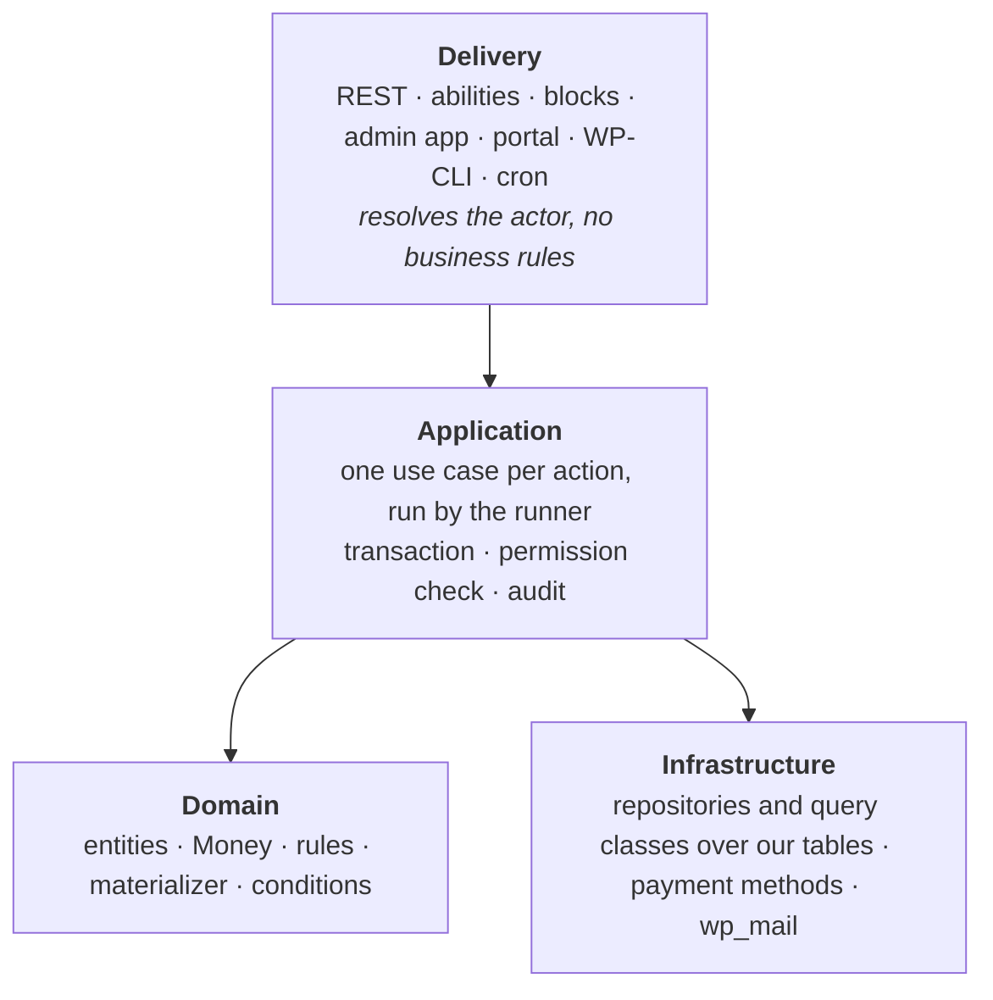
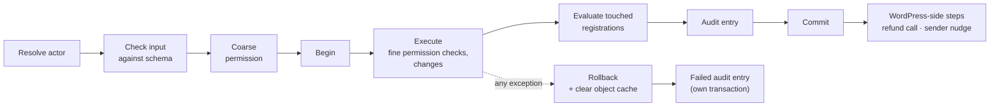

# Foundation

How every write happens, how failures are kept, and the rules that cut across
all modules. Most of this lives in the Foundation module; its `AGENTS.md`
holds the mechanics.

## Layers

Every plugin we ship has the same layers. Dependencies point downward only.

1. **Domain code may use WordPress** where that makes sense. There is no
   "pure domain" rule: this is a WordPress plugin and need not be portable.
2. **An interface exists only where there really are several
   implementations** (payment methods, the clock). There is no general
   "infrastructure is swappable" layer.
3. **Use cases are the only entry point for writes.** REST controllers,
   abilities, WP-CLI commands, the periodic run and form submissions all call
   a use case. Nothing writes a table directly.
4. **Module and plugin boundaries are checked in CI**
   ([Engineering](engineering.md#static-checks)), not left to discipline.

**What follows:** a new screen, command or route adds no business rule of its
own. It resolves the actor, calls a use case and shows its answer; the
command line and the screens therefore always agree.

## Two sides, one machinery

- **Admin side:** the actor is a WordPress user, WP-CLI or the system. A
  user reaches registration data through the views granted to them
  ([Views and grants](#views-and-grants)).
- **Portal side:** the actor is access to a registration. A secret link
  grants that one registration; an account grants every registration it
  owns, plus account-level actions. The delivery layer resolves the active
  registration into this actor
  ([Registrations](registrations-and-identity.md#access)). A guest with no
  registration may run only public use cases, such as a submit.

Both sides use the same use-case runner (transaction, evaluation, audit,
errors) but have **separate action catalogues, authorization and REST
namespaces** (`kalaka-admin/v1`, `kalaka-portal/v1`). **Use cases never read
the current user themselves:** the delivery layer resolves the actor once and
passes it in. This keeps every use case runnable from WP-CLI, from the
periodic run and from tests with a chosen actor.

## Views and grants

Organizers, module leaders and outside partners (e.g. a church body confirming
its own people) are all admin-side users. **The view defines which data can be
reached; the grant defines who holds the view.**

- **A view** belongs to one event: a row filter plus a column set, each column
  read or read-write. **It is the only place where permissions on data are
  defined.**
  - The master view has every column and no filter. Its columns are composed
    by rule, never by a hand list: every core column, every field key that
    holds a value in the event, every decision kind and every computed column
    (owner ruling 2026-11-27). A new column joins one of those groups. A read-only variant
    is simply another view.
  - Admins define subset views; extensions define special-case views and
    contribute columns and filterable facts.
  - **Stored view filters and sorts use only stored facts and decisions**
    ([Facts and decisions](#facts-decisions-and-computed-values)), so they
    stay per-event indexed queries under the `EXPLAIN` test. A viewer's own
    filters, search and sorting are never stored and only narrow the view;
    they may also use the computed sorszám and the computed "awaits an
    answer" column, which core compiles to SQL from its sources' declarative
    rules. A map lookup is expanded in SQL ("lunch option in the mapped
    options"); a congregation level matches the answer's stored path
    snapshot.
    PHP computes only display and export columns.
  - A filter may take **one parameter bound at grant time** (e.g. "program
    roster, program = ?"), so twelve module leaders need one view.
  - View definitions are copied to the next event, optionally with their
    grants.
- **A grant** is (WordPress user, event, view, optional bound value, set of
  actions). A user may hold several grants for the same event. There are no
  grants across all events. Grants and changes to a view are audited.
- **A grant never lists registrations.** It covers whatever the view's filter
  matches when access is checked, so the set grows and shrinks as
  registrations come and change.
- **Full access** is one site-wide capability: every view, every column
  read-write, every action, every event including future ones. It is for the
  people running the system.
  - It is given **per user, never to a role**: administrators do not get it
    by their role. The user who activates the plugin gets it while nobody
    holds it; after that a holder gives or takes it on the user's profile
    screen, or through WP-CLI, both through audited use cases.
  - **The last holder cannot lose it** through Kaláka's use cases, the users
    screen, REST or WP-CLI. Plain code can still delete the user, which is
    logged, and re-activation restores a holder. On multisite, super admins
    pass every check.
- **Actions that are not a column** (withdraw, remove, admit, confirm without
  payment, record money, view money, answer a request, send a manual mail,
  regenerate link, notes, audit history) are carried by the grant, not by
  WordPress roles. Modules declare the actions they offer
  ([Modules](modules-and-extensions.md#the-module-interface)). A grant lists
  its actions one by one; there are no default bundles yet.
- **A grant holds a use case only by name:** the use case names an action
  the grant carries, or it is a field change with at least one target; in
  both cases every target is inside the grant's view. An event use case with
  neither is for full access only.
- **Editing or deleting a view with grants is allowed.** When the view's
  parameter is removed or moved, its grants lose their bound values, and a
  grant without one sees the whole view. Deleting a view deletes its grants.
  Each change is audited.
- Core ships a **minimal WordPress role** that only opens the Kaláka admin
  app, for outside grantees.
- **Enforced in one place:** on the admin side, registration data is read
  only through the view query (grids, detail page, export, search, display
  names in mail screens) or through full access, checked in CI like module
  boundaries. A use case changes a field only if it is a read-write column of
  a view the user holds, for a registration inside that view's filter.
- **Screens decide no access.** An admin screen shows what the read
  returns, including what it may do (`can`), and the server decides each
  call again.

**What follows:** a new admin feature never gets a permission check of its
own. It is a column, a filter, or a grant action that a module declares. A
partner's self-service is a view filtered to its registrations plus the
actions it needs, never a separate screen with separate rules.

## The use-case runner

- **One transaction per use case.** The audit entry is written in the same
  transaction as the changes, so neither exists without the other. The
  [evaluation](#evaluation) of the touched registrations runs in it too,
  before the audit entry.
- **Any database error rolls back the whole use case;** code never continues
  after catching one, and the run refuses every further write once one
  happened. A rollback also clears the per-request object cache.
- **Isolation:** each run's transaction is READ COMMITTED and waits at most
  5 seconds for a row lock. Under binary logging with
  `binlog_format=STATEMENT` such writes fail, so the runner then refuses
  every use case and a site warning shows why ([Failures](#site-warnings)).
- **Retries:** only errors marked retryable (a reference-code collision, a
  deadlock, a lock-wait timeout, a version conflict hit by a system run, a
  reconnect inside a run) are retried, about three times, each attempt from
  scratch, at the outermost run only.
- **Nested use cases** join the outer transaction and write their own audit
  entry, linked to the parent. Effects are released after the outermost
  commit.
- **A preview** is a run that writes nothing and answers what a real run
  would do. The runner evaluates and audits nothing for a preview that
  succeeds. Staff acts with consequences (status acts, field corrections,
  money settings, manual mail) offer one, so a screen can warn first.
- **An act's retry key.** A staff act outside the ledger may take an
  idempotency key: a repeat with the same input returns the stored result and
  changes nothing, the same key with other input is refused. A double click
  or a retry after a lost response therefore never acts twice. The ledger's
  manual entries keep their own keys.
- **Inside a transaction only our own tables are written:** no WordPress
  functions that fire hooks or fill WordPress caches.
- **WordPress-owned data is changed before or after our transaction, never
  inside it,** ordered so that a failure leaves a harmless state:
  - Creating a WordPress account happens on WordPress's own registration
    page, before the form is sent. If the registration then fails, the
    account simply exists, as after a plain sign-up
    ([Registrations](registrations-and-identity.md#accounts-on-the-registration-form)).
  - Steps *after* commit run in the same request and must be safe to repeat.
    A **nudge** (schedule a run now, such as the sender) is only logged when
    it fails: the periodic run does the same work within 5 minutes. **A call
    to an outside system whose outcome matters** (the admin-started
    WooCommerce refund, [Money](money.md#refunds)) keeps its outcome on its
    own record ([Failures](#failures)) through its own use cases. Whatever
    escapes a step is logged, and the person still sees the use case's own
    result: it committed.
- **The permission checks.** The coarse check runs before the transaction:
  on the admin side, full access passes; otherwise the user needs a grant for
  the event that carries the action (any grant for a field change), with
  every target inside that grant's view; a site-level use case (events, site
  settings, views and grants) needs full access. The system and WP-CLI
  without `--user` have full access; with `--user` the CLI is checked as that
  user. The fine check of a field change runs inside the transaction, on the
  locked registration. On the portal side the check is access to the
  registrations the input names.
- **No domain events in the initial shape.** Everything our own plugins do in
  response to a change must be consistent with it, so it happens inside the
  use case. Public after-save actions for third parties come later
  ([Modules and extensions](modules-and-extensions.md#after-save-actions)).

**What follows:** a use case cannot send mail, call WooCommerce or touch a
WordPress option in the middle of its work. Such work is either an after-commit
step, safe to repeat, or a record that a later run acts on (a delivery, a
refund request).

### Lock order

Every use case takes its locks in one order, so two transactions never wait
on each other in a circle:

1. the event row;
2. quota rows (price tiers and support offers), by key;
3. registration rows, by (event, code);
4. everything else.

- **A use case that touches several registrations locks them all first,**
  before it changes any of them.
- **The registration row is locked before its payments are read,** so the
  evaluation never decides on payments that change under it.
- **The runner enforces it:** every locking read and write declares its level
  and key, and a lower level after a higher one, or a lower key within the
  same level, ends the use case.

**What follows:** an act that takes a seat in a price tier or an offer must
read what it will claim before it locks the registration, then lock the
quota rows, then the registration, and check its read again under the lock.
Code that locks the registration first and then finds a quota pool fails.

## Errors

**Where errors happen.** An error falls in one of five places, each with one
way of being handled:

1. **Inside a use case:** the runner rolls back, retries what is retryable,
   writes the failed audit entry ([Audit](#audit)), and the caller shows the
   error's text and status.
2. **Our code outside a use case:** see the rule below. When a person's
   action causes the error, it is shown the same way as a use-case error.
3. **A failure kept on a record:** the record holds the status and the error
   ([Failures](#failures)).
4. **A standing condition:** the site cannot work correctly until something
   changes. It is shown as a site warning ([Site warnings](#site-warnings)).
5. **A PHP fatal:** WordPress's own fatal handling. Locks are freed only when
   their expiry passes.

**Outside a use case, nothing is consistency-critical.** Code outside the
runner may only read, write WordPress-owned data before or after a use case,
or run development-only tools. It never writes our own tables. **The one
exception is the schema upgrade,** whose failure is a failed load
([Modules](modules-and-extensions.md#failure-isolation)).

**One error boundary at every entry point.** REST callbacks, WP-CLI commands,
cron hooks and rendered pages and blocks run inside Foundation's error
boundary. A Kaláka error is shown as it is; anything else is logged as one
line and shown as a system failure. No entry point shows WordPress's
"critical error" or a raw PHP error. A WP-CLI command's own refusal (a bad
argument) is shown and not logged. On the participant side, a form whose
field fails to render fails as a whole.

- **Use cases throw exceptions;** the throw triggers the rollback. There is
  no result type and no code-to-text mapping: each exception class carries a
  `WP_Error` code, a Hungarian default text and an HTTP status, and the place
  that throws may add Hungarian context. The classes are invalid input (400,
  not audited), permission denied (403), not found (404), version conflict
  (409), rule violation (422), system failure (500, a retryable variant
  among them) and site closed (503, which shows no `Hibaazonosító` line).
  Their texts are in the code.
- **A 500 never shows its context to the person:** REST, rendered output and
  the admin show only the default text. The error log and the audit keep the
  full message; WP-CLI, the operator's console, prints it too. Below 500 the
  context is meant for the person and is shown.
- **The correlation ID reaches the person.** Every error response carries it.
  A 500 shows its first 8 hex digits as a separate, less pronounced
  `Hibaazonosító:` line, which finds the audit entries and log lines by
  prefix. Other statuses do not show it: the person can act on them.
- **The UI addresses everyone with tegezés,** in the admin and the portal.

## Entities, repositories and queries

- **Entities** are plain objects that carry their own key. A reference to
  another record holds that record's key and is loaded through a per-request
  cache when needed, never stored on the entity.
- **Repositories** offer `find(key)` (null when missing; the caller decides
  whether that is an error), `upsert()` and `delete()` for entities, and
  `insert()` for append-only records (ledger lines, submissions), which are
  never updated or deleted.
- **Concurrent edits:** mutable records carry a `version`, and `upsert()`
  writes only if it has not changed. An edit screen sends back the version it
  showed; a stale one is a conflict error. A system run that hits a conflict
  retries from scratch. One mechanism covers stale screens and races inside a
  request.
- **Change tracking for the audit:** the repository keeps a copy of each
  record as loaded and builds the audit diff from it on save, so a forgotten
  setter cannot drop a change from the audit.
- **Query classes** serve lists and evaluation runs, built on indexes. **No
  N+1:** a list loads each related record type in one query.
- **Per-event cost:** every table holding per-event data has indexes that
  start with the event ID, and every per-event query filters by event first.
  An integration test seeds many events and checks each per-event query's
  plan; a query that examines rows of other events fails the build.

**What follows:** a new per-event table or query must pass the `EXPLAIN`
test from the start. A feature that needs a cross-event read is a site-level
report, not a view.

## Audit

- **One row per use case** in `kalaka_audit_entries`: time, correlation ID,
  parent (for nested use cases), side and actor, action name, IP address and
  user agent, optional reason, outcome and error, and the changes as JSON
  (changed fields only, before and after, secrets masked).
- **Every record a use case touched is listed** as a subject (record type,
  event ID and key), so a record's history, and everything touched in one
  event, is an indexed query.
- **Failed use cases are audited too,** after the rollback in a transaction
  of their own, with the action, actor, error and known record keys, but **no
  changes and no input values**: input may hold personal data that a later
  privacy erase could not find. If even that write fails, PHP's error log is
  the fallback.
- **What is audited:** every real run, an unchanged one included, and
  permission refusals, edit conflicts, rule violations and system errors. Not
  audited: plain validation failures shown to the person at once, and a
  preview that succeeded.
- **System entries:** a failure noticed outside any person's action (an
  extension contribution starting to fail, or recovering) is recorded by a use
  case run as the system, so it is audited like everything else.
- **Our own audit trail and notes replace WordPress revisions and comments**
  for our data. When the privacy tools come ([Deferred](deferred.md)), IP
  address and user agent are declared to them and an erase also scrubs audit
  diffs.

## Failures

**Failures are kept on the record they concern; there is no log table.**
PHP's error log counts as storage.

- A mail delivery keeps its status and latest error.
- A refund request keeps its status and error.
- A registration the periodic run cannot evaluate gets an **"evaluation
  failed" flag** naming the rule and its error ([Evaluation](#evaluation)).
  Admins see it as a broken record; the next successful evaluation clears it.
- A failing extension contribution is kept on its extension and shown as a
  site warning
  ([Modules and extensions](modules-and-extensions.md#failure-isolation)).
- Interactive failures are shown to the person at once. PHP's error log is
  the last fallback.

### The error log

- **A log line carries the full error:** what failed, the correlation ID and
  the whole exception chain (MariaDB's message included). It may hold
  personal data. Our own code still never writes a secret into a log line or
  into an exception message it makes.
- **The log is protected and rotated, never scrubbed:** it lives outside the
  web root and is deleted after 30 days
  ([Platform](engineering.md#platform)). The audit differs: it is kept for
  good, so a failed entry holds no input values and no wrapped messages.
- **One writer:** every line goes through Foundation's error-log writer.
  Nothing else calls `error_log()` (a static check,
  [Engineering](engineering.md#static-checks)).

### Site warnings

**A standing condition is shown as a site warning: an admin banner, and a
Site Health test only when the condition is an environment requirement.**

- **Modules contribute warnings.** A check writes nothing, is cheap (it runs
  on every admin page) and never throws. The boot registers the banners
  before any module, so a failed load still shows its warning.
- **Shown** on every admin page to users who may see Site Health and to users
  with full access; grant holders see none.
- **Two severities,** error and info; never dismissible; errors first. A
  Hungarian title states the condition; English details may follow,
  collapsed.
- **One cause, one warning:** a warning caused by another warning's condition
  stays silent.
- **The current warnings:**

  | Condition | Banner | Site Health |
  |---|---|---|
  | The load failed ([Modules](modules-and-extensions.md#failure-isolation)) | error | no |
  | Binary logging with `binlog_format=STATEMENT` ([The use-case runner](#the-use-case-runner)) | error | yes |
  | The PHP error log lies under the web root ([The error log](#the-error-log)) | error | yes |
  | The periodic run has stalled: cron does not start it, or it fails ([Deferred work](#deferred-work)) | error | yes |
  | An extension contribution is failing ([Modules](modules-and-extensions.md#failure-isolation)) | error | no |
  | Mail sending is paused after errors ([Mail](mail.md#pausing)) | error | no |
  | Mail sending is paused by hand ([Mail](mail.md#pausing)) | info | no |
  | A published form's definition is broken, so it stays closed ([Events and forms](events-and-forms.md#forms-implementation)) | error | no |

  An event's own problems (its reference codes running out) are not site
  warnings: they show on that event's admin pages.

## Deferred work

**There is no job queue** (no Action Scheduler, no general queue). Each kind
of deferred work gets exactly the guarantee it needs:

- **Money converges.** The materializer writes only the difference between
  target and recorded, so it can run any number of times
  ([Money](money.md#materializer)). Changes caused by an action are
  materialized inside that action's transaction; changes caused by time
  passing are applied by the periodic run.
- **Mail is never sent over and over.** Deciding a mail is due inserts a
  delivery with a unique key; only the sender sends, never an interactive
  request ([Mail](mail.md#sending)).
- **The periodic run** comes **every 5 minutes**, matching today's Google
  Sheets system. It evaluates only work that has fallen due over time (late
  fees, scheduled mails, reminders), retries registrations flagged
  "evaluation failed" (once an hour, and on every run an admin or WP-CLI
  starts), deletes drafts that are done
  ([Registrations](registrations-and-identity.md#submissions-and-values)),
  then runs the steps modules contribute, the sender and the WooCommerce
  reconcile among them. A failing step never stops the others. An admin or WP-CLI can
  start it at any time; this is safe because every effect is claim-guarded.
- **It stays cheap:** it sweeps only published events, and time rules query
  only what became due since the last run. A failing time rule is isolated to
  its rule and event, and its window is kept until it succeeds, so nothing
  that fell due is missed.
- **A real system cron is required,** with WP-Cron as the fallback.
  - A warning shows when the last completed run is older than 20 minutes, or
    none has completed, naming whether cron or the run itself is the cause.
    A run started from WP-CLI records no failure for it: its failure shows
    where it was started.
    20 minutes is longer than the run lock's 15-minute expiry, so a lock left
    by a crash is taken over before the warning shows.
  - A lock keeps two runs from overlapping.
- **No wake-ups per due time.** With a real cron every 5 minutes, per-time
  wake-ups would gain nothing; they would need a "next due" method on every
  date-bearing extension and a recompute on every date change. Precision is
  set by what drives the cron.

**What follows:** anything time-based (a late fee, a reminder, a scheduled
mail) happens up to 5 minutes late, and only if cron runs. A feature that
needs an exact moment needs a new decision, not a new queue.

### Evaluation

**The evaluation is one core procedure, not an extension point.** It brings a
registration's money, decisions and mail up to date with its facts.

- **When it runs:** the runner evaluates each registration a use case wrote
  to once, at the outermost use case, inside its transaction, before the
  audit entry. The periodic run does the same for work that falls due over
  time, one transaction per registration. **Showing a registration never
  evaluates it:** a page view writes nothing.
- **Three phases, in order:**
  1. **money:** fee targets and the materializer
     ([Money](money.md#materializer));
  2. **decisions:** confirmation first, then extension decisions
     ([Money](money.md#confirmation)), reading the fee targets and the
     payment facts;
  3. **mail decisions** ([Mail](mail.md)), reading facts plus the decisions
     recorded in the same pass.
- **Writes happen only on change:** a new transition, a non-zero difference,
  or a new delivery key.
- **Failure:** any rule failure rolls back the whole use case, or, in the
  periodic run, just that registration, which then gets the "evaluation
  failed" flag in a small transaction of its own. A repeat of the same
  failure leaves the flag as it is, so it tells when it first failed. A
  retryable failure that outlasts the retries sets no flag: the run skips the
  registration and keeps it due.

**What follows:** every act that changes a fact (a payment, an answer, a
field correction, an admission) gets confirmation and mail right in the same
transaction, without any code of its own for that. An act must never write a
decision or queue a confirmed mail itself.

## Facts, decisions and computed values

**Every piece of registration state is one of three kinds.** Views filter and
sort on the first two ([Views and grants](#views-and-grants)).

- **Facts** come from people's acts: field values, payments (with their value
  date), the manual confirmation flag, staff's unconfirm, assignments, seats,
  status, the "full" latch and "not counted". They are ordinary audited
  writes.
  - **A field value is a fact,** whatever writes it: answers copied from a
    submission, a staff correction, or the declaring extension's own code
    (e.g. the award of adjudicated aid, written when staff or a partner
    answer a request). A field has one kind of writer by its source
    ([Fields](events-and-forms.md#fields)).
  - **A participant field of source "system" is not a fact.** It only
    declares a decision under a key, read-only; no field value is ever
    written for it.
  - **A setting that money or a rule needs from a field** (a number field's
    decimals) is stored on the event's participant field, never read from the
    form post.
- **Seats follow one rule:** the event's places, a set option's places, and a
  price tier's or offer's places.
  - **A seat is a fact,** taken under a lock inside the registration's own
    act (a submit, an additional form's submit, an admission, a restore,
    staff placing, a field correction, an answer to a request). Leaving frees
    it, and only another act can take it again: **a seat never moves by
    itself,** so a freed place is never handed to the next person on a list.
  - **The form only controls visibility;** the backend takes the seat.
  - **A full pool turns away only the registrant's own submit** (a full event
    waitlists it). A staff act takes the seat even over the limit, with a
    "full" warning, and leaves the event's "full" latch as it is.
  - **A submit that lands on the waitlist may choose nothing limited** (owner
    ruling 2026-11-25): a limited choice refuses it like a full pool, and on
    a registration form every limited option reads as having no places while
    the event has none. A waitlisted registration holds no seats.
- **Decisions** are written by the system alone. **A fact that changes does
  not recompute a decision;** only a transition its rule names changes it.
  Core defines confirmation ([Money](money.md#confirmation)); the late fee is
  foreseen as an extension decision.
  - **Each decision is an append-only transition record** with kind, state,
    effective time, recorded time, cause and actor. The current state is the
    latest record. A rule may return several transitions in one pass.
  - **A kind may declare a base state** for the statuses it is defined for:
    no record reads as it there, and it is never written (confirmation:
    `unconfirmed`, for `registered` only). Every read applies it, view
    filters included.
  - **A kind is declared with a Hungarian label and its states,** each with a
    label, an icon and a tone; the grid and the detail show them for every
    kind.
  - Extensions contribute transition rules through a decision point, and core
    writes the records
    ([Modules](modules-and-extensions.md#the-extension-surface)).
- **Computed values are never stored:** balance, tallies, the tree's
  ancestors, a meal turn from the option map, the sorszám, payment due, and
  whether a registration awaits an answer (yes or no while it is
  `registered`, N/A otherwise: N/A is not "no", owner ruling 2026-11-27). The
  one exception: a congregation answer keeps the path snapshot taken when it
  was answered.
- **Reading order:** confirmation is checked once at the end of every money
  pass, whatever act caused it. It reads the composed targets and the payment
  facts, never ledger charge lines. A decision reads facts and earlier
  decisions only. An extension decision reads facts and core decisions, never
  another extension's.
- **No decision, condition or view depends on deliveries.** Only the sender
  and the staff screens that list deliveries read them ([Mail](mail.md)).

**What follows:** to change what a registration is (confirmed, waitlisted),
change a fact and let the evaluation decide; there is no "set confirmed"
anywhere. To add a column, decide which kind it is first: a stored fact can
be a stored filter, a computed value only an ad hoc one, compiled to SQL.

## Bulk changes

**A bulk change is never blocked by one broken record:**

- one transaction per item;
- a result report linking to each failed record, with options to retry or
  skip it;
- a preview that surfaces problems first, where one exists (e.g. a money
  settings change).

There is no tariff snapshot, so saving money settings reaches every open
registration through a preview and an apply, one transaction each
([Money](money.md#money-settings-apply)).

Queuing a manual mail is one act, not a bulk change: one transaction for the
batch, with the skipped registrations in its result.

## Cross-cutting rules

| Concern | Rule |
|---|---|
| **Storage** | Our own database tables for the domain (events, registrations, values, submissions, drafts, presets, ledger, deliveries, audit, notes, …). WordPress posts only for documents edited in the block editor: forms, field definitions, mail templates |
| **Time** | Stored in UTC, every stored instant as a `datetime(6)` column; displayed and computed in the site's WordPress time zone, never a fixed zone. A deadline set as a day ends at midnight in the site's time zone, fixed when it is stored ([Date references](events-and-forms.md#date-references)). The current time comes only from our own `Clock` (the shape of PSR-20), which wraps `current_datetime()` in production and is fixed in tests; nothing calls `time()` or "now" directly. Dates are set through date references |
| **Permissions** | Data access through views and grants per event; one site-wide full-access capability, given per user, never to a role; other actions are carried by the grant, usable inside that grant's view ([Views and grants](#views-and-grants)). Core ships a minimal role for outside grantees. Admin actions are also WordPress abilities and use the same checks |
| **Personal data** | Kept only in our tables, except the spam rate limit's keyed hash of an address (a transient that expires with its window, [Forms implementation](events-and-forms.md#forms-implementation)) and the billing details of a card payment's WooCommerce order, kept by WooCommerce's own retention. Privacy export, erase and retention are deferred until a wide release ([Deferred](deferred.md)); archiving an event starts its retention clock |
| **Secret links** | Treated as secrets: our own code never writes one into a log line, an audit entry or an exception message; masked in exports ([Registrations](registrations-and-identity.md#access)) |
| **Money** | `DECIMAL(26,8)`, a currency code on every record, brick/math arithmetic, never floats ([Money](money.md#amounts)) |
| **Sorting** | `utf8mb4_hungarian_ci` on our text columns ([Engineering](engineering.md#database)) |
| **Language** | Hungarian UI strings directly in code; English identifiers and comments. The one exception: a plugin declares the names of its own fields and labels with their defaults, and its settings screen may override them, in one option per plugin, `kalaka_<module id>_names`; an empty value is the default, and the text is read where it is shown. There is no table of overrides for other strings |
