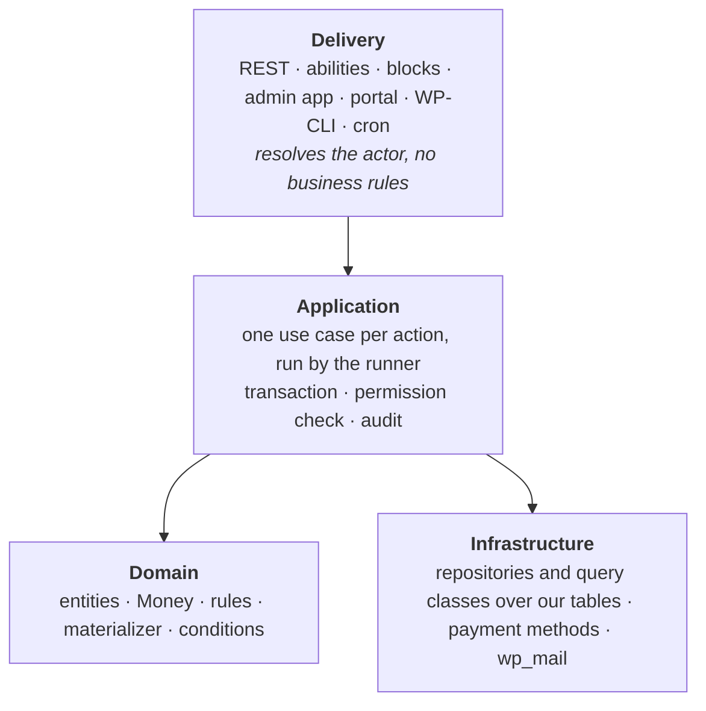
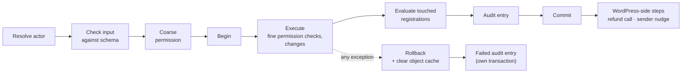

# Foundation

How every write happens, how failures are kept, and the rules that cut across
all modules. The Foundation module's `AGENTS.md` holds the mechanics.

## Layers

Every plugin we ship has the same layers. Dependencies point downward only.

1. **Domain code may use WordPress** where that makes sense. There is no
   "pure domain" rule: this is a WordPress plugin and need not be portable.
2. **An interface exists only where there really are several
   implementations** (payment methods, the clock).
3. **Use cases are the only entry point for writes.** REST controllers,
   abilities, WP-CLI commands, the periodic run and form submissions all call
   a use case. Nothing writes a table directly.
4. **Module and plugin boundaries are checked in CI**
   ([Engineering](engineering.md#static-checks)), not left to discipline.

**What follows:** a screen, command or route adds no business rule of its
own; it resolves the actor, calls a use case and shows its answer, so the
command line and the screens always agree.

## Two sides, one machinery

- **Admin side:** the actor is a WordPress user, WP-CLI or the system. A user
  reaches registration data through the views granted to them
  ([Views and grants](#views-and-grants)).
- **Portal side:** the actor is access to a registration: a secret link
  grants that one registration, an account every registration it owns plus
  account-level actions ([Registrations](registrations-and-identity.md#access)).
  A guest may run only public use cases, such as a submit.

Both sides share the runner (transaction, evaluation, audit, errors) but have
**separate action catalogues, authorization and REST namespaces**
(`kalaka-admin/v1`, `kalaka-portal/v1`). **Use cases never read the current
user themselves:** the delivery layer resolves the actor and passes it in, so
every use case runs the same from WP-CLI, the periodic run and tests.

## Views and grants

Organizers, module leaders and outside partners (e.g. a church body confirming
its own people) are all admin-side users. **The view defines which data can be
reached; the grant defines who holds the view.**

- **A view** belongs to one event: a row filter plus a column set, each column
  read or read-write. **It is the only place where permissions on data are
  defined.**
  - The master view has every column and no filter. Its columns are composed
    by rule, never by a hand list: every core column, every field key that
    holds a value in the event, every decision kind and every computed column
    (owner ruling 2026-11-27). [UNAPPROVED R392]
  - Admins define subset views; extensions define special-case views and
    contribute columns and filterable facts.
  - **Stored view filters and sorts use only stored facts and decisions**
    ([Facts and decisions](#facts-decisions-and-computed-values)), so they
    stay per-event indexed queries. A viewer's own filters, search and sorting
    are never stored and only narrow the view; they may also use computed
    columns that core compiles to SQL (the sorszám, "awaits an answer", a meal
    turn's option map). A congregation level matches the answer's stored path
    snapshot.
  - A filter may take **one parameter bound at grant time** (e.g. "program
    roster, program = ?"), so twelve module leaders need one view.
  - View definitions are copied to the next event, optionally with their
    grants.
- **A grant** is (WordPress user, event, view, optional bound value, set of
  actions). A user may hold several grants for one event; there are no grants
  across all events. **A grant never lists registrations:** it covers whatever
  the view's filter matches when access is checked. Grants and view changes
  are audited.
- **Full access** is one site-wide capability: every view, column, action and
  event, future ones included. It is given **per user, never to a role**
  (administrators do not get it by their role), through audited use cases on
  the profile screen or WP-CLI; the activating user gets it while nobody holds
  it. **The last holder cannot lose it** through Kaláka, the users screen,
  REST or WP-CLI. On multisite, super admins pass every check.
- **Actions that are not a column** (withdraw, remove, admit, confirm without
  payment, record money, view money, answer a request, send a manual mail,
  regenerate link, notes, audit history) are carried by the grant, never by
  WordPress roles. Modules declare them
  ([Modules](modules-and-extensions.md#the-module-interface)); a grant lists
  them one by one, with no default bundles yet.
- **A grant holds a use case only by name:** the use case names an action the
  grant carries, or it is a field change with at least one target; either way
  every target is inside the grant's view. Anything else is full access only.
- **Editing or deleting a view with grants is allowed.** When the view's
  parameter is removed or moved, its grants lose their bound values and see
  the whole view; deleting a view deletes its grants.
- Core ships a **minimal WordPress role** that only opens the Kaláka admin
  app, for outside grantees.
- **Enforced in one place:** on the admin side, registration data is read only
  through the view query (grids, detail, export, search, names on mail
  screens) or full access, checked in CI. A field change needs a read-write
  column of a held view whose filter holds the registration. **Screens decide
  no access:** they show what the read returns, including what may be done,
  and the server decides each call again.

**What follows:** a new admin feature is a column, a filter or a grant action,
never its own permission check. A partner's self-service is a view filtered to
its registrations plus the actions it needs.

## The use-case runner

- **One transaction per use case,** with the [evaluation](#evaluation) and
  the audit entry inside it, so a change never exists without its audit entry.
  Nested use cases join it and write their own linked entries.
- **Any database error rolls back the whole use case;** code never continues
  after catching one. A rollback also clears the per-request object cache.
- **Isolation:** READ COMMITTED for the run's transaction, waiting at most 5
  seconds for a row lock. Under binary logging with `binlog_format=STATEMENT`
  such writes fail, so the runner refuses every use case and a site warning
  says why ([Site warnings](#site-warnings)).
- **Retries:** only retryable errors (a reference-code collision, a deadlock,
  a lock-wait timeout, a system run's version conflict, a reconnect) are
  retried, about three times, from scratch, at the outermost run.
- **A preview** writes nothing and answers what a real run would do; staff
  acts with consequences offer one so a screen can warn first. A successful
  preview is neither evaluated nor audited.
- **A retry key:** a staff act may take an idempotency key, so a double click
  or a retry after a lost response never acts twice.
- **Inside a transaction only our own tables are written:** no WordPress
  function that fires hooks or fills WordPress caches. **WordPress-owned data
  is changed before or after it,** ordered so a failure leaves a harmless
  state: an account is created on WordPress's registration page before the
  form is sent
  ([Registrations](registrations-and-identity.md#accounts-on-the-registration-form));
  steps after commit must be safe to repeat. A **nudge** (schedule the sender
  now) is only logged when it fails, since the periodic run does the same work
  within 5 minutes; **a call to an outside system whose outcome matters**
  keeps its outcome on its own record through its own use cases
  ([Money](money.md#refunds)). A failed step never turns the committed result
  into an error.
- **Permission checks:** the coarse check runs before the transaction. On the
  admin side full access passes; otherwise a grant for the event must carry
  the action (any grant, for a field change) with every target in its view; a
  site-level use case needs full access. The system and WP-CLI without
  `--user` have full access; with `--user` the CLI is checked as that user.
  The fine check of a field change runs inside, on the locked registration. On
  the portal side the check is access to the named registrations.
- **No domain events.** Everything our own plugins do in response to a change
  happens inside the use case. Public after-save actions for third parties
  come later ([Modules](modules-and-extensions.md#after-save-actions)).

**What follows:** a use case never sends mail, calls WooCommerce or touches a
WordPress option mid-work; such work is an after-commit step or a record that
a later run acts on (a delivery, a refund request).

### Lock order

Every use case takes its locks in one order, so two transactions never wait on
each other in a circle:

1. the event row;
2. quota rows (price tiers and support offers), by key;
3. registration rows, by (event, code);
4. everything else.

A use case that touches several registrations locks them all first. The
registration row is locked before its payments are read, so the evaluation
never decides on payments that change under it. **The runner enforces the
order:** a lower level after a higher one, or a lower key within a level, ends
the use case.

**What follows:** an act that takes a tier or offer seat reads what it will
claim first, locks those quota rows, then the registration, and checks its
read again under the lock.

## Errors

**An error falls in one of five places,** each handled one way:

1. **inside a use case:** rollback, retry if retryable, a failed audit entry
   ([Audit](#audit)), and the caller shows the error;
2. **our code outside a use case:** shown the same way when a person caused
   it;
3. **a failure kept on a record** ([Failures](#failures));
4. **a standing condition,** shown as a site warning ([Site warnings](#site-warnings));
5. **a PHP fatal:** WordPress's own handling; locks are freed when they
   expire.

**Outside a use case, nothing is consistency-critical:** code there only
reads, writes WordPress-owned data before or after a use case, or runs
development tools; it never writes our tables. **The one exception is the
schema upgrade,** whose failure is a failed load
([Modules](modules-and-extensions.md#failure-isolation)).

- **One error boundary at every entry point** (REST, WP-CLI, cron, rendered
  pages and blocks): a Kaláka error is shown as it is; anything else is logged
  and shown as a system failure. No entry point shows WordPress's "critical
  error" or a raw PHP error.
- **Use cases throw exceptions;** there is no result type and no code-to-text
  mapping. Each class carries a `WP_Error` code, an HTTP status and a
  Hungarian default text, and the thrower may add Hungarian context: invalid
  input (400, not audited), permission denied (403), not found (404), version
  conflict (409), rule violation (422), system failure (500, with a retryable
  variant) and site closed (503).
- **A 500 never shows its context to the person;** the error log, the audit
  and WP-CLI keep it. Below 500 the context is for the person and is shown.
- **The correlation ID reaches the person:** every error response carries it,
  and a 500 (but not "site closed") shows its first 8 hex digits as a
  `Hibaazonosító:` line, which finds the audit entries and log lines.
- **The UI addresses everyone with tegezés,** in the admin and the portal.

## Entities, repositories and queries

- **Entities** are plain objects carrying their own key; a reference holds the
  other record's key, never the loaded record.
- **Repositories** offer `find()` (null when missing), `upsert()` and
  `delete()` for entities, and `insert()` for append-only records (ledger
  lines, submissions), which are never updated or deleted.
- **Concurrent edits:** mutable records carry a `version`, and a write
  succeeds only if it has not changed. A stale edit screen gets a conflict; a
  system run retries. **The audit diff is built by the repository** from the
  record as loaded, so no change can slip past it.
- **Query classes** serve lists and evaluation, on indexes, with **no N+1**.
- **Per-event cost:** every per-event table's indexes start with the event ID,
  and every per-event query filters by event first. An integration test seeds
  many events and fails the build on a query plan that reads other events.

## Audit

- **One row per use case:** time, correlation ID, parent, side and actor,
  action, IP address and user agent, optional reason, outcome and error, and
  the changed fields before and after, secrets masked. **Every touched record
  is listed as a subject** (record type, event, key), so a record's history and
  "everything touched in event 12" are indexed queries.
- **Failed use cases are audited too,** in a transaction of their own, with
  **no changes and no input values** (input may hold personal data a later
  erase could not find). PHP's error log is the fallback.
- **Audited:** every real run, unchanged ones included, and refusals,
  conflicts, rule violations and system errors. **Not audited:** plain
  validation failures shown at once, and successful previews.
- **System entries:** a failure noticed outside any person's act (an extension
  contribution starting to fail or recovering) is audited as a system use
  case.
- **Our audit trail and notes replace WordPress revisions and comments** for
  our data. The privacy tools ([Deferred](deferred.md)) will declare IP address
  and user agent and scrub audit diffs on erase.

## Failures

**Failures are kept on the record they concern; there is no log table.**
PHP's error log counts as storage.

- A mail delivery and a refund request keep their status and latest error.
- A registration the periodic run cannot evaluate gets an **"evaluation
  failed" flag** naming the rule and its error ([Evaluation](#evaluation));
  the next successful evaluation clears it.
- A failing extension contribution shows as a site warning
  ([Modules](modules-and-extensions.md#failure-isolation)).
- Interactive failures are shown to the person at once.

### The error log

- **A log line carries the full error:** what failed, the correlation ID and
  the whole exception chain. It may hold personal data, but our own code never
  writes a secret into a log line or an exception message.
- **The log is protected and rotated, never scrubbed:** outside the web root,
  deleted after 30 days ([Platform](engineering.md#platform)). The audit is
  kept for good, which is why a failed entry holds no input values.
- **One writer:** nothing but Foundation's error-log writer calls `error_log()`
  ([Engineering](engineering.md#static-checks)).

### Site warnings

**A standing condition is a site warning: an admin banner, plus a Site Health
test only for an environment requirement.** Modules contribute them; a check
writes nothing, is cheap and never throws. The boot registers the banners
before any module, so a failed load still shows its warning. They show to
users who may see Site Health and to full access, never to grant holders; they
cannot be dismissed; errors come first; a Hungarian title states the
condition, and English details may follow, collapsed. **One cause, one warning:** a warning
caused by another's condition stays silent.

| Condition | Banner | Site Health |
|---|---|---|
| The load failed ([Modules](modules-and-extensions.md#failure-isolation)) | error | no |
| Binary logging with `binlog_format=STATEMENT` ([The use-case runner](#the-use-case-runner)) | error | yes |
| The PHP error log lies under the web root ([The error log](#the-error-log)) | error | yes |
| The periodic run has stalled: cron does not start it, or it fails ([Deferred work](#deferred-work)) | error | yes |
| An extension contribution is failing ([Modules](modules-and-extensions.md#failure-isolation)) | error | no |
| Mail sending is paused after errors ([Mail](mail.md#pausing)) | error | no |
| Mail sending is paused by hand ([Mail](mail.md#pausing)) | info | no |
| A published form's definition is broken, so it stays closed ([Events and forms](events-and-forms.md#forms-implementation)) | error | no |

An event's own problems (its reference codes running out) show on that
event's admin pages, not as site warnings.

## Deferred work

**There is no job queue.** Each kind of deferred work gets exactly the
guarantee it needs:

- **Money converges:** the materializer writes only differences, so it can run
  any number of times ([Money](money.md#materializer)). An act's changes are
  materialized in its own transaction; time's changes by the periodic run.
- **Mail is never sent over and over:** a due mail is a delivery with a unique
  key, and only the sender sends ([Mail](mail.md#sending)).
- **The periodic run** comes **every 5 minutes**, matching today's Google
  Sheets system. It evaluates only what fell due over time (late fees,
  scheduled mails, reminders), retries "evaluation failed" registrations once
  an hour, deletes finished drafts
  ([Registrations](registrations-and-identity.md#submissions-and-values)), and
  runs the steps modules contribute, the sender and the WooCommerce reconcile
  among them. A failing part never stops the others. Admins and WP-CLI may
  start it any time, since every effect is claim-guarded.
- **It stays cheap:** only published events, and time rules query only what
  became due since the last run. A failing time rule keeps its window until it
  succeeds, so nothing due is missed.
- **A real system cron is required,** with WP-Cron as the fallback. A warning
  shows when no run completed in 20 minutes, naming cron or the run as the
  cause; 20 minutes outlasts the run lock's 15-minute expiry, so a lock left
  by a crash is taken over first. A run started from WP-CLI reports its own
  failure there instead.
- **No wake-ups per due time:** with a 5-minute run they would gain nothing,
  and would need a "next due" method on every date-bearing extension.

**What follows:** anything time-based happens up to 5 minutes late, and only
while cron runs.

### Evaluation

**The evaluation is one core procedure, not an extension point.** It brings a
registration's money, decisions and mail up to date with its facts.

- **When:** the runner evaluates each registration a use case wrote to, once,
  at the outermost use case, inside its transaction, before the audit entry.
  The periodic run does the same for time, one transaction per registration.
  **Showing a registration never evaluates it.**
- **Three phases, in order:** **money** (fee targets and the materializer,
  [Money](money.md#materializer)); **decisions** (confirmation, then extension
  decisions, [Money](money.md#confirmation)); **mail** ([Mail](mail.md)),
  reading facts plus the decisions just recorded.
- **Writes happen only on change.**
- **Failure** rolls back the whole use case or, in the periodic run, just that
  registration, which gets the "evaluation failed" flag (kept from its first
  occurrence while the same failure repeats). A retryable failure sets no
  flag; the registration stays due.

**What follows:** every act that changes a fact (a payment, an answer, a
correction, an admission) gets its confirmation and mail in the same
transaction, with no code of its own for that.

## Facts, decisions and computed values

**Every piece of registration state is one of three kinds.** Views filter and
sort on the first two ([Views and grants](#views-and-grants)).

- **Facts** come from people's acts: field values, payments (with their value
  date), the manual confirmation flag, staff's unconfirm, assignments, seats,
  status, the "full" latch and "not counted". They are ordinary audited
  writes.
  - **A field value is a fact,** whatever writes it: a submission's answers, a
    staff correction, or the declaring extension's own code (the aid award).
    A field's source decides its writer ([Fields](events-and-forms.md#fields)).
  - **A participant field of source "system" is not a fact:** it only
    declares a decision under a key; no value is ever written for it.
  - **A setting money or a rule needs from a field** (a number field's
    decimals) is stored on the event's participant field, never read from the
    form post.
- **Seats follow one rule:** the event's places, a set option's, a price
  tier's, an offer's.
  - **A seat is a fact,** taken under a lock inside the registration's own act
    (a submit, an additional form, an admission, a restore, staff placing, a
    field correction, an answer). Leaving frees it, and only another act takes
    it: **a seat never moves by itself.** The form only controls visibility.
  - **A full pool turns away only the registrant's own submit** (a full event
    waitlists it). A staff act takes the seat over the limit, with a "full"
    warning, and leaves the event's latch as it is.
  - **A submit that lands on the waitlist may choose nothing limited** (owner
    ruling 2026-11-25): a limited choice refuses it like a full pool, and on a
    registration form every limited option reads as having no places while
    the event has none. A waitlisted registration holds no seats.
    [UNAPPROVED R393]
- **Decisions** are written by the system alone. **A changed fact never
  recomputes a decision;** only a transition its rule names changes it. Core
  defines confirmation ([Money](money.md#confirmation)); the late fee is the
  foreseen extension decision.
  - **Each decision is an append-only transition record** (kind, state,
    effective and recorded time, cause, actor); the latest is current. A rule
    may return several in one pass.
  - **A kind may declare a base state** that no record reads as, never written
    (confirmation: `unconfirmed`, for `registered` only); every read applies
    it.
  - **A kind is declared with Hungarian labels, icons and tones** for its
    states, which the grid and detail show.
- **Computed values are never stored:** balance, tallies, the tree's
  ancestors, a meal turn, the sorszám, payment due, and "awaits an answer"
  (yes or no while `registered`, N/A otherwise; N/A is not "no", owner ruling
  2026-11-27). The one exception: a congregation answer keeps its path
  snapshot.
- **Reading order:** confirmation is checked once after money in every pass.
  It reads composed targets and payment facts, never charge lines. A decision
  reads facts and earlier decisions; an extension's reads facts and core
  decisions, never another extension's.
- **No decision, condition or view depends on deliveries** ([Mail](mail.md)).

**What follows:** to change what a registration is (confirmed, waitlisted),
change a fact and let the evaluation decide; nothing anywhere "sets
confirmed". A stored fact can be a stored filter; a computed value only an ad
hoc one, compiled to SQL.

## Bulk changes

**A bulk change is never blocked by one broken record:** one transaction per
item, a report linking each failed record with retry and skip, and a preview
that surfaces problems first where one exists. Money settings reach every open
registration this way ([Money](money.md#money-settings-apply)). Queuing a
manual mail is one act, not a bulk change: one transaction, with the skipped
registrations in its result.

## Cross-cutting rules

| Concern | Rule |
|---|---|
| **Storage** | Our own database tables for the domain (events, registrations, values, submissions, drafts, presets, ledger, deliveries, audit, notes, …). WordPress posts only for documents edited in the block editor: forms, field definitions, mail templates |
| **Time** | Stored in UTC as `datetime(6)`; displayed and computed in the site's WordPress time zone, never a fixed zone. A deadline set as a day ends at midnight in the site's time zone, fixed when stored ([Date references](events-and-forms.md#date-references)). The current time comes only from our `Clock` (PSR-20's shape, wrapping `current_datetime()`, fixed in tests), never from `time()` or "now" |
| **Permissions** | Views and grants per event; one site-wide full-access capability, per user, never to a role; other actions carried by the grant inside its view ([Views and grants](#views-and-grants)); a minimal role for outside grantees. Admin actions are also WordPress abilities with the same checks |
| **Personal data** | Only in our tables, except the spam limit's keyed address hash (a transient, [Forms implementation](events-and-forms.md#forms-implementation)) and a card order's billing details in WooCommerce, under its retention. Privacy export, erase and retention are deferred until a wide release ([Deferred](deferred.md)); archiving an event starts its retention clock |
| **Secret links** | Secrets: never in a log line, an audit entry or an exception message; masked in exports ([Registrations](registrations-and-identity.md#access)) |
| **Money** | `DECIMAL(26,8)`, a currency code on every record, brick/math, never floats ([Money](money.md#amounts)) |
| **Sorting** | `utf8mb4_hungarian_ci` on our text columns ([Engineering](engineering.md#database)) |
| **Language** | Hungarian UI strings in code; English identifiers and comments. The one exception: a plugin's declared field names and labels, which its settings screen may override, in one option per plugin, `kalaka_<module id>_names` (empty is the default); no other string can be overridden |
