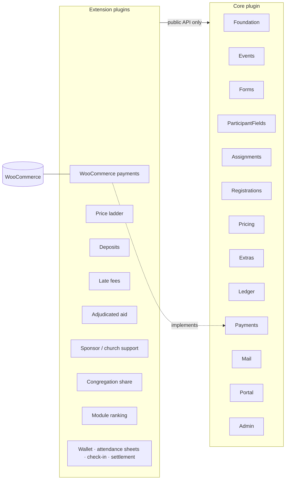
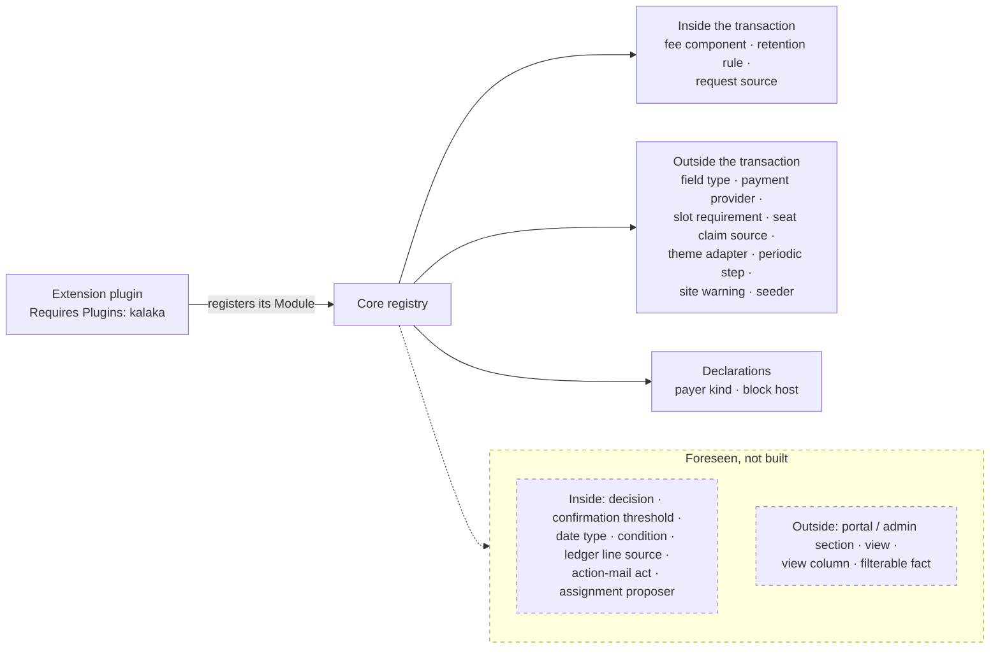

# Modules and extensions

## Packaging

- **A core plugin plus one extension plugin per feature,** in one repository
  with one version number and one CI pipeline that builds a zip per plugin.
  Extensions use only core's public API. Core itself is internally modular
  with strict boundaries.
- **Core money is minimal:** a fixed price, full payment, manual charges and
  discounts, an event's extra charges and its donation. Deposits, the price
  ladder, financial aid, sponsor and church support, the congregation share,
  late fees and the wallet are plugins; core keeps full support for extending
  it in these ways ([Money](money.md#core-money-scope)).
- **Core keeps the base concepts that organizations extend,** such as
  assignment sets ([Assignment sets](#assignment-sets)), not a general system
  that could build either organization's logic.
- **The extension plugins on `main`:**

  | Plugin | What it adds |
  |---|---|
  | `kalaka-woocommerce` | card payments on core's payments port ([Money](money.md#payments)) |
  | `kalaka-price-ladder` | price tiers and their quotas ([Money](money.md#core-money-scope)) |
  | `kalaka-deposits` | the per-event deposit amount (the threshold and retention that read it: not built yet) |
  | `kalaka-aid` | adjudicated aid ([Money](money.md#core-money-scope)) |
  | `kalaka-support` | the organization directory, the congregation picker and the support offers ([Money](money.md#sponsor-and-church-support)) |
  | `kalaka-share` | the congregation share ([Money](money.md#congregation-share)) |
  | `kalaka-ranking` | the module ranking field type ([Extensions in view](#extensions-in-view)) |
  | `kalaka-divi4` | the Divi 4 theme adapter ([Extensions in view](#extensions-in-view)) |

- **Core has no WooCommerce dependency at all.** On a WooCommerce site the
  extension also lets anyone who may reach Kaláka's admin (full access or any
  grant) into wp-admin, and sends logged-out visitors of My Account and of a
  customer's pay page to WordPress's own login and password pages, so there is
  one login screen (owner ruling 2026-11-26).
- **Core holds no organization data;** the directory is `kalaka-support`'s.

**What follows:** a feature one organization needs goes into an extension
unless it is a base concept both extend; a plugin core would have to know
about means a point is missing.



## Core modules

| Module | Responsibility |
|---|---|
| Foundation | runner, audit, clock, Money, evaluation, decisions, the periodic run, site warnings, module registry |
| Events | events, states, timeline points, the payment-due date type, capacity and the "full" latch; later the participant phase tracker |
| Forms | forms, the registration slot, field types, field definitions, values and conditions, prefill, form links |
| ParticipantFields | the event's participant fields: the list, its sources, titles and option labels, retired fields |
| Assignments | assignment sets, options, assignment facts, tallies, roster views, the proposer point |
| Registrations | registrations, field values, submissions, drafts, presets, statuses, waitlist, seats, requests and answers, reference codes, accounts |
| Pricing | fixed price, fee-component framework, confirmation, retention, materializer, money settings apply |
| Extras | extra charges and the donation, each declaring the participant field with its key for forms to join |
| Ledger | lines, payers, balances, organizer-recorded payments, refunds and corrections, manual charges and discounts |
| Payments | the payments port, online recording, starting a card payment |
| Mail | action mails, templates, deliveries, the sender, manual mail, the pause |
| Portal | the active registration (by secret link or account), the participant blocks admins place on any page, the registrant's own acts, the account area |
| Admin | views and grants, data grid, detail views, field corrections, notes, audit, settings, the mail screens |

Each module's `AGENTS.md` names the sections it implements and its
invariants.

## Assignment sets

Modules, workshops, talk groups, rooms and meal turns share one core concept.
**Built on `main`:** sets, options, assignment facts, the request mode's tie to
its request field, and staff placing with seats. **Not built yet:** direct
mode, tallies, rosters, the proposer, meal turns, copying to the next event.

- **A set** belongs to an event: a name, an optional time slot, required or
  optional, an access mode and a **published switch** (unpublished, it is
  hidden from participants). **A set has no choice window of its own** (owner
  ruling 2026-11-25): the form that holds the choice decides when it can be
  answered, with its own open period and conditions.
- **An option** has a capacity, leaders (display text) and a place. **It holds
  no condition:** the form field that names the set holds a condition per
  option ([Conditions](events-and-forms.md#conditions)).
- **A registration holds at most one option per set,** as an audited
  assignment fact with its source and state (proposed or confirmed). Only staff
  and, later, the proposer's confirmation change it.
- **A `registered` registration holds a seat in each option it is confirmed
  into,** under the one seat rule
  ([Foundation](foundation.md#facts-decisions-and-computed-values)). The
  confirmed assignment stays as the record when the registration leaves, with
  no seat. A proposed assignment holds none. The option's capacity is the
  pool's limit.
- **Access modes:**
  - **request** (e.g. IVK's modules): the participant writes a request, a
    field value of the set's **one request field** (tied once, never
    released; the ranking field type comes from `kalaka-ranking`), which an
    additional form holding it can change while open. Staff run the proposer
    with a preview, then confirm in bulk (one transaction per item, capacity
    re-checked, what no longer fits into the report); the participant sees
    the result once confirmed and the set is published;
  - **direct** (e.g. REFISZ's morning and afternoon programs): the choice
    writes a confirmed assignment; a full option cannot be chosen; the choice
    changes through an additional form while it is open, then only by staff;
  - **none** (talk groups, rooms, meal turns): staff place people, or a
    proposer proposes and staff confirm; shown once published.
  - **Staff can place or override in every mode,** warned first when the
    option is full; the warning never stops the placing.
- **Meal turns** (IVK's lunch turn, REFISZ's dining shift) are an access-none
  set **computed from another set through an option map**, never stored,
  unless staff placed someone by hand; eligibility is taking lunch.
- **Tallies** (count per option, unassigned, missing a required choice) are
  view columns. **Rosters are views, not documents:** each set has one roster
  view filtered by "assigned option = ?", bound per grant
  ([Foundation](foundation.md#views-and-grants)); the option screen shows who
  has access.
- **The assignment proposer** is an extension point. The IVK ranking engine is
  the first: first choices in registration order, then second choices into
  what is left, then third; staff confirm. **It runs once, on choices frozen
  beforehand,** and need not handle later changes. Talk-group and room
  proposers come later on the same point.
- Extensions read confirmed assignments through point inputs and keep their
  own per-option data. Sets and options are copied to the next event.
- **Not in core:** ranking capture, placement algorithms, per-option
  waitlists.

**What follows:** placement logic of any kind lives in a proposer extension;
a new kind of grouping (rooms, buses) is a set, not a new concept.

## Extensions in view

Besides the money plugins:

- **Module ranking** (IVK, `kalaka-ranking`): the ranking field type (built)
  and the ranking proposer (not built yet). The module recommender is IVK's
  own quiz on another site, which hands its order to the form as a prefill.
  **A form link created on a public page** (e.g. "register for the other camp
  too" on a thank-you page) **is created by a portal or system use case with
  its own rate limit, never an admin use case.**
- **Attendance sheets** (REFISZ, not built yet): printable sheets
  participants sign on site, for a supporting body or a grant report.
  Templates per event (header, columns from field values plus blank ones such
  as a signature, optional consent text, footer) are bound to a view, which
  picks the rows and caps the columns; each print is audited as a
  personal-data export.
- **The Divi 4 theme adapter** (both organizations, `kalaka-divi4`): Divi's
  contact-form classes on Kaláka's markup, `p` wrappers where Divi's rules
  need them, Divi's form red as the error colour, Divi's form styles loaded
  inline where a form or the status block appears, and the card return page in
  Divi's page frame. It keeps visible labels and the browser's own radio
  buttons and checkboxes ([Engineering](engineering.md#wordpress-surfaces)).
  Divi 5 and other themes come later, each as its own adapter.
- **The wallet** is designed later ([Deferred](deferred.md)).

## The Module interface

- **One `Module` interface for core modules and extension plugins.** A module
  declares its tables, per-event actions and contributions, and wires itself
  into WordPress in `boot()`:

  ```php
  interface Module {
      public function id(): string;                        // [a-z][a-z0-9_]*
      public function requiresApi(): string;               // e.g. '>=0.1 <0.2'
      public function schema(): Schema;                    // Schema::none() without tables
      public function capabilities(): array;               // list<string>, per-event actions
      public function contribute(Contributions $to): void; // typed extension points
      public function boot(): void;                        // add_action etc.
  }
  ```

- **`capabilities()` names the per-event actions** the module offers (e.g.
  `kalaka_withdraw_registration`), which core collects into the catalogue
  grants pick from ([Foundation](foundation.md#views-and-grants)). **They are
  not WordPress capabilities and are never added to roles.** Only the minimal
  role for outside grantees touches roles; full access is given per user.
  Both belong to Admin.
- **Boot:** on `plugins_loaded`, core adds its modules in a fixed order, then
  fires `kalaka_register_modules` for extensions, so plugin load order does not
  matter. For each module: the version check, the schema upgrade (under
  WordPress's upgrader lock; a module another request is upgrading is not
  booted), `contribute()` and `boot()`.
- An extension plugin is a module that lives in another plugin, so a core
  module can later move into its own plugin unchanged.
- **Other modules and plugins use only a module's `Api` namespace**
  (`Kalaka\<Module>\Api\…`), checked in CI. It is the PHP contract, not the
  REST API. **No DI container:** each module builds its own objects.

## Schema ownership

- **Each module owns its schema:** it creates, migrates and writes only its own
  tables, under its own schema version; others go through its `Api`. Modules
  upgrade independently.
- **`dbDelta`** creates tables and adds columns; ordered upgrade steps handle
  drops, renames and data moves. **Steps are safe to rerun,** since MariaDB
  commits after every schema change.
- **An upgrade fails rather than advance the version** while the tables still
  differ from their definitions (checked by a `dbDelta` dry run), and **a
  failed upgrade is a failed load** ([Failure isolation](#failure-isolation));
  the next request tries again.
- **Until production data exists there are no migrations:** in development
  everything is dropped and recreated freely
  ([Engineering](engineering.md#fixtures)). Migrations start at the first
  production deployment.

## Identifiers

The product name is **Kaláka**. `wp_` is reserved for WordPress core and is
never our prefix.

| What | Form |
|---|---|
| Core plugin | `kalaka` (`kalaka/kalaka.php`) |
| Extension plugins | `kalaka-<name>`, e.g. `kalaka-woocommerce` |
| PHP namespace | `Kalaka\<Module>\…` for core and extensions alike, so a module moves between plugins unchanged |
| Composer packages | vendor `kalaka`: `kalaka/core`, `kalaka/woocommerce`, … |
| Tables, options, capabilities, hooks | `kalaka_` prefix; hooks with underscores like WordPress core |
| Table names | plural like WordPress core, e.g. `kalaka_registrations`; extension tables `kalaka_<module id>_<plural>` |
| Module IDs | `[a-z][a-z0-9_]*`, e.g. `events`, `price_ladder`; schema version option `kalaka_schema_<id>` |
| Use-case classes | verb + noun: `SubmitRegistration`, `WithdrawRegistration` |
| Action names (audit, abilities) | admin `kalaka/<verb-noun>` (also the ability name), portal `kalaka-portal/<verb-noun>` |
| Blocks, abilities | `kalaka/<name>` |
| Post types | `kalaka_form`, `kalaka_field`, `kalaka_mail` |
| REST namespaces | `kalaka-admin/v1`, `kalaka-portal/v1`; an extension's own `kalaka-<module id>/v1`, where every public route calls `LoadState::requireOpen()` |
| Repository | `reformatus/kalaka` |
| Plugin headers | `Plugin Name: Kaláka` (extensions `Kaláka – <Feature>`), `Plugin URI: https://kalaka.dev`, `Author: Benedek Fodor`, `Update URI: https://kalaka.dev` so WordPress never offers a wordpress.org plugin of the same slug as an update; no Text Domain; extensions add `Requires Plugins: kalaka[, …]` |

## Bundled libraries

- **Any plugin that bundles a library prefixes it into its own namespace**
  (core uses Strauss: `Kalaka\Vendor\Brick\Math`), so no clash is possible.
- **Libraries that appear in core's public API are core's:** an extension uses
  core's prefixed copy, since a second copy would be a different class. Core's
  `Money` takes and returns no brick/math type.
- **Our own extensions reuse core's copy when they can** (a convenience, not a
  rule for third parties).

## The extension surface



- **Extensions declare core in their `Requires Plugins` header,** so WordPress
  refuses to activate them without it (it checks only that core is active, not
  its version).
- **They contribute through a typed registry** with a closed list of points.
  Anything that shapes behavior or money goes through these typed interfaces.
- **Each point runs inside or outside the transaction.** An inside point fires
  no WordPress hooks and writes nothing, so it can run while rows are locked.
- **The points on `main`:**
  - **fee component** (inside): what a registration owes at its stage
    ([Money](money.md#materializer));
  - **retention rule** (inside): what a payer keeps owing on leaving
    ([Money](money.md#withdrawal-removal-and-substitution));
  - **request source** (inside): a module's requests that need an answer (an
    offer that needs approval, an aid request), read from its field values;
    the writer of its own answer field when the one "answer a request" act
    answers; and a declarative "awaits an answer" rule that core compiles to
    SQL ([Money](money.md#sponsor-and-church-support));
  - **field type** (outside, except that reading a stored answer as a value is
    pure and runs inside): a block type with its data shape, validation,
    editor, UI and display ([Fields](events-and-forms.md#fields));
  - **payment provider** (outside): the payments port, one per site
    ([Money](money.md#payments));
  - **theme adapter** (outside), below;
  - **slot requirement** (outside): fields every registration form must hold,
    required and outside any condition (the ladder's `price_tier`);
  - **seat claim source** (outside): answers in, the seat claims of limited
    choices out, plus its pools for the form's places-left values; it locks,
    counts and writes nothing
    ([Foundation](foundation.md#facts-decisions-and-computed-values));
  - **periodic step**, **site warning** and **seeder** (outside);
  - **payer kind** (a declaration): a payer besides the participant, with a
    plain per-event read of whether it applies;
  - **block host** (a declaration): which Kaláka blocks another editor may
    insert, and its own blocks no other editor offers.
- **Foreseen points, not built yet:** decision (an extension's transition
  rule, first the late fee; core writes the records), confirmation threshold
  (the deposit), date type (one immutable input of the registration's facts
  and the event's points, a date or nothing out, no database access; today
  payment due is core's own), condition, ledger line source (only the
  wallet's), action-mail act (a check-in that causes an action mail, keyed by
  its record), assignment proposer, and the UI slots (portal or admin section,
  view, view column, filterable fact).
- **A theme adapter** fits participant-side markup to a theme that styles its
  own components ([Engineering](engineering.md#wordpress-surfaces)). It says
  whether it applies and returns data only: classes per element role, a `div`
  or `p` wrapper for text-like fields, the frame of a page core renders whole
  (from core's closed list), and the error colour. Core applies them and still
  produces the markup. The adapter may load the theme's styles and a
  stylesheet mapping core's neutral base onto the theme's look; it never
  changes markup. At most one applies at a time.

### Contracts

- **A point models a domain concept** (a fee component, a payment method), not
  a place in the code, and **is added only when one of our own extensions
  needs it,** which uses it first.
- **Inputs are immutable value objects,** one `<Point>Input` per point, so
  adding a field breaks no one. A point never receives repositories, entities,
  the runner or database access, and returns a defined value.
- **Extensions contribute; they never modify.** No WordPress filter or open
  hook changes a money value or decision: extensions contribute lines or
  decisions, and core composes and records the result. **UI points are
  slots:** no point lets an extension change markup core produced; the theme
  adapter returns values from closed lists. (Moodle's renderer overrides and
  WordPress's HTML filters are the most fragile parts of those ecosystems.)
- **After the alpha phase, a released point is permanent:** additive changes
  only (a base class gives new methods a default, or a separate optional
  interface), and a breaking change is a new versioned point (`…V2`) beside the
  old one for a deprecation period. CI then compares the public API with the
  last release.

**What follows:** an extension needing new behavior asks for a new point,
shaped as a domain concept, not a hook into core's code; and it never writes
core's tables, even through a point.

### Alpha phase

While every extension lives in this repository and serves only REFISZ and IVK,
and no plugin has been released publicly, the public API may change in
breaking ways: a change updates every user in the same pull request.
Permanence, additive-only changes and the CI compatibility check do not apply;
the contract *shape* above does. **Alpha ends with the first public release of
any plugin;** the deprecation period and the compatibility tool are chosen
then.

### Version check

- Core's public API carries **the shared release version, under semantic
  versioning.** Each extension declares its range through `requiresApi()`
  (e.g. `>=1.4 <2.0`, only `>=` and `<`). During 0.x any release may break.
- **Core boots only extensions in range;** one out of range is a failed load
  ([Failure isolation](#failure-isolation)). This holds for our own
  extensions too: WordPress updates plugins one by one.

### Failure isolation

- **A contribution outside the transaction that throws is caught and
  skipped,** so core keeps working (a failing theme adapter: the form renders
  without it; a failing payment provider: read as absent), and logged. The
  design also keeps the failure on its extension as a site warning with system
  audit entries when it starts, changes or ends (after 24 hours without one,
  so it does not flap); that stored record is not built yet.
- **A contribution inside the transaction that throws rolls back the use
  case.** One exception: a fee component that throws while a leaving composes
  the fee for its retention rule gives the rule no fee, and the leaving goes
  through.
- **No point writes to our tables.**
- **If anything fails to load** (an extension out of range or unbooted, a
  missing field type, a failed upgrade, an exception while extensions
  register), **every event is treated as unpublished:** every public entry
  point refuses with "site closed" (503), background work skips, and the
  runner refuses every use case before its transaction, so nothing writes to
  tables that may not match the code. Admins can still read and see the
  warning. There is no per-event dependency analysis: at our scale stopping
  everything is simple and clear. The stored event states do not change, so
  events come back once it is fixed. A check that runs only once WordPress has
  loaded may close the site later in the request; nothing reopens it. The
  failure is logged when it starts or changes, not on every request.

**What follows:** deactivating an extension whose field type a published form
uses closes the whole site, not just that form; a half-working registration
that drops answers is worse than a closed one.

### After-save actions

Public after-save WordPress actions for third-party plugins are deferred. When
added, they come **first** among points offered to third parties: stable
documented names, an immutable payload, fired after the data is saved, with no
effect on core behavior. They are the cheapest promise to keep and what most
integrations need (syncing to a CRM, posting to a chat); points that shape
behavior or money are the costly ones to keep stable.
