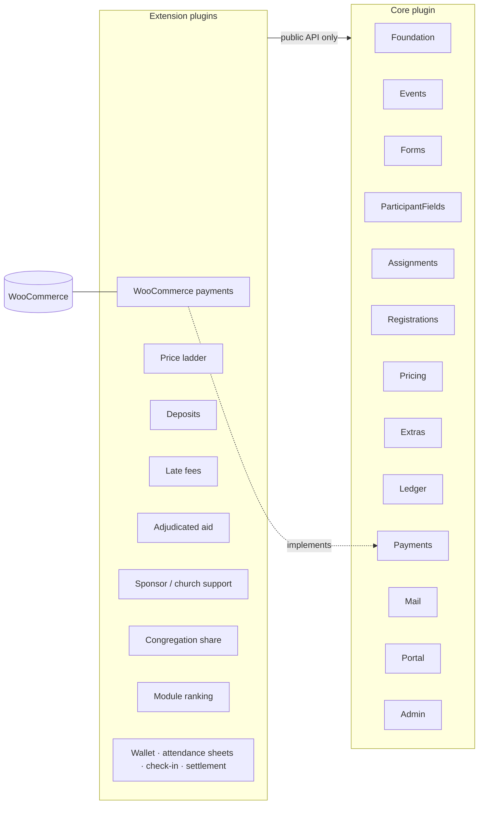
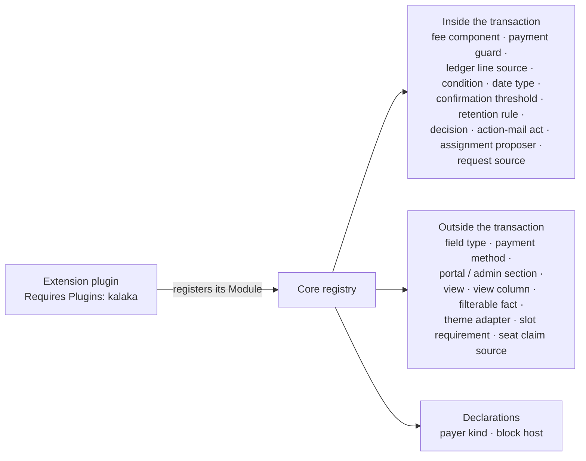

# Modules and extensions

## Packaging

- **A core plugin plus one extension plugin per feature,** in one repository
  with one version number and one CI pipeline that builds a zip per plugin.
  Extensions use only core's public API.
- **Core itself is internally modular** with strict boundaries.
- **Core money is minimal:** a fixed price per registration, full payment,
  an event's extra charges and its donation. Deposits, the price ladder,
  financial aid, sponsor and church support, the congregation share, late
  fees and the wallet are plugins; core keeps full support for extending it
  in these ways ([Money](money.md#core-money-scope)).
- **Core keeps the base concepts that organizations extend,** such as
  assignment sets ([Assignment sets](#assignment-sets)), not a general system
  that could build either organization's logic.
- **The WooCommerce integration is our own extension plugin** on core's
  payments port. Core has no WooCommerce dependency at all. On a WooCommerce
  site, the WooCommerce extension lets anyone who may reach Kaláka's admin
  (full access or any grant) into wp-admin.
- **Sponsor and church support is one extension plugin, `kalaka-support`:**
  the organization directory, the congregation picker and the support offers
  ([Money](money.md#sponsor-and-church-support)). Core holds no organization
  data.



## Core modules

| Module | Responsibility |
|---|---|
| Foundation | runner, audit, clock, Money, evaluation, module registry |
| Events | events, states, timeline points, date types, capacity and the "full" latch; later the participant phase tracker |
| Forms | forms, the registration slot, field types, field definitions, values and conditions, prefill, form links |
| ParticipantFields | the event's participant fields: the list, its sources, titles and option labels, retired fields |
| Assignments | assignment sets, options, assignment facts, tallies, roster views, the proposer point |
| Registrations | registrations, field values, submissions, presets, statuses, waitlist, seats, reference codes |
| Pricing | fixed price, fee-component framework, confirmation, retention, materializer |
| Extras | extra charges and the donation: generic per-event charges, each declaring the participant field with its key for forms to join, and the donation, the number field with the key `adomany`, declared by the same save |
| Ledger | lines, payers, balances, organizer-recorded payments, refunds and corrections, manual charges and discounts |
| Payments | the payments port, payment-method registry |
| Mail | mails, deliveries, the sender |
| Portal | the active registration (by secret link or account), the participant blocks admins place on any page, the account area |
| Admin | views and grants, data grid, detail views, notes, audit, settings |

## Assignment sets

Modules, workshops, talk groups, rooms and meal turns share one core concept.

- **A set** belongs to an event: a name, an optional time slot,
  required or optional, an access mode and a **published
  switch** (for a direct set, unpublished, it is hidden from participants
  and publishing opens the choice). A set has **no choice window of its
  own:** the form that holds the choice, with its own open period and
  conditions, decides when it can be answered.
- **An option** has a capacity, leaders (display text) and a place. Who may
  pick it is decided in the form: the form field that names the set may hold a
  condition per option ([Conditions](events-and-forms.md#conditions)).
- **A registration holds at most one option per set,** stored as an
  assignment fact with its source and state (proposed or confirmed),
  audited (computed meal turns excepted, below).
- **A `registered` registration holds a seat in the pool of each option it
  is confirmed into,** under the one seat rule
  ([Foundation](foundation.md#facts-decisions-and-computed-values)): taken
  under the lock on the option row, freed by withdrawal, removal or a placing
  elsewhere in the set. The confirmed assignment stays as the record, and
  holds no seat while its registration is not `registered`. An admission or a
  restore takes its seats again, over the limit where an option is full, with
  the "full" warning. A proposed
  assignment holds none until it is confirmed. The option's capacity is the
  pool's limit.
- **Access modes:**
  - **direct** (e.g. REFISZ's morning and afternoon programs): the choice
    field writes a confirmed assignment; capacity is checked
    in the transaction under a lock on the option row; a full option cannot be
    chosen; the choice can be changed through an additional form holding it
    while that form is open, then only by staff;
  - **request** (e.g. IVK's modules): the participant writes a request (a
    field value; the ranking field type comes from the `kalaka-ranking`
    extension), which an additional form holding it can change while that
    form is open. The request field's block either names its set, and its
    options are then the set's, or names none and holds its own options; the
    author picks one per block. The participant field a block that names a
    set declares becomes the set's one **request field**, recorded on the
    set, and a second, different field naming the same set is refused on
    save. The request is locked when its form closes;
    staff run the proposer with a preview, then confirm in bulk; the
    participant sees the result once confirmed and the set is published.
    **Bulk confirmation** runs one transaction per item: it locks the option
    row and re-checks capacity; items that no longer fit go
    into the report;
  - **none** (talk groups, rooms, meal turns): staff place people, or a
    proposer proposes and staff confirm; shown once published.
  - Staff can place or override in every mode. Staff are warned first when
    the option is full; the warning never stops the placing.
- **Meal turns** (IVK's lunch turn, REFISZ's dining shift) are an access-none
  set **computed from another set through an option map**, never stored,
  unless staff placed someone by hand, which is stored as a fact;
  eligibility is taking lunch
  ([Foundation](foundation.md#facts-decisions-and-computed-values)).
- **Tallies** for every set (count per option, unassigned, missing a required
  choice) are view columns.
- **Rosters are views, not generated documents:** each set has one roster view
  filtered by "assigned option = ?", bound per grant
  ([Foundation](foundation.md#views-and-grants)). Giving each option's
  leaders their roster means granting it to them; the option screen shows who
  has access.
- **The assignment proposer** is an extension point. The IVK ranking engine
  is the first: it fills first choices in registration order, then second
  choices into what is left, then third; staff confirm. **It runs once, on
  module choices frozen beforehand** (after the form that holds the request
  has closed), and need not handle later changes. Talk-group and room
  algorithms come later on the same point.
- Extensions read confirmed assignments through point inputs and keep their
  own per-option data (e.g. a module's level and the needs it answers).
- Sets and options are copied to the next event.
- **Not in core:** ranking capture, placement algorithms, per-option
  waitlists.

## Extensions in view

Besides the money plugins:

- **Module ranking** (IVK): the ranking field type and the ranking
  proposer. Its plugin is `kalaka-ranking`. The module recommender is not
  part of Kaláka: it is IVK's own quiz on another site, which hands its
  order to the form as a prefill. **A form link created on a public page**
  (e.g. a "register for the other camp too" link on a thank-you page) **is
  created by a portal or system use case with its own rate limit, never an
  admin use case.**
- **Attendance sheets** (REFISZ, later): printable sheets participants sign on
  site, for a supporting body or a grant report. Templates per event (header,
  columns from field values plus blank columns such as a signature, optional
  consent text, footer) are bound to a view, which picks the rows and caps the
  columns; each print is audited as a personal-data export.
- **The Divi 4 theme adapter** (both organizations): Divi's contact-form
  classes on Kaláka's form markup, `p` wrappers where Divi's form rules need
  them, Divi's form red as the error colour, and Divi's form styles loaded on
  pages that hold a form. It keeps visible labels and the browser's own radio
  buttons and checkboxes ([Engineering](engineering.md#wordpress-surfaces)).
  Its plugin is `kalaka-divi4`. Divi 5 and other themes come
  later, each as its own adapter.
- **The wallet** is designed later ([Deferred](deferred.md)).

## The Module interface

- **One `Module` interface for core modules and extension plugins.** A module
  declares its tables, capabilities and extension-point contributions, and
  wires itself into WordPress in `boot()`:

  ```php
  interface Module {
      public function id(): string;                        // [a-z][a-z0-9_]*
      public function requiresApi(): string;               // e.g. '>=0.1 <0.2'
      public function schema(): Schema;                    // Schema::none() without tables
      public function capabilities(): array;               // list<string>, per-event actions
      public function contribute(Contributions $to): void; // typed extension points
      public function boot(): void;                        // add_action etc.
  }
  ```

  `capabilities()` names the per-event actions the module offers (e.g.
  `kalaka_withdraw_registration`). Core collects them into one catalogue that
  grants pick from ([Foundation](foundation.md#views-and-grants)); they are
  not WordPress capabilities and are never added to roles. Only the
  minimal role for outside grantees touches WordPress roles; the
  full-access capability is given per user, never to a role. Both belong
  to Admin.

  `AbstractModule` gives the defaults (no schema, capabilities or
  contributions). Each module's class is `<Module>\Module`, in `Module.php`
  ([Engineering](engineering.md#inside-a-module-grouped-by-domain)).
- **`Schema`** is a value object: a version, the `CREATE TABLE` statements for
  `dbDelta` (table names written as `{prefix}…`), and upgrade steps keyed by
  the version they upgrade to. The stored version is the option
  `kalaka_schema_<id>`.
- **`Contributions` starts empty.** Each typed method (`feeComponent()`,
  `dateType()`, `paymentMethod()`, …) is added with the first module that
  needs it.
- **Boot:** core boots on `plugins_loaded` (priority 10). It adds the core
  modules in a fixed order, then fires `kalaka_register_modules`, where
  extensions add theirs; because this runs after every plugin is loaded,
  plugin load order does not matter. Then for each module: the version check,
  the schema upgrade, `contribute()` and `boot()`. Schema upgrades run in any
  request that sees a lower stored version, and on activation, under an
  WordPress's upgrader lock
  (`WP_Upgrader::create_lock()`); a module whose upgrade is in progress in
  another request is not booted in this one. An extension plugin's main file:

  ```php
  add_action('kalaka_register_modules', static function (Kalaka\Foundation\Api\Module\Modules $modules): void {
      $modules->add(new Kalaka\WooCommerce\Module());
  });
  ```
- An extension plugin is a module that lives in another plugin, so a core
  module can later move into its own plugin unchanged.
- Other modules and plugins use only a module's **`Api` namespace**
  (`Kalaka\<Module>\Api\…`), checked in CI. It is the PHP contract, not the
  REST API. A module's own `Api` may use the module's other classes, as their
  facade.
- **No DI container.** Each module builds its own objects in plain PHP with
  constructor injection; other modules reach them only through its `Api`.

## Schema ownership

- **Each module owns its schema.** A module creates and migrates only its own
  tables, under its own schema version. No module, core included, migrates
  another module's tables. Modules upgrade independently, so one module's
  upgrade never blocks another's.
- **Tools:** WordPress's schema tool (`dbDelta`) creates tables and adds
  columns; ordered upgrade steps handle drops, renames and data moves.
- **Upgrade steps are safe to rerun.** MariaDB commits automatically after
  every schema change, so an upgrade cannot be rolled back; the schema
  version advances one step at a time.
- **An upgrade fails rather than advance the version** when the tables do not
  match their definitions: `dbDelta` reports no errors, so the upgrader runs
  it again as a dry run, and any change still pending is a failure. Table
  definitions are therefore written in `dbDelta`'s own format.
- **A failed upgrade** leaves its module unbooted, which is a failed load
  ([Failure isolation](#failure-isolation)): public forms and the portal
  close, and admins see the failed-load warning. The next request tries the
  upgrade again.
- **Until production data exists there are no migrations:** during
  development everything is dropped and recreated freely, with test fixtures
  ([Engineering](engineering.md#fixtures)). Migrations start at the first
  production deployment.

## Identifiers

The product name is **Kaláka**. `wp_` is reserved for WordPress core and is
never our prefix.

| What | Form |
|---|---|
| Core plugin | `kalaka` (`kalaka/kalaka.php`) |
| Extension plugins | `kalaka-<name>`, e.g. `kalaka-woocommerce` |
| PHP namespace | `Kalaka\<Module>\…` for core and extensions alike, so a module moves between plugins unchanged |
| Composer packages | vendor `kalaka`, not tied to a GitHub organization: `kalaka/core`, `kalaka/woocommerce`, … |
| Tables, options, capabilities, hooks | `kalaka_` prefix; hooks with underscores like WordPress core |
| Table names | plural like WordPress core, e.g. `kalaka_registrations`, `kalaka_audit_entries`; extension tables `kalaka_<module id>_<plural>`, e.g. `kalaka_woocommerce_refund_requests` |
| Module IDs | `[a-z][a-z0-9_]*`, e.g. `events`, `woocommerce`; schema version option `kalaka_schema_<id>` |
| Use-case classes | verb + noun: `SubmitRegistration`, `WithdrawRegistration`, `RegenerateSecretLink` |
| Action names (audit, abilities) | admin `kalaka/<verb-noun>` (also the ability name), portal `kalaka-portal/<verb-noun>` |
| Blocks, abilities | `kalaka/<name>` |
| Post types | `kalaka_form`, `kalaka_field`, `kalaka_mail` |
| REST namespaces | `kalaka-admin/v1`, `kalaka-portal/v1` |
| Extension REST namespaces | `kalaka-<module id>/v1`, e.g. `kalaka-support/v1`; routes are registered in the module's `boot()`, and every public route calls `LoadState::requireOpen()` |
| Repository | `reformatus/kalaka` |
| Plugin headers | `Plugin Name: Kaláka` (extensions `Kaláka – <Feature>`), `Plugin URI: https://kalaka.dev`, `Author: Benedek Fodor`, `Update URI: https://kalaka.dev` so WordPress never offers a wordpress.org plugin of the same slug as an update; no Text Domain; extensions add `Requires Plugins: kalaka[, …]` |

## Bundled libraries

- **Any plugin that bundles a library prefixes it into its own namespace:**
  core, our extensions and third-party ones alike. Core uses Strauss and
  produces, for example, `Kalaka\Vendor\Brick\Math`. An extension can bundle
  and prefix its own libraries, and no clash is possible. This is standard in
  the WordPress ecosystem (WooCommerce and Yoast do it).
- **Libraries that appear in core's public API are core's.** If an extension
  point hands over a Money built on brick/math, the extension uses core's
  prefixed copy through the `Api`; a second copy would be a different class,
  and the objects would not match.
- **Our own extensions reuse core's copy when they can,** instead of bundling
  another. This is a convenience for us, not a rule for third parties.

## The extension surface



- **Extensions declare core in their `Requires Plugins` header,** so WordPress
  refuses to activate them without it. (The header checks only that core is
  active, not its version.)
- **They contribute through a typed registry** with a closed list of extension
  points. Anything that shapes behavior or money goes through these typed PHP
  interfaces.
- **Each point is documented as running inside or outside the transaction:**
  - **Inside** (fee component, payment guard, ledger line source (only the
    deferred wallet's), rule or mail condition, date type, confirmation
    threshold, retention rule,
    decision, action-mail act, assignment proposer, request source): fires no
    WordPress hooks.
  - **Outside** (field type, payment method, portal or admin section, view,
    view column, filterable fact, theme adapter, slot requirement, seat claim source). A field type's value type
    and its reading of a stored answer as a value fire no WordPress hooks
    and write nothing (they may read, e.g. a congregation's name), so the
    evaluation reads a registration's field values with them inside the
    transaction.
  - A **slot requirement** names participant fields the event's registration
    form must hold, required and outside any condition (the price ladder
    requires `price_tier`); a form without one is closed until fixed.
  - A **payer kind** is only declared (e.g. "congregation"); it runs no code.
  - A **block host** is only declared: the Kaláka blocks (e.g. the condition
    blocks) that an editor other than a form's may insert, and its own blocks
    that no other editor offers, for a post type or a block editor context.
    Forms gates its blocks by post type and lets a host allow some elsewhere;
    a host's own blocks it hides in every other editor and keeps out of forms,
    without knowing the module that declares it.
- **Date types** are an inside point: one immutable input (the
  registration's facts and the event's points) in, a date or nothing out; no
  database access, no hooks ([Events](events-and-forms.md#date-references)).
- **A decision** is an inside point: a transition rule in, its transitions
  (none, one or more, in order) out; core writes the records. It reads facts
  and core decisions only, never another extension's decision. The late fee
  is the one extension decision foreseen; price-tier and support places are
  seats, facts ([Foundation](foundation.md#facts-decisions-and-computed-values)).
- **An action-mail act** is an inside point: an extension's act (e.g. a
  check-in) that can cause an action mail, keyed by the act's record
  ([Mail](mail.md#five-kinds-of-mail)). It is built with the check-in
  extension.
- **A request source** is an inside point: a module's requests on a
  registration that need an answer (a support offer that needs approval, an
  aid request), read from its field values, and the writer of its own field
  when the one "answer a request" act answers one. It also states when its
  request awaits an answer as data (`awaitingRule()`: any-of groups of field
  tests), which core compiles to SQL for the grid column. Core keeps the answer
  record and the computed "awaits an answer"
  ([Money](money.md#sponsor-and-church-support)).
- **A seat claim source** is an outside point: a submit's validated answers
  in, the seat claims of the limited choices made in them out (the field and
  the pool of each). It also lists its pools (the field, the option value and
  the pool of each), from which a form's `seats_left.<field key>.<option
  value>` is served. It locks, counts and writes nothing; the submit locks the
  pools and takes the seats when the registration becomes `registered`
  ([Foundation](foundation.md#facts-decisions-and-computed-values)). An
  additional form may take seats, only for a `registered` registration: it
  takes the seat of a new claim and frees the seat of one its values no longer
  make, in one run, and a full pool refuses it as it does the registration form
  (a waitlisted registration has no additional forms). A tier or an offer
  stays once written, so a price never changes through it.
- **A theme adapter** is an outside point that fits participant-side markup
  to a theme which styles its own components instead of WordPress's
  ([Engineering](engineering.md#wordpress-surfaces)). It says whether it
  applies to the active theme, and returns data only:
  - extra classes for each element role core names (form, field, text
    control, choice group, option, submit button, error message, …);
  - the wrapper element of a text-like field, `div` or `p` (a choice and a
    consent checkbox always sit in a `div`);
  - the error colour.

  Core applies these to the markup it renders, for the block and the
  shortcode alike, and still produces that markup itself. The adapter loads
  the theme's own styles where a form appears through the theme's own
  mechanisms in its `boot()`, and may add a stylesheet that maps core's
  neutral base (its `--kalaka-…` properties and classes) onto the theme's
  look ([Engineering](engineering.md#wordpress-surfaces)). That stylesheet
  may also style field types' own `data-kalaka-*` markup, and fixes what its
  theme breaks; the adapter never changes markup. At most one adapter
  applies at a time.

### Contracts

- **A point models a domain concept** (a fee component, a payment method), not
  a place in the code.
- **A point is added only when one of our own extensions needs it,** and that
  extension uses it first.
- **Inputs are immutable value objects:** one input object per point, named
  `<Point>Input` (`DateTypeInput`, `FeeComponentInput`, …), so adding a field
  breaks no one. A point never receives repositories,
  entities, the use-case runner or database access, and returns a defined
  value.
- **Extensions contribute; they never modify.** No WordPress filter or other
  open hook changes a money value or a money decision: extensions contribute
  lines or decisions through typed points, and core composes and records the
  result (fee components in a fixed sequence of stages,
  [Money](money.md#materializer)). **UI points are slots:** a portal or admin section renders into a
  region it owns; no point lets an extension change markup that core
  produced. The theme adapter is no exception: it returns classes, a
  wrapper choice and a colour from closed lists, and core applies them. (Moodle's renderer overrides and WordPress's HTML filters are the
  most fragile parts of those ecosystems.)
- **After the alpha phase, a released point is permanent.** It is never
  changed incompatibly or removed. Changes are additive only: each point
  interface comes with an abstract base class that gives new methods a
  default, or a new capability is a separate optional interface. A breaking
  change is a new versioned point (`…V2`) that runs alongside the old one for
  a deprecation period. CI compares the public API (the `Api` namespaces and
  the point interfaces) with the last release on every pull request; an
  incompatible change fails the build. (WordPress's hooks stay stable because
  a released hook is never removed.)

### Alpha phase

While every extension lives in this repository and serves only REFISZ and
IVK, and no plugin has been released publicly as open source, the public API
may change in breaking ways: a change updates every user in the repository in
the same pull request. During alpha, permanence, additive-only changes and the
CI compatibility check do not apply; the contract *shape* above (domain
concepts, immutable input objects, our own extension using a point first)
does. **Alpha ends with the first public release of any plugin.** The
deprecation period and the compatibility-check tool are chosen then.

### Version check

- Core's public API carries a version: **the shared release version, under
  semantic versioning.** Each extension module declares the range it
  supports through `requiresApi()`, e.g. `>=1.4 <2.0`, using only `>=` and
  `<`, so core parses it without a library. Core modules declare
  `>=` their own version. During 0.x any release may break.
- Core boots only extensions in range. One out of range is not booted, which
  is a failed load ([Failure isolation](#failure-isolation)): admins see the
  failed-load warning instead of a fatal error. This holds for our own
  extensions too: WordPress updates plugins one by one, so a site can run
  mismatched versions despite the one repository version.

### Failure isolation

- A contribution **outside** the transaction that throws is caught and
  skipped, so core keeps working. Its failure is kept on its extension: an
  option per contribution holding its latest message, since when it has
  failed and when it last failed, shown as a site warning
  ([Foundation](foundation.md#site-warnings)). It is not a Site Health test:
  it is not an environment requirement. When a failure starts, its message
  changes, or the contribution succeeds again, a log line and a system audit
  entry record it ([Foundation](foundation.md#audit)). A failure ends only after
  24 hours without a failure, so a contribution that fails in one place and
  works in another does not flap; then the option is deleted. A failure that
  only repeats writes nothing but the option's last-failure time, at most
  once an hour.
- A contribution **inside** the transaction that throws rolls back the use
  case like any error.
- **No point writes to our tables:** a point returns a value, and core writes
  it.
- **If anything fails to load** (an extension out of range or unbooted, a
  missing field type, a failed upgrade, an exception thrown while extensions
  register), **every event is treated as
  unpublished**: all public access is refused and mail decisions and sending
  stop ([Events](events-and-forms.md#event-lifecycle)). There is no
  per-event dependency analysis: at our scale stopping everything is simple
  and clear. The stored event states do not change, so events come back once
  the problem is fixed. The boot records the outcome in
  `Kalaka\Foundation\Api\LoadState`; `isOpen()` is false after any load
  failure and before boot has finished. A module's check that can only run
  once WordPress has loaded (on `wp_loaded`) may add a failure, closing the
  site from then on; nothing reopens it.
  - **One outcome:** every public entry point calls `requireOpen()`, which
    refuses with `SiteClosed` (503, [Foundation](foundation.md#errors)).
    Background work (the periodic run, the sender) skips. The runner refuses
    every use case with `SiteClosed` too, before its transaction and without
    a failed audit entry, so nothing writes to tables that may not match the
    code. Admins can still read, and see the failed-load
    warning ([Foundation](foundation.md#site-warnings)), which reads the
    request's load state.
  - **Logged once:** the failure is logged when it starts or changes, not on
    every request; a WordPress option holds what was last logged and is
    deleted after a clean load. The boot's and the late checks' failures are
    logged together, after the late checks. A schema upgrade still in progress in another
    request closes the request but is not logged.

### After-save actions

Public after-save WordPress actions for third-party plugins are deferred.
When they are added, they come **first** among points offered to third
parties: stable documented names, an immutable payload, fired after the data
is saved, with no effect on core behavior. They are the cheapest promise to
keep and what most integrations need (syncing to a CRM, posting to a chat);
points that shape behavior or money are the costly ones to keep stable.
