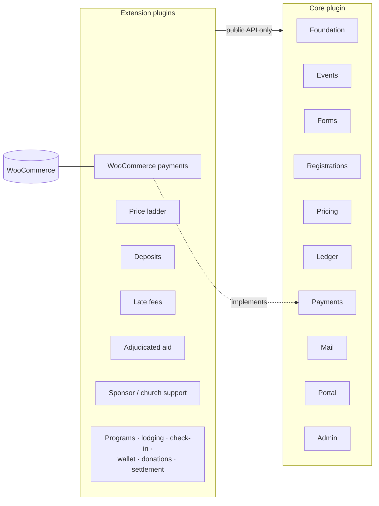
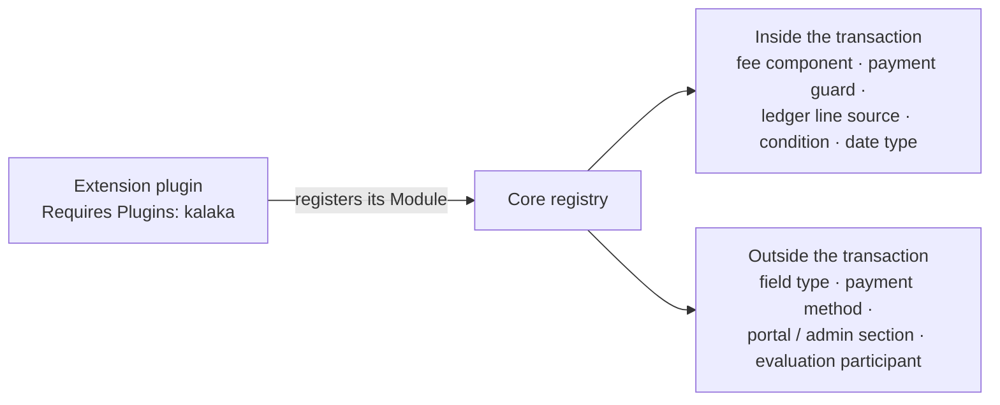

# Modules and extensions

## Packaging

- **A core plugin plus one extension plugin per feature,** in one repository
  with one version number and one CI pipeline that builds a zip per plugin.
  Extensions use only core's public API.
- **Core itself is internally modular** with strict boundaries.
- **Core money is minimal:** a fixed price per registration and full payment.
  Deposits, the price ladder, financial aid, sponsor and church support and
  late fees are plugins; core keeps full support for extending it in these
  ways ([Money](money.md#core-money-scope)).
- **The WooCommerce integration is our own extension plugin** on core's
  payments port. Core has no WooCommerce dependency at all.



## Core modules

| Module | Responsibility |
|---|---|
| Foundation | runner, audit, clock, evaluation trigger, module registry |
| Events | events, states, timeline points, date types, capacity and the "full" latch; later the participant phase tracker |
| Forms | forms, the registration slot, field types, field definitions, conditions, invitations |
| Registrations | registrations, field values, submissions, presets, statuses, waitlist, reference codes |
| Pricing | fixed price, fee-component framework, materializer |
| Ledger | lines, balances, organizer-recorded payments |
| Payments | the payments port, payment-method registry |
| Mail | mails, deliveries, the sender |
| Portal | registration access by secret link or account, the account area |
| Admin | data grid, detail views, notes, audit, settings |

## The Module interface

- **One `Module` interface for core modules and extension plugins.** A module
  declares its tables, capabilities and extension-point contributions, and
  wires itself into WordPress in `boot()`:

  ```php
  interface Module {
      public function id(): string;                        // [a-z][a-z0-9_]*
      public function requiresApi(): string;               // e.g. '>=0.1 <0.2'
      public function schema(): Schema;                    // Schema::none() without tables
      public function capabilities(): array;               // list<string>
      public function contribute(Contributions $to): void; // typed extension points
      public function boot(): void;                        // add_action etc.
  }
  ```

  `AbstractModule` gives the defaults (no schema, capabilities or
  contributions). Each module's class is `<Module>\Module`, in `Module.php`
  ([Engineering](engineering.md#inside-a-module-grouped-by-domain)).
- **`Schema`** is a value object: a version, the `CREATE TABLE` statements for
  `dbDelta` (table names written as `{prefix}…`), and upgrade steps keyed by
  the version they upgrade to. The stored version is the option
  `kalaka_schema_<id>`.
- **`Contributions` starts empty.** Each typed method (`feeComponent()`,
  `dateType()`, `paymentMethod()`, …) is added with the first module that
  needs it.
- **Boot:** core boots on `plugins_loaded` (priority 10). It adds the core
  modules in a fixed order, then fires `kalaka_register_modules`, where
  extensions add theirs; because this runs after every plugin is loaded,
  plugin load order does not matter. Then for each module: the version check,
  the schema upgrade, `contribute()` and `boot()`. Schema upgrades run in any
  request that sees a lower stored version, and on activation, under an
  option-based lock. An extension plugin's main file:

  ```php
  add_action('kalaka_register_modules', static function (Kalaka\Foundation\Api\Modules $modules): void {
      $modules->add(new Kalaka\WooCommerce\Module());
  });
  ```
- An extension plugin is a module that lives in another plugin, so a core
  module can later move into its own plugin unchanged.
- Other modules and plugins use only a module's **`Api` namespace**
  (`Kalaka\<Module>\Api\…`), checked in CI. It is the PHP contract, not the
  REST API.
- **No DI container.** Each module builds its own objects in plain PHP with
  constructor injection; other modules reach them only through its `Api`.

## Schema ownership

- **Each module owns its schema.** A module creates and migrates only its own
  tables, under its own schema version. No module, core included, migrates
  another module's tables. Modules upgrade independently, so one module's
  upgrade never blocks another's.
- **Tools:** WordPress's schema tool (`dbDelta`) creates tables and adds
  columns; ordered upgrade steps handle drops, renames and data moves.
- **Upgrade steps are safe to rerun.** MariaDB commits automatically after
  every schema change, so an upgrade cannot be rolled back; the schema
  version advances one step at a time.
- **A failed upgrade:**
  - an extension module stays unbooted, and admins get a notice with a retry;
  - a core module puts core in a **safe mode**: public forms and the portal
    close, and admins see the notice.
- **Until production data exists there are no migrations:** during
  development everything is dropped and recreated freely, with test fixtures
  ([Engineering](engineering.md#fixtures)). Migrations start at the first
  production deployment.

## Identifiers

The product name is **Kaláka**. `wp_` is reserved for WordPress core and is
never our prefix.

| What | Form |
|---|---|
| Core plugin | `kalaka` (`kalaka/kalaka.php`) |
| Extension plugins | `kalaka-<name>`, e.g. `kalaka-woocommerce` |
| PHP namespace | `Kalaka\<Module>\…` for core and extensions alike, so a module moves between plugins unchanged |
| Composer packages | vendor `kalaka`, not tied to a GitHub organization: `kalaka/core`, `kalaka/woocommerce`, … |
| Tables, options, capabilities, hooks | `kalaka_` prefix; hooks with underscores like WordPress core |
| Table names | plural like WordPress core, e.g. `kalaka_registrations`, `kalaka_audit_entries`; extension tables `kalaka_<module id>_<plural>`, e.g. `kalaka_woocommerce_refund_requests` |
| Module IDs | `[a-z][a-z0-9_]*`, e.g. `events`, `woocommerce`; schema version option `kalaka_schema_<id>` |
| Use-case classes | verb + noun: `SubmitRegistration`, `WithdrawRegistration`, `RegenerateSecretLink` |
| Action names (audit, abilities) | admin `kalaka/<verb-noun>` (also the ability name), portal `kalaka-portal/<verb-noun>` |
| Blocks, abilities | `kalaka/<name>` |
| Post types | `kalaka_form`, `kalaka_field`, `kalaka_mail` |
| REST namespaces | `kalaka-admin/v1`, `kalaka-portal/v1` |
| Repository | `reformatus/kalaka` |
| Plugin headers | `Plugin Name: Kaláka` (extensions `Kaláka – <Feature>`), `Plugin URI: https://kalaka.dev`, `Author: Benedek Fodor`, `Update URI: https://kalaka.dev` so WordPress never offers a wordpress.org plugin of the same slug as an update; no Text Domain; extensions add `Requires Plugins: kalaka[, …]` |

Where extensions register REST routes is decided with the first extension that
needs one.

## Bundled libraries

- **Any plugin that bundles a library prefixes it into its own namespace:**
  core, our extensions and third-party ones alike. Core uses Strauss and
  produces, for example, `Kalaka\Vendor\Brick\Math`. An extension can bundle
  and prefix its own libraries, and no clash is possible. This is standard in
  the WordPress ecosystem (WooCommerce and Yoast do it).
- **Libraries that appear in core's public API are core's.** If an extension
  point hands over a Money built on brick/math, the extension uses core's
  prefixed copy through the `Api`; a second copy would be a different class,
  and the objects would not match.
- **Our own extensions reuse core's copy when they can,** instead of bundling
  another. This is a convenience for us, not a rule for third parties.

## The extension surface



- **Extensions declare core in their `Requires Plugins` header,** so WordPress
  refuses to activate them without it. (The header checks only that core is
  active, not its version.)
- **They contribute through a typed registry** with a closed list of extension
  points. Anything that shapes behavior or money goes through these typed PHP
  interfaces.
- **Each point is documented as running inside or outside the transaction:**
  - **Inside** (fee component, payment guard, ledger line source, rule or
    mail condition, date type): may only touch our tables and fires no
    WordPress hooks.
  - **Outside** (field type, payment method, portal or admin section,
    evaluation participant).
- **Date types** are an inside point: one immutable input (the
  registration's facts and the event's points) in, a date or nothing out; no
  database access, no hooks ([Events](events-and-forms.md#date-references)).

### Contracts

- **A point models a domain concept** (a fee component, a payment method), not
  a place in the code.
- **A point is added only when one of our own extensions needs it,** and that
  extension uses it first.
- **Inputs are immutable value objects:** one input object per point, named
  `<Point>Input` (`DateTypeInput`, `FeeComponentInput`, …), so adding a field
  breaks no one. A point never receives repositories,
  entities, the use-case runner or database access, and returns a defined
  value.
- **Extensions contribute; they never modify.** No WordPress filter or other
  open hook changes a money value or a money decision: extensions contribute
  lines or decisions through typed points, and core composes and records the
  result. **UI points are slots:** a portal or admin section renders into a
  region it owns; no point lets an extension change markup that core
  produced. (Moodle's renderer overrides and WordPress's HTML filters are the
  most fragile parts of those ecosystems.)
- **After the alpha phase, a released point is permanent.** It is never
  changed incompatibly or removed. Changes are additive only: each point
  interface comes with an abstract base class that gives new methods a
  default, or a new capability is a separate optional interface. A breaking
  change is a new versioned point (`…V2`) that runs alongside the old one for
  a deprecation period. CI compares the public API (the `Api` namespaces and
  the point interfaces) with the last release on every pull request; an
  incompatible change fails the build. (WordPress's hooks stay stable because
  a released hook is never removed.)

### Alpha phase

While every extension lives in this repository and serves only REFISZ and
IVK, and no plugin has been released publicly as open source, the public API
may change in breaking ways: a change updates every user in the repository in
the same pull request. During alpha, permanence, additive-only changes and the
CI compatibility check do not apply; the contract *shape* above (domain
concepts, immutable input objects, our own extension using a point first)
does. **Alpha ends with the first public release of any plugin.** The
deprecation period and the compatibility-check tool are chosen then.

### Version check

- Core's public API carries a version: **the shared release version, under
  semantic versioning.** Each extension module declares the range it
  supports through `requiresApi()`, e.g. `>=1.4 <2.0`, using only `>=` and
  `<`, so core parses it without a library. Core modules declare
  `>=` their own version. During 0.x any release may break.
- Core boots only extensions in range. One out of range is not booted, and
  admins see a notice instead of a fatal error. This holds for our own
  extensions too: WordPress updates plugins one by one, so a site can run
  mismatched versions despite the one repository version.

### Failure isolation

- A contribution **outside** the transaction that throws is caught and
  skipped, so core keeps working. Its failure is kept on its extension: an
  option holding the latest failure per contribution (message, time, count),
  shown in Site Health and written to PHP's error log.
- A contribution **inside** the transaction that throws rolls back the use
  case like any error.
- **If anything fails to load** (an extension out of range or unbooted, a
  missing field type, a failed upgrade), **every event is treated as
  unpublished**: all public access is refused and mail decisions and sending
  stop ([Events](events-and-forms.md#event-lifecycle)). There is no
  per-event dependency analysis: at our scale stopping everything is simple
  and clear. The stored event states do not change, so events come back once
  the problem is fixed.

### After-save actions

Public after-save WordPress actions for third-party plugins are deferred.
When they are added, they come **first** among points offered to third
parties: stable documented names, an immutable payload, fired after the data
is saved, with no effect on core behavior. They are the cheapest promise to
keep and what most integrations need (syncing to a CRM, posting to a chat);
points that shape behavior or money are the costly ones to keep stable.
