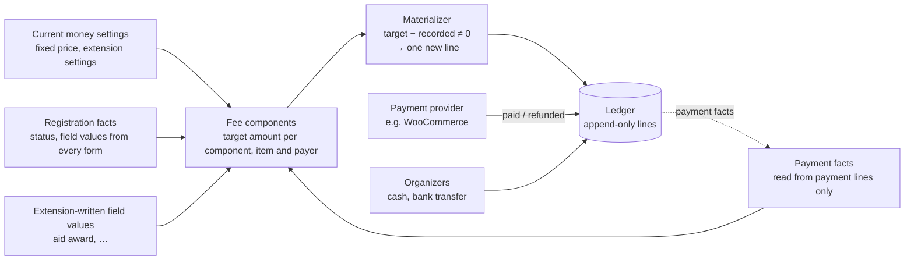
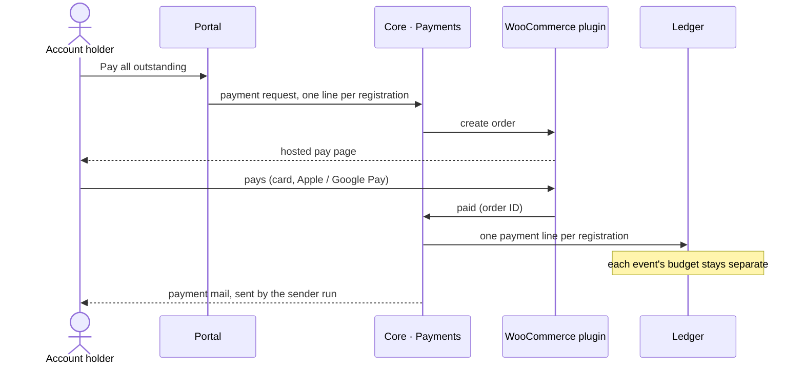

# Money

How a registration's fee is composed, recorded and paid. The short version:
fee components compute what each payer owes from the current settings and
the registration's facts; the materializer writes the difference into an
append-only ledger; payments are ledger lines too; confirmation reads the
targets and the payments.

## Core money scope

- **Core:** a fixed price per registration, full payment, manual charges and
  discounts, an event's extra charges and its donation, retention on leaving,
  and the **payment due** date type. Core ships no money field types.
- **Payment due** is N days after the later of the moment the registration
  last became `registered` (at submit, admission or restore) and its last
  changed answer to a request (a yes or no or an amount; a note alone does not
  move it); N is configured per event (IVK: 7 days). While a request awaits an
  answer it has no due date. There are no absolute payment deadlines.
  **Passing payment due never cancels a registration:** an unconfirmed
  registration stays `registered` until someone withdraws or removes it
  ([Registrations](registrations-and-identity.md#status-capacity-and-waitlist)).
- **Plugins:** deposits, payment tiers (the price ladder, with its tier
  quotas), late fees, financial aid, sponsor or church support, the
  congregation share and the wallet. Core keeps full support for extending it
  in these ways through typed extension points
  ([Modules](modules-and-extensions.md#the-extension-surface)).
- **Every money plugin declares the participant fields it acts on** (the tier
  choice, a charge, an offer, the aid request), as `extension` fields that
  forms join by key ([Fields](events-and-forms.md#fields)). Who sees and may
  pick an item is the form's condition; **the money side holds no condition
  of its own.** An item an open registration has chosen (a tier, an extra
  charge, an offer) cannot be removed from the settings (for extra charges,
  built so with the owner's approval still open).
- **Financial aid is two separate extensions:**
  1. **adjudicated aid** (`kalaka-aid`; the organizations call it a
     scholarship): the participant states what they can pay, staff or a
     partner decide whether and how much to grant through the one "answer a
     request" act, and no payment is asked until decided. A "no" is an award
     of 0. **The award is a participant field of source "extension,"**
     written only by the aid extension's own code, never by a form. It reduces
     only the participant's own part, and is never more than what the
     participant would pay before it;
  2. **sponsor or church support:** offers on an organization directory
     ([Sponsor and church support](#sponsor-and-church-support)).
- **Extra charges and the donation are core,** two fee components at the
  extras stage that the participant pays. An extra charge is a key, a label,
  an amount and a field type (a consent, charged once, or a whole number,
  charged that many times); each declares the participant field with its key,
  and a charge key no field uses charges nobody. Each charge a registration
  owes is its own line. **The donation** is the value of the event's number
  field with the fixed key `adomany`, charged exactly as stored; empty, 0 or
  negative charges nothing, and it has no setting. Support and the
  congregation share never cover either.
- **The price ladder** (`kalaka-price-ladder`) is a fee component at the tier
  stage. A tier is a key, a label, an amount and an optional limit of places,
  in order; **it has no condition and no deadline** (owner ruling 2026-11-19):
  date and congregation guards are the form's conditions on the tier field's
  options. A registration chooses its tier only through the field
  `price_tier`, which every registration form of an event with tiers must
  hold as a required field outside any condition. **The chosen tier applies
  at its current amount and is never swapped for another;** a later change of
  any other answer never re-checks it. A chosen tier no longer in the ladder,
  or no answer at all, is never a base of zero: the use case is refused,
  saying why, so staff set a tier before an admission or a restore. **The ladder sets only the base price;** with a ladder, the
  event's fixed price is never charged.
- **WooCommerce stays the payment engine** for online payment, through our
  own extension plugin ([Payments](#payments)). Without a payment plugin,
  online payment is unavailable, and organizer-recorded payments still work.

**What follows:** a price rule ("cheaper before December", "only for this
church") is a form condition on an option, never a money setting. Removing an
option somebody chose is refused rather than silently re-pricing them.

## Amounts

- **WooCommerce-compatible shapes:** every monetary record carries a currency
  code (ISO 4217). Multi-currency is possible but not built.
- **Stored as `DECIMAL(26,8)`,** like WooCommerce's order tables.
- **Payment requests are rounded up** to the currency's payable unit (whole
  forints for HUF). **Kaláka rounds payment requests itself:** WooCommerce
  has no method for rounding to a payable unit.
- **Below one fillér counts as zero** in every outstanding check: the
  confirmation threshold, "nothing due" and fully paid.
- **Arithmetic uses brick/math, never floats.**
- SQLite stores `DECIMAL` inexactly; that is accepted. Tests that fail on
  SQLite for this reason are fixed in the tests, not by changing the type.

## Ledger

- **One ledger per registration,** so per participant and event. Budgets and
  accounting are separate per event by construction.
- **Every line has a payer.** The default is the participant; extensions
  declare other payer kinds (the congregation share declares
  "congregation"). Each payer has its own balance, and the registration's
  total is the sum of all lines. **A payment or correction is accepted for a
  payer only where its kind applies to the event or it already has lines on
  the registration,** so a payer with lines can always be settled.
- **Sign convention:** a positive amount increases what the payer owes; a
  negative amount decreases it. A balance is the sum of lines; above zero is
  due, below zero is overpaid. No line is exactly zero.
- **Two sides:** every line kind declares one side: owed (charges, manual
  charges and discounts, support, the share pair, retention) or paid (money
  that moved: payments, refunds, corrections). Each payer's owed total, paid
  total and balance come from the lines.
- **Lines are append-only.** Every change is a new, explained line with a
  source reference and an idempotency key. Balances are computed, never
  stored.
- **A ledger line holds no free text and no personal data:** a bank
  reference, a payer's note or a reason lives where erasure can reach it.
  **Ledger lines and decision records survive erasure**
  ([Registrations](registrations-and-identity.md#attribution-and-erasure)).
- **An invoice shows every line that makes up its total, and the lines add
  up.** No component's lines are hidden: support, the share and aid show
  whoever the invoice is issued to, and the invoice marks the part the other
  party pays, from the split per payer.

| Kind | Side | Sign | Written by |
|---|---|---|---|
| `charge`, per fee component and item (the fixed price; each extra charge; each manual charge or discount; plugin components such as support, the share, aid, retention) | owed | ± | the materializer |
| `payment` (online) | paid | − | Payments, from the payment provider's report |
| `refund` (online) | paid | + | Payments, from the payment provider's report |
| `manual_payment` (bank transfer, cash, card terminal; a correction) | paid | − | the "record payment" use case, or "record charge" marked as completed |
| `manual_refund` (money returned by any recorded method; a correction) | paid | + | the "record refund" use case, or "record discount" marked as completed |
| feature lines (the wallet, deferred) | declared by the kind | ± | feature plugins, through an extension point |

**What follows:** nothing about money is ever edited or deleted. A mistake is
a correction, a „Díj” or a „Kedvezmény”; a changed price is a new difference
line. Reports and invoices can always be rebuilt from the lines.

## Recording payments by hand

- **One "record payment" use case** serves the bookkeeper and the
  registration desk. One action records **one registration, one payer and one
  amount**, with the method, the value date and an optional bank reference or
  payer note. It writes one `manual_payment` line.
- **One permission, "record money",** covers recording payments, refunds,
  corrections, manual charges and manual discounts.
- **A manual charge or discount** („Díj”, „Kedvezmény”) is a fact: one
  `registered` registration, one payer, a positive amount and a required
  title the registrant sees; the type gives the sign. A core fee component
  turns each into its own `charge` line, so it counts like any fee: in
  confirmation, retention and the money settings preview. **Marked as
  completed,** the same act also records the payment (for a charge) or the
  refund (for a discount) of the same amount as a second, unlinked entry,
  never a correction.
- **The value date is entered as a day,** stored as 00:00 of that day in the
  site time zone, fixed when recorded. A payment with that value date
  therefore counts as before a deadline that ends at midnight at the end of
  the same day.
- **"Record refund"** writes a `manual_refund` line for money returned by any
  recorded payment method. WooCommerce refunds keep their own path
  ([Refunds](#refunds)).
- **A correction** is a "record payment" or "record refund" row of either
  direction, flagged as a correction (owner ruling 2026-11-19), with an
  optional reason, **no method and no value date**: it counts from the time it
  is recorded. It is a payment fact like any recorded payment, so
  confirmation and balances count it with no special case, but it sends no
  mail. Every recorded movement's note, a correction's reason included, is
  shown to the participant.
- **A short transfer** (e.g. a foreign bank's deduction) is recorded as it
  arrived; the rest stays due until waived with a manual discount.
- **An unnamed transfer** is found through a view (name, code, amount) and
  recorded there. Core has no holding area for unassigned money.
- **Invoicing is by hand.** Kaláka offers views that show the bookkeeper what
  to copy into the invoicing service. Automatic invoicing, if ever, is our own
  integration, not WooCommerce's.

## Confirmation

- **Confirmation is a core decision**
  ([Foundation](foundation.md#facts-decisions-and-computed-values)), defined
  only for `registered` registrations. The evaluation writes its transition
  records; **nobody sets it directly.** It is not a status
  ([Registrations](registrations-and-identity.md#status-capacity-and-waitlist)).
  It is checked once at the end of every pass, after money: a payment, a
  correction, a „Kedvezmény”, an answer, an apply, an admission or a restore
  all lead to the same check.
- **The threshold is a target per payer.** Each payer with something owed
  must reach its own target. In core the target is the full amount; the
  deposit extension is meant to lower it to the deposit (not built yet). A
  payer's target is what the fee composition says it owes now, manual charges
  and discounts included; **nothing is due** when every payer's target is zero
  or below. Confirmation reads payment facts, never charge lines. A request
  that awaits an answer does not block it: payments still count.
- **The manual flag** ("may come without paying") is a fact: set with an
  optional reason, audited, carrying its own set time.
- **Staff's unconfirm** („Visszaigazolás visszavonása”) is the one way to take
  a confirmation back. It is a fact, audited, allowed on any confirmed
  registration. It revokes the manual flag if set and records `unconfirmed`;
  then confirmation is decided again at once, so payments that reach the
  threshold or nothing due confirm it again. Staff are warned before that
  happens.

| Transition | When |
|---|---|
| → confirmed | payments reach the threshold, the manual flag is set, or nothing is due at the moment of the check |
| → unconfirmed | staff unconfirm it; the registration leaves `registered` |

- **Effective time:** the value date of the payment that reached the last
  required target (the paid time for online payments), or the set time of the
  manual flag. A confirmation after staff's unconfirm is never effective
  before it.
- **Once confirmed, it stays confirmed** while the registration stays
  `registered` (owner rulings 2026-11-14 and 2026-11-19): a later charge, a
  refund or a higher threshold changes nothing, a money settings apply
  included. Only staff's unconfirm unconfirms it. A lower threshold can
  confirm more registrations at the next evaluation.
- **No record is the base state:** a `registered` registration with no
  confirmation record is unconfirmed, derived and never written. Other
  statuses have no confirmation state.
- **Withdrawal or removal closes the sequence:** a confirmed registration gets
  an `unconfirmed` record, and the manual flag is revoked in the same
  transaction. A restore or admission writes a new record if the registration
  qualifies; the old one and the flag are never revived.
- **Deposit payment request** (with the deposit extension, not built yet):
  max(0, threshold − payments so far), capped at the remaining balance.
  Waitlisted registrations get none.

**What follows:** "confirmed" means "this person is coming", decided once
and kept; it is not "paid in full now". A view that needs "fully paid" reads
the balance, not confirmation.

## Late fee

An extension decision
([Foundation](foundation.md#facts-decisions-and-computed-values)), for
REFISZ. Not built yet; its place in the evaluation's pass is settled with its
slice ([Deferred](deferred.md)). It looks only at the participant's side.

- **Assessed** when the payment deadline passes and no payment dated before it
  (by value date, or paid time online) brought the participant's side to its
  target, and no manual flag was set before it. The materializer writes the
  charge.
- **Withdrawn** when a payment recorded later turns out to have a value date
  before the deadline, for example a bank transfer entered days later. The
  materializer reverses the charge. There is no grace-period setting.
- **A manual flag set after the deadline** does not remove the fee; admins who
  want to drop it record a manual discount.
- **Charged only on tiers that have it enabled** (a per-tier setting). At
  REFISZ the normal and discounted tiers pay it; higher tiers have paid it in
  advance. It is never charged on staff registrations.

## Quota places

Tier places of the price ladder and support-offer places are seats, under the
one seat rule
([Foundation](foundation.md#facts-decisions-and-computed-values)).

- **Taken** at submit, admission or restore, or when a `registered`
  registration's additional form makes a new choice, under a lock on the tier
  or offer row. Waitlisted registrations hold none, and a submit that lands
  on the waitlist may choose nothing limited.
- **A full one cannot be chosen:** the submit is refused, as for a full set
  option. Staff can still place a registration by hand, warned that the pool
  is full.
- **Released** on withdrawal or removal, and when an answer refuses the offer
  (a partner answers through the same act as staff). A tier or an offer, once
  written, is locked like every money-relevant value, so an additional form
  never changes it away.
- **A restored or admitted registration** keeps what it chose and takes its
  places, over the limit where a pool is full, with the "full" warning.
- **A limit is a setting, never a seat:** it may be given, changed or removed
  at any time, and a limit added later counts the choosers already there.

## Withdrawal, removal and substitution

- **Retention applies per payer:** on withdrawal or removal (treated the
  same), each payer keeps owing what the event's retention rule keeps of that
  payer's own payments, as one retention line per payer. It is never more
  than the payer paid, so **nobody owes more after leaving.** Core offers
  "retain everything paid" (the default) and "retain nothing"; the deposit
  extension is meant to add "retain up to the deposit", which counts against
  the participant first (not built yet). A surplus shows as an overpayment;
  **refunds are never automatic.** The rule is chosen per event in its money
  settings; a restore takes the retention line back.
- **Moving a payment is not handled in code** (a substitute takes someone's
  place): staff record a refund, remove the registration, and record the
  payment on the other. A transfer helper is deferred.
- Money moves between events only through the wallet's carry-over
  ([Deferred](deferred.md)).

## Congregation share

An extension (`kalaka-share`): the registrant's congregation pays part or all
of the **base price** (the chosen tier, or the fixed price without a ladder),
never extras such as lunch or a donation.

- **The ladder sets only the base price;** the share between payers is decided
  by the registrant's answers, never by the tier (owner ruling 2026-11-19). The
  share extension declares two participant fields, `share_mode` (none, shared
  or full) and `share_amount`, which forms join by key; a form may offer any
  subset of the modes, and its conditions decide who sees which. A missing
  answer is none.
- **The share is zero, the amount the registrant declares, or the base
  price.** A fee component writes a zero-sum pair of `share` lines,
  participant −X′ and congregation +X′, where X′ = max(0, min(share, base
  price − support)). Support thus reduces the participant's part first, and
  the congregation's only below zero.
- It is switched on per event in the money settings; on, the congregation
  payer kind applies to the event.
- **The congregation's payments carry the congregation payer,** so its
  overpayment never settles the participant's extras.
- **The congregation's part is always needed for confirmation**
  ([Confirmation](#confirmation)); a manual confirmation covers a late payer.
- **A congregation that declines after registration** has no path of its own:
  staff correct each payer's balance with the ordinary per-payer entries
  (built so; the owner's approval is still open).

**What follows:** because the share is a pair of lines that sums to zero, the
registration's total never changes with the share; only who owes it does.
Tier and share answers are both locked after their first write, so a form
that asks one must ask the other in the same place.

## Sponsor and church support

- **An organization directory** (`kalaka-support`), site-wide: a tree of
  typed nodes whose root is the encompassing body (e.g. denomination → church
  district → deanery → congregation; a body without levels is a root on its
  own). Nodes have an external ID, aliases and an active flag; they are
  imported from CSV, deactivated and never deleted, so a stored answer always
  resolves. No data is shipped.
- **A congregation field type** stores a node ID with a snapshot of its path
  (each node's external ID and type, root first), taken when it is answered. A
  new answer takes a new snapshot; a re-import never changes a stored one. Its
  value for conditions is the path's external IDs, so "<level> is <node>" is
  `contains`, never `equals`; its text is the node's current name. The
  registrant searches for the congregation directly, or goes down from the
  top level by level. **Only a terminal leaf is an answer;** there is no free
  text and no "not in the list". Admins add an "egyéb" leaf by hand where one
  is needed.
- **Conditions, rules, fees, mail and view filters read the answer's stored
  path snapshot;** a view filter on a level matches it in SQL (owner ruling
  2026-11-18), under the same per-event `EXPLAIN` test.
- **Support offers per event on any node,** the root included, several per
  node, are offered to the node and everything below it, and the registrant
  selects them: an amount, whether it needs a request (answered by staff or by
  the body, where a partner approves, through the one "answer a request" act;
  while it awaits an answer, no payment is asked and no due date is shown), and
  an optional limit of places. Who sees an offer, and whether it stacks with
  another, is set up on the form: an offer carries no condition of its own. A
  selected offer takes a place ([Quota places](#quota-places)).
- **Each applying offer is one participant-side line** of the support stage,
  named by the offer's label. An offer applies when it is selected, approved
  where it needs a request, and holds its place.
- **Support is capped at the base price,** all applying offers together, so
  the fee never goes negative and support never pays for extras such as
  lunch.
- **Bodies pay in lump sums after the event,** against a report that groups
  support lines by granting node. It is a view, not a payer, and is separate
  from the congregation share.
- **Requests and answers are core's,** for offers and aid alike: a module's
  request source says what awaits an answer, the one "answer a request" act
  (a grant action, so a partner can hold it on a view of its own
  registrations) records each answer with who, when and an optional note, and
  the source writes its own answer field. Every answering act mails once
  ([Mail](mail.md#five-kinds-of-mail)). "Awaits an answer" is computed, never
  stored, and only a `registered` registration is answered.

## Money settings apply

- **There is no tariff snapshot.** Money is always computed from the event's
  current settings plus the registration's field values and facts. A fee
  component reads its own current settings; a registration admitted from the
  waitlist pays today's price, with a ladder the current amount of the tier
  it chose.
- **Every time-dependent rule counts from the moment the registration last
  became `registered`** (`registered_at`, a personal fact), never from "now"
  and never from the submit. A waitlisted registration is not registered, so
  an admission from the waitlist counts from its admission. A deadline's day
  ends at midnight in the site time zone
  ([Cross-cutting rules](foundation.md#cross-cutting-rules)).
- **Personal facts still recompute automatically:** e.g. a price-ladder
  choice, the aid award, staff status (a field value written by the staff
  form), a passed deadline. Every write is evaluated, so a change
  re-materializes the money.
- **A money-relevant field value is locked after its first write** unless an
  organizer unlocked the field
  ([Changing participant fields after submit](events-and-forms.md#changing-participant-fields-after-submit)).
- **Saving money settings is preview → confirm → apply**
  ([Bulk changes](foundation.md#bulk-changes)), for full access only. Every
  money setting of the event (the fixed price, the retention rule, the extra
  charges and each plugin's settings) is saved this way. **The preview**
  composes every `registered` and `waitlisted` registration with the proposed
  settings and writes nothing, showing what each payer owes now and would
  owe, how many registrations would become confirmed and how many "confirmed"
  mails would go. **The apply** saves the settings, then re-evaluates each of
  them in its own transaction, and the materializer writes the difference. Its
  report lists the failed registrations, with retry and skip; a failed or
  skipped one converges on its next evaluation, since the settings are saved.
  A change of the retention rule reaches the withdrawn and removed
  registrations too.

**What follows:** raising a price raises it for everyone not yet withdrawn,
paid or not, unless the form or the tier separates them; there is no
"grandfathering" except through a separate tier. Confirmation never falls
back because of it.

## Materializer

- **Core composes the fee in a fixed sequence of named stages:** tier →
  support → share → aid → extras. A fee component declares its stage, and core
  composes the stages in order; there are no order numbers. **A component sees
  only the totals of earlier stages,** and computed values they put into its
  facts (such as the applied tier), never stored. This order is why support
  is capped at the base price, the share comes out of what is left after
  support, aid reduces only the participant's part, and nothing before the
  extras ever covers them.
- **Only a `registered` registration composes;** a withdrawn or removed one
  owes only its retention, and a waitlisted one owes nothing.
- **It converges:** it writes only the difference between target and
  recorded, per component, item and payer, so it can run any number of times.
- **Changes caused by an action** are materialized by the evaluation inside
  that action ([Foundation](foundation.md#evaluation)). **Changes caused by
  time passing** (e.g. a late fee) are applied by the periodic run.
- **It reconciles only the fee components registered now,** and leaves lines
  of unknown components untouched, so turning a plugin off never erases its
  lines.
- **Rules never read charge lines,** only payment facts. That avoids a
  feedback loop.
- **A component that cannot say what is owed refuses** with a reason for
  staff (e.g. a chosen tier no longer exists); the act is refused, and the
  periodic run flags the registration "evaluation failed".

## Payments

- **Payments is a port in core.** Core defines what it needs from a payment
  provider: start a payment request for registration lines, each for one
  payer, up to that payer's balance; return the pay URL; replace an open
  request that was never paid (so a registration has at most one unpaid
  request); look up the latest request; and report paid and refunded money
  back. **One provider is used per site.**
- **Payment providers are pluggable,** so more automatic methods (another
  gateway, bank-statement import, …) can be added without changing core. Cash
  and bank transfers are recorded by organizers in core
  ([Recording payments by hand](#recording-payments-by-hand)).
- **Online payment covers the participant's lines only.**
- **A card payment** is started by the registrant from the status block,
  for the amount they enter: at most what is payable now and at least a
  minimum. Payable now is one rule, shared with the bank-transfer block: the
  registration is `registered`, its event is published, no request awaits an
  answer, and the participant's balance is above zero. A start is refused
  while an earlier request is still in flight at the provider, or paid and not
  yet recorded.
- **Recording is idempotent and never gated:** each provider item writes one
  ledger line exactly once, whatever the registration's status, the event's
  state or the balance (a surplus is an overpayment), and a repeated report
  writes nothing. Each recorded payment or refund of the participant sends the
  "payment recorded" mail ([Mail](mail.md#five-kinds-of-mail)).
- **The WooCommerce extension** implements the port:
  - only through WooCommerce's own order API, so both of its order-storage
    modes work; it has no table of its own;
  - one order per request, with one hidden product line per registration
    line, its name and amount set per order, and metadata giving its payer
    and the registration as `12:47K3`
    ([Registrations](registrations-and-identity.md#registrations));
  - WooCommerce's payment and refund events write ledger lines exactly once,
    keyed by order, refund and item; **a periodic reconcile** records what a
    missed event left unrecorded in the last 30 days;
  - **billing details** come from five participant fields the extension
    declares per event (name, country, postcode, city, address); a country is
    a valid ISO code or left out. The customer's IP address and user agent
    are not stored on the order;
  - an event may have a **card surcharge**, a per-event setting of the
    extension: one WooCommerce fee line on the order, never ledger money (a
    payment records only the registration lines, and a refund gives a fee
    line to no registration).
- Wallet top-ups are their own payment requests and never mix with
  registration payments. The wallet is designed later
  ([Deferred](deferred.md)).

**What follows:** the ledger, not WooCommerce, is the truth of what was paid.
WooCommerce can be down, late or wrong without changing a registration's
money until its report arrives, and a second report never doubles a payment.

## Paying several registrations at once

An account holder pays everything outstanding, e.g. two children in two
camps, in one payment. Each event's money still lands in its own ledger. The
port and the WooCommerce order already carry several registrations' lines;
the account's "pay all outstanding" is not built yet.

## Refunds

**A refund made in WooCommerce** arrives through WooCommerce's refund event
and is recorded once per refund and item. A refund that names no item is
split over the order's items in order; a refund of the card surcharge gives
nothing to a registration.

**An admin-started WooCommerce refund** (not built yet):

1. writes a **refund-request record** in state `requested` inside the use
   case's transaction (its uniqueness guards against starting the same refund
   twice);
2. **after commit, in the same request,** sets the record to `in progress`
   just before calling WooCommerce, so the admin sees the result right away;
3. on a **definite failure**, keeps the error on the record, with a retry
   button;
4. on a **timeout or unknown outcome**, leaves the record `in progress` for
   the admin to check in WooCommerce. It is **never retried automatically**,
   which rules out a double refund.

A record left in `requested` (the call never started) gets a retry button.
Steps 2 and 3 each change the record through a use case of their own
([Foundation](foundation.md#the-use-case-runner)). The refund line itself
still arrives through WooCommerce's refund event, exactly once.
