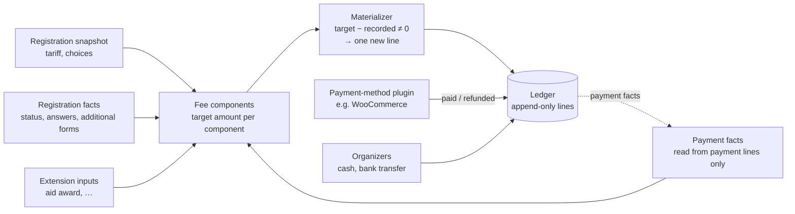
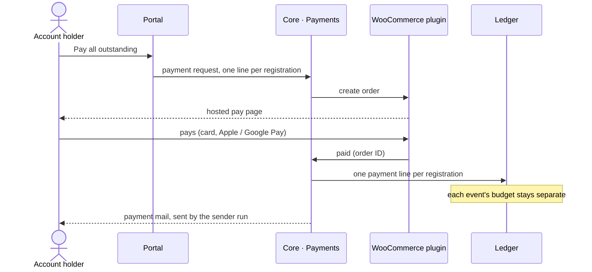

# Money

## Core money scope

- **Core:** a fixed price per registration and full payment, with its
  **payment due** date type. Core ships no money field types.
- **Plugins:** deposits, payment rungs (the price ladder, with its tier
  quotas), late fees, financial aid and sponsor or church support. Core keeps
  full support for extending it in these ways through typed extension points
  ([Modules](modules-and-extensions.md#the-extension-surface)).
- **Financial aid is two separate extensions:**
  1. adjudicated aid: request → decision, payment blocked until decided, a
     self-declared amount;
  2. sponsor or church support: a directory, conditions, contributions.
- Price-ladder tier quotas are separate from the event's waitlist.
- **WooCommerce stays the payment engine,** through our own extension plugin
  ([Payments](#payments)). Without a payment plugin, online payment is
  unavailable, and organizer-recorded payments still work.

## Amounts

- **WooCommerce-compatible shapes:** every monetary record carries a currency
  code (ISO 4217); decimals and rounding follow WooCommerce conventions.
  Multi-currency is possible but not built.
- **Stored as `DECIMAL(26,8)`,** like WooCommerce's order tables.
- **Arithmetic uses brick/math, never floats** (it uses bcmath or GMP when
  present, pure PHP otherwise).
- SQLite stores `DECIMAL` inexactly; that is accepted. Tests that fail on
  SQLite for this reason are fixed in the tests, not by changing the type, and
  no SQLite number formats are normalized.

## Ledger

- **One ledger per registration,** so per participant and event. Budgets and
  accounting are separate per event by construction.
- **Sign convention:** a positive amount increases what the participant owes;
  a negative amount decreases it. Balance = the sum of lines; above zero is
  due, below zero is overpaid.
- **Lines are append-only.** Every change is a new, explained line with a
  source reference and an idempotency key.

| Kind | Sign | Written by |
|---|---|---|
| `charge`, per fee component (the fixed price; plugin components such as a late fee or a staff discount) | ± | the materializer |
| `payment` (online or another automatic method) | − | Payments, from payment-method events |
| `refund` | + | Payments, from payment-method events |
| `manual_payment` (bank transfer, cash) | − | an organizer use case |
| `adjustment` (correction with a reason) | ± | an admin use case |
| feature lines (aid award, sponsor support, wallet, …) | ± | feature plugins, through an extension point |

## Tariff snapshot and re-price

- **Each registration keeps the tariff snapshot** it registered under.
- **Personal facts still recompute automatically:** e.g. a price-ladder
  choice, aid, staff status (a fact from an additional form), a passed
  deadline, quota position.
- **Event configuration edits reach existing registrations only through an
  explicit re-price** action with a preview. It replaces the snapshot, and the
  materializer writes the difference as `charge` lines; `adjustment` lines
  stay for manual corrections with a reason. Saving event settings never
  touches existing registrations.

## Materializer

- **It converges:** it writes only the difference between target and
  recorded, so it can run any number of times, with line idempotency keys.
- **Changes caused by an action** are materialized inside that action's
  transaction. **Changes caused by time passing** (e.g. a late fee) are
  applied by the periodic run, one transaction per registration, under a
  per-registration lock. Opening a registration in the portal or admin also
  re-evaluates it.
- **Rules never read charge lines,** only payment facts. That avoids a
  feedback loop.

## Payments

- **Payments is a port in core.** Core defines what it needs from a payment
  method:
  - create a payment request for N registration lines;
  - return the pay URL;
  - reuse an open request;
  - report paid, refunded and failed.
- **Payment methods are pluggable,** so more automatic methods (another
  gateway, bank-statement import, …) can be added without changing core.
  Cash and bank transfers are recorded by organizers in core.
- **The WooCommerce extension** implements the port:
  - only through WooCommerce's own API, so both of its order-storage modes
    work;
  - one hidden product line per order, with its name and amount set per
    order (coupons keep working);
  - WooCommerce payment and refund events write ledger lines **exactly
    once**, keyed by WooCommerce order and refund IDs;
  - order-line metadata identifies the registration as `12:47K3`
    ([Registrations](registrations-and-identity.md#registrations)).
- The coupon-covered part of an order needs its own wallet ledger line; that
  is settled with the wallet design ([Deferred](deferred.md)).

## Paying several registrations at once

An account holder pays everything outstanding, e.g. two children in two
camps, in one payment. Each event's money still lands in its own ledger.

## Refunds

An admin-started WooCommerce refund:

1. writes a **refund-request record** inside the use case's transaction (its
   uniqueness guards against starting the same refund twice);
2. calls WooCommerce **after commit, in the same request,** so the admin sees
   the result right away;
3. on a **definite failure**, keeps the status and error on the record, with a
   retry button;
4. on a **timeout or unknown outcome**, leaves the record "in progress" for
   the admin to check in WooCommerce. It is **never retried automatically**,
   which rules out a double refund.

The refund line itself arrives through WooCommerce's refund event, exactly
once.
