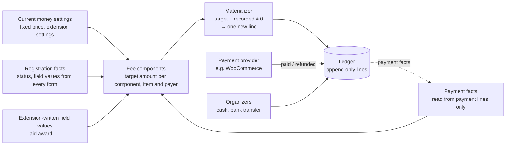
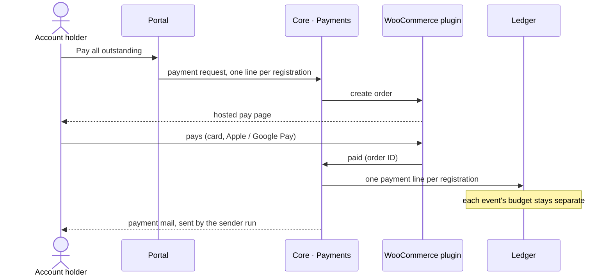

# Money

How a registration's fee is composed, recorded and paid, in short: fee
components compute what each payer owes from the current settings and the
registration's facts; the materializer writes the difference into an
append-only ledger; payments are ledger lines too; confirmation reads the
targets and the payments.

## Core money scope

- **Core:** a fixed price per registration, full payment, manual charges and
  discounts, an event's extra charges and its donation, retention on leaving,
  and the **payment due** date type. Core ships no money field types.
- **Payment due** is N days (per event; IVK: 7) after the later of the moment
  the registration last became `registered` (submit, admission or restore) and
  its last changed answer to a request (a note alone does not move it). While a
  request awaits an answer there is no due date. There are no absolute payment
  deadlines. **Passing payment due never cancels a registration:** it stays
  `registered` until someone withdraws or removes it
  ([Registrations](registrations-and-identity.md#status-capacity-and-waitlist)).
- **Plugins:** deposits, the price ladder with its tier quotas, late fees,
  financial aid, sponsor or church support, the congregation share and the
  wallet, through typed extension points
  ([Modules](modules-and-extensions.md#the-extension-surface)).
- **Every money plugin declares the participant fields it acts on** (the tier
  choice, a charge, an offer, the aid request) as `extension` fields that forms
  join by key ([Fields](events-and-forms.md#fields)). **Who sees and may pick an
  item is the form's condition; the money side holds no condition of its
  own.** An item an open registration chose (a tier, an extra charge, an offer)
  cannot be removed from the settings (for extra charges, built so with the
  owner's approval still open).
- **Financial aid is two separate extensions:**
  1. **adjudicated aid** (`kalaka-aid`; the organizations call it a
     scholarship): the participant states what they can pay; staff or a partner
     decide whether and how much to grant through the one "answer a request"
     act, and no payment is asked until decided. A "no" is an award of 0. **The
     award is a participant field of source "extension,"** written only by the
     aid extension's code. It reduces only the participant's own part, never by
     more than what the participant would pay before it. [UNAPPROVED R395]
  2. **sponsor or church support:** offers on an organization directory
     ([Sponsor and church support](#sponsor-and-church-support)).
- **Extra charges and the donation are core,** two fee components of the extras
  stage that the participant pays. An extra charge is a key, a label, an amount
  and a field type: a consent (charged once) or a whole number (charged that
  many times); each declares the field with its key, and a key no field uses
  charges nobody. Each charge owed is its own line. **The donation** is the
  value of the event's number field with the fixed key `adomany`, charged
  exactly as stored; empty, 0 or negative charges nothing. Support and the
  congregation share never cover either.
- **The price ladder** (`kalaka-price-ladder`) is a fee component of the tier
  stage. A tier is a key, a label, an amount and an optional limit of places, in
  order, with **no condition and no deadline** (owner ruling 2026-11-19): date
  and congregation guards are the form's conditions on the tier field's options.
  A registration chooses only through `price_tier`, which every registration
  form of an event with tiers must hold, required and outside any condition.
  **The chosen tier applies at its current amount and is never swapped;** no
  other answer re-checks it. A tier no longer in the ladder, or no answer, is
  never a base of zero: the act is refused, saying why, so staff set a tier
  before an admission or restore. **The ladder sets only the base price;** with
  a ladder, the fixed price is never charged.
- **WooCommerce stays the payment engine** for online payment, through our own
  extension ([Payments](#payments)). Without a payment plugin, online payment is
  unavailable and organizer-recorded payments still work.

**What follows:** a price rule ("cheaper before December", "only for this
church") is a form condition on an option, never a money setting, and removing
an option somebody chose is refused rather than silently re-pricing them.

## Amounts

- **Every monetary record carries a currency code** (ISO 4217), in
  WooCommerce-compatible shapes. Multi-currency is possible but not built.
- **Stored as `DECIMAL(26,8)`,** like WooCommerce's order tables; **brick/math
  arithmetic, never floats.**
- **Payment requests are rounded up** to the payable unit (whole forints for
  HUF), by Kaláka itself: WooCommerce has no rounding to a payable unit.
- **Below one fillér counts as zero** in every outstanding check: the
  confirmation threshold, "nothing due" and fully paid.
- SQLite stores `DECIMAL` inexactly; that is accepted, and tests that fail on
  SQLite for it are fixed in the tests.

## Ledger

- **One ledger per registration,** so budgets and accounting are separate per
  event by construction.
- **Every line has a payer.** The default is the participant; extensions
  declare other payer kinds (the share's "congregation"). Each payer has its own
  balance; the registration's total is the sum of all lines. A payment, refund
  or correction is accepted for a payer whose kind applies to the event or that
  already has lines (built so; the owner's approval is still open).
- **Sign:** positive increases what the payer owes, negative decreases it; a
  balance above zero is due, below zero overpaid. No line is exactly zero.
- **Two sides:** each line kind is owed (charges of every component, manual
  charges and discounts) or paid (payments, refunds, corrections). Each payer's
  owed, paid and balance come from the lines and are never stored.
- **Lines are append-only:** every change is a new, explained line with a
  source reference and an idempotency key.
- **A line holds no free text and no personal data** (a bank reference, note or
  reason lives where erasure can reach it), and **lines and decision records
  survive erasure** ([Registrations](registrations-and-identity.md#attribution-and-erasure)).
- **An invoice shows every line of its total, and the lines add up.** Support,
  the share and aid show whoever is invoiced; the invoice marks the part another
  payer pays.

| Kind | Side | Sign | Written by |
|---|---|---|---|
| `charge`, per fee component and item (the fixed price, each extra charge, each manual charge or discount, plugin components such as support, the share, aid, retention) | owed | ± | the materializer |
| `payment` (online) | paid | − | Payments, from the provider's report |
| `refund` (online) | paid | + | Payments, from the provider's report |
| `manual_payment` (bank transfer, cash, card terminal; a correction) | paid | − | "record payment", or "record charge" marked as completed |
| `manual_refund` (money returned by any recorded method; a correction) | paid | + | "record refund", or "record discount" marked as completed |
| feature lines (the wallet, deferred) | declared by the kind | ± | feature plugins, through an extension point |

**What follows:** money is never edited or deleted; a mistake is a correction,
a „Díj” or a „Kedvezmény”, and a changed price is a new difference line, so
reports and invoices can always be rebuilt from the lines.

## Recording payments by hand

- **One "record payment" use case** serves the bookkeeper and the desk: **one
  registration, one payer, one amount,** with the method, the value date and an
  optional bank reference or payer note; one `manual_payment` line.
- **One permission, "record money",** covers payments, refunds, corrections,
  manual charges and discounts.
- **A manual charge or discount** („Díj”, „Kedvezmény”) is a fact: one
  `registered` registration, one payer, a positive amount and a required title
  the registrant sees; the type gives the sign. A core fee component turns each
  into its own `charge` line, so it counts like any fee. **Marked as
  completed,** the same act records the payment (for a charge) or refund (for a
  discount) of the same amount as a second, unlinked entry, never a correction.
- **The value date is entered as a day,** stored as 00:00 of it in the site time
  zone, so it counts as before a deadline ending at midnight that day.
- **"Record refund"** is for money returned by any recorded method; WooCommerce
  refunds keep their own path ([Refunds](#refunds)).
- **A correction** is a payment or refund row of either direction flagged as a
  correction (owner ruling 2026-11-19), with an optional reason, **no method
  and no value date** (it counts from when it is recorded). It is a payment fact
  like any other, but sends no mail. Every movement's note, a correction's
  reason included, is shown to the participant.
- **A short transfer** is recorded as it arrived; the rest stays due until
  waived with a „Kedvezmény”. **An unnamed transfer** is found through a view
  (name, code, amount); core has no holding area for unassigned money.
- **Invoicing is by hand,** from views that show the bookkeeper what to copy.
  Automatic invoicing, if ever, is our own integration, not WooCommerce's.

## Confirmation

- **Confirmation is a core decision**
  ([Foundation](foundation.md#facts-decisions-and-computed-values)), for
  `registered` registrations only. The evaluation writes its records; **nobody
  sets it directly;** it is not a status. It is checked once after money in
  every pass, whatever caused it.
- **The threshold is a target per payer:** each payer with something owed must
  reach its own. In core it is the full amount; the deposit extension is meant
  to lower it (not built yet). A target is what the composition says the payer
  owes now, manual charges and discounts included; **nothing is due** when
  every target is zero or below. Confirmation reads payment facts, never charge
  lines; a request awaiting an answer does not block it.
- **The manual flag** ("may come without paying") is a fact, with an optional
  reason and its own set time.
- **Staff's unconfirm** („Visszaigazolás visszavonása”) is the one way to take a
  confirmation back: a fact, allowed on any confirmed registration. It revokes
  the manual flag and records `unconfirmed`; confirmation is decided again at
  once, so payments that reach the threshold or nothing due confirm it again.
  Staff are warned before that happens.

| Transition | When |
|---|---|
| → confirmed | payments reach the threshold, the manual flag is set, or nothing is due at the moment of the check |
| → unconfirmed | staff unconfirm it; the registration leaves `registered` |

- **Effective time:** the value date of the payment that reached the last
  target (the paid time online), or the flag's set time; never before a
  preceding unconfirm.
- **Once confirmed, it stays confirmed** while `registered` (owner rulings
  2026-11-14 and 2026-11-19): a later charge, a refund or a higher threshold
  changes nothing, an apply included; only staff's unconfirm unconfirms it. A
  lower threshold can confirm more registrations at the next evaluation.
- **No record is the base state:** a `registered` registration without one is
  unconfirmed, never written. Other statuses have no confirmation state.
- **Leaving closes the sequence:** a confirmed registration gets an
  `unconfirmed` record and loses its manual flag. A restore or admission writes
  a new record if it qualifies; the old one and the flag are never revived.
- **Deposit payment request** (with the deposit extension, not built yet):
  max(0, threshold − payments so far), capped at the remaining balance; none for
  waitlisted registrations.

**What follows:** "confirmed" means "this person is coming", decided once and
kept, not "paid in full now".

## Late fee

An extension decision for REFISZ
([Foundation](foundation.md#facts-decisions-and-computed-values)), not built
yet; its place in the pass is settled with its slice ([Deferred](deferred.md)).
It looks only at the participant's side.

- **Assessed** when the payment deadline passes and no payment dated before it
  (value date, or paid time online) brought the participant to the target, and
  no manual flag was set before it. The materializer writes the charge.
- **Withdrawn** when a payment recorded later has a value date before the
  deadline (a transfer entered days later); the materializer reverses it. No
  grace period.
- **A manual flag set after the deadline** does not remove it; admins record a
  „Kedvezmény” instead.
- **Only on tiers that have it enabled** (at REFISZ the normal and discounted
  tiers; higher tiers paid it in advance), and never on staff registrations.

## Quota places

Tier places and support-offer places are seats under the one seat rule
([Foundation](foundation.md#facts-decisions-and-computed-values)).

- **Taken** at submit, admission or restore, or by a `registered`
  registration's additional form, under a lock on the tier or offer row.
  Waitlisted registrations hold none, and a submit that lands on the waitlist
  may choose nothing limited.
- **A full one cannot be chosen:** the submit is refused. Staff can still place
  a registration by hand, warned that the pool is full.
- **Released** on withdrawal or removal, and when an answer refuses the offer. A
  tier or offer, once written, is locked like every money-relevant value.
- **A restored or admitted registration** keeps its choice and takes its places,
  over the limit with the "full" warning where needed.
- **A limit is a setting, never a seat:** it may be set, changed or removed at
  any time, and counts the choosers already there.

## Withdrawal, removal and substitution

- **Retention applies per payer:** on withdrawal or removal (the same), each
  payer keeps owing what the event's retention rule keeps of its own payments,
  as one retention line, **never more than it paid,** so nobody owes more after
  leaving. Core offers "retain everything paid" (the default) and "retain
  nothing"; the deposit extension is meant to add "retain up to the deposit",
  counted against the participant first (not built yet). A surplus is an
  overpayment; **refunds are never automatic.** A restore takes the line back.
- **Moving a payment is not handled in code** (a substitute takes someone's
  place): staff record a refund, remove the registration and record the payment
  on the other. A transfer helper is deferred.
- Money moves between events only through the wallet's carry-over
  ([Deferred](deferred.md)).

## Congregation share

An extension (`kalaka-share`): the registrant's congregation pays part or all of
the **base price** (the chosen tier, or the fixed price without a ladder), never
extras such as lunch or a donation.

- **The ladder sets only the base price;** the split between payers is decided
  by the registrant's answers, never by the tier (owner ruling 2026-11-19). The
  extension declares `share_mode` (none, shared or full) and `share_amount`,
  which forms join by key, offering any subset of the modes under their own
  conditions. A missing answer is none.
- **The share is zero, the declared amount, or the base price;** a fee component
  writes a zero-sum pair of `share` lines, participant −X′ and congregation +X′,
  with X′ = max(0, min(share, base price − support)). Support thus reduces the
  participant's part first, the congregation's only below zero.
- It is switched on per event in the money settings, which makes the
  congregation payer apply.
- **The congregation's payments carry its payer,** so its overpayment never
  settles the participant's extras; **its part is always needed for
  confirmation** ([Confirmation](#confirmation)), and a manual confirmation
  covers a late payer.
- **A congregation that declines after registration** has no path of its own:
  staff correct each payer's balance with the ordinary entries (built so; the
  owner's approval is still open).

**What follows:** the pair sums to zero, so the share never changes a
registration's total, only who owes it.

## Sponsor and church support

- **An organization directory** (`kalaka-support`), site-wide: a tree of typed
  nodes whose root is the encompassing body (e.g. denomination → district →
  deanery → congregation; a body without levels is a root alone), with external
  IDs, aliases and an active flag, imported from CSV, deactivated and **never
  deleted,** so a stored answer always resolves. No data is shipped.
- **A congregation field** stores a node with a snapshot of its path (each
  node's external ID and type, root first), taken when answered; a re-import
  never changes it. For conditions its value is the path, so "<level> is
  <node>" is `contains`, never `equals`; its text is the node's current name. The
  registrant searches directly or walks down level by level. **Only a terminal
  leaf is an answer:** no free text, no "not in the list"; admins add an "egyéb"
  leaf where needed.
- **Conditions, rules, fees, mail and view filters read the stored snapshot;**
  a view filter on a level matches it in SQL (owner ruling 2026-11-18), under the
  per-event `EXPLAIN` test.
- **Support offers per event on any node,** the root included, several per node,
  are offered to the node and everything below it, and the registrant selects
  them: an amount, whether it needs a request (answered by staff, or by the body
  where a partner approves, through the one "answer a request" act; while it
  waits, no payment is asked and no due date shown), and an optional limit of
  places. Who sees an offer, and whether it stacks, is set up on the form. A
  selected offer with a limit takes a place ([Quota places](#quota-places)).
- **Each applying offer is one participant-side line** of the support stage,
  named by the offer's label; an offer applies when selected, approved where it
  needs a request, and, if limited, holding its place. [UNAPPROVED R389]
- **Support is capped at the base price,** all offers together, so the fee never
  goes negative and support never pays for extras.
- **Bodies pay in lump sums after the event,** against a report grouping support
  lines by granting node: a view, not a payer, separate from the share.
- **Requests and answers are core's,** for offers and aid alike. A module's
  request source says what awaits an answer; the one "answer a request" act (a
  grant action, so a partner can hold it on a view of its own registrations)
  records each answer with who, when and an optional note, and the source writes
  its own answer field. Every answering act mails once
  ([Mail](mail.md#five-kinds-of-mail)). "Awaits an answer" is computed, never
  stored, and only a `registered` registration is answered.

## Money settings apply

- **There is no tariff snapshot.** Money is always computed from the event's
  current settings plus the registration's values and facts; a registration
  admitted from the waitlist pays today's price (with a ladder, its tier's
  current amount).
- **Every time-dependent rule counts from when the registration last became
  `registered`** (`registered_at`), never from "now" or the submit, so an
  admission counts from the admission. A deadline's day ends at midnight in the
  site time zone ([Cross-cutting rules](foundation.md#cross-cutting-rules)).
- **Personal facts recompute automatically** (a tier choice, the aid award,
  staff status, a passed deadline): every write is evaluated and re-materialized.
  **A money-relevant value is locked after its first write** unless unlocked
  ([Changing participant fields after submit](events-and-forms.md#changing-participant-fields-after-submit)).
- **Saving money settings is preview → confirm → apply**
  ([Bulk changes](foundation.md#bulk-changes)), full access only, for every money
  setting (the fixed price, retention, extra charges, each plugin's). **The
  preview** composes every `registered` and `waitlisted` registration with the
  proposed settings and writes nothing: what each payer owes now and would owe,
  how many would become confirmed and how many "confirmed" mails would go. **The
  apply** saves, then re-evaluates each registration in its own transaction; its
  report lists failures with retry and skip, and a skipped one converges on its
  next evaluation. A retention change reaches withdrawn and removed ones too.

**What follows:** raising a price raises it for everyone not withdrawn, paid or
not, unless the form or the tier separates them; there is no grandfathering
except through a separate tier, and confirmation never falls back because of
it.

## Materializer

- **Core composes the fee in fixed, named stages:** tier → support → share →
  aid → extras. A component declares its stage; there are no order numbers. **A
  component sees only earlier stages' totals** and the computed values they add
  (such as the applied tier), never stored. This order is why support is capped
  at the base price, the share comes out of what is left after support, aid
  reduces only the participant's part, and nothing covers the extras.
- **Only a `registered` registration composes;** a withdrawn or removed one owes
  only its retention, a waitlisted one nothing.
- **It converges:** only the difference between target and recorded, per
  component, item and payer, so it can run any number of times.
- **An act's changes** are materialized inside the act
  ([Foundation](foundation.md#evaluation)); **time's changes** (a late fee) by
  the periodic run.
- **It reconciles only the components registered now,** leaving unknown
  components' lines untouched, so turning a plugin off never erases its lines.
- **Rules never read charge lines,** only payment facts, which avoids a
  feedback loop.
- **A component that cannot say what is owed refuses** with a reason for staff;
  the act is refused, and the periodic run flags the registration "evaluation
  failed".

## Payments

- **Payments is a port in core.** A payment provider starts a request for
  registration lines, each for one payer, up to its balance; returns the pay
  URL; replaces a never-paid open request (so a registration has at most one
  unpaid request); reports its latest request; and reports paid and refunded
  money back. **One provider per site.** More automatic methods (another
  gateway, bank-statement import) need no change in core; cash and transfers
  are recorded by organizers ([Recording payments by hand](#recording-payments-by-hand)).
- **Online payment covers the participant's lines only.**
- **A card payment** is started by the registrant from the status block for the
  amount they enter, at most what is payable now and at least a minimum.
  **Payable now** is one rule, shared with the bank-transfer block: `registered`,
  the event published, no request awaiting, and a balance above zero. A start is
  refused while an earlier request is in flight or paid and not yet recorded.
  [UNAPPROVED R396]
- **Recording is idempotent and never gated:** each provider item writes one
  line exactly once, whatever the status, the event's state or the balance (a
  surplus is an overpayment). Each recorded payment or refund of the participant
  sends the "payment recorded" mail ([Mail](mail.md#five-kinds-of-mail)).
- **The WooCommerce extension** implements the port only through WooCommerce's
  order API (both storage modes work) and has no table: one order per request,
  one hidden product line per registration line with its payer and the
  registration as `12:47K3` ([Registrations](registrations-and-identity.md#registrations));
  payment and refund events recorded once, with a periodic reconcile for missed
  ones; billing details from five participant fields it declares per event
  (a country is a valid ISO code or left out); no customer IP or user agent on
  the order; and an optional per-event **card surcharge**, a WooCommerce fee
  line that is never ledger money.
- Wallet top-ups are their own requests and never mix with registration
  payments ([Deferred](deferred.md)).

**What follows:** the ledger, not WooCommerce, is the truth of what was paid; a
late or repeated report never doubles a payment.

## Paying several registrations at once

An account holder pays everything outstanding, e.g. two children in two camps,
in one payment, and each event's money still lands in its own ledger. The port
and the WooCommerce order already carry several registrations' lines; the
account's "pay all outstanding" is not built yet.

## Refunds

**A refund made in WooCommerce** arrives through its refund event and is
recorded once per refund and item; one that names no item is split over the
order's items in order, and a refunded surcharge gives nothing to a
registration.

**An admin-started WooCommerce refund** (not built yet):

1. writes a **refund-request record** `requested` inside the use case (its
   uniqueness guards against starting the same refund twice);
2. **after commit, in the same request,** sets it `in progress` just before
   calling WooCommerce, so the admin sees the result at once;
3. on a **definite failure**, keeps the error on the record, with a retry
   button;
4. on a **timeout or unknown outcome**, leaves it `in progress` for the admin to
   check in WooCommerce, **never retried automatically,** which rules out a
   double refund.

A record left `requested` gets a retry button. Steps 2 and 3 each change the
record through a use case of their own
([Foundation](foundation.md#the-use-case-runner)). The refund line still arrives
through WooCommerce's refund event, exactly once.
