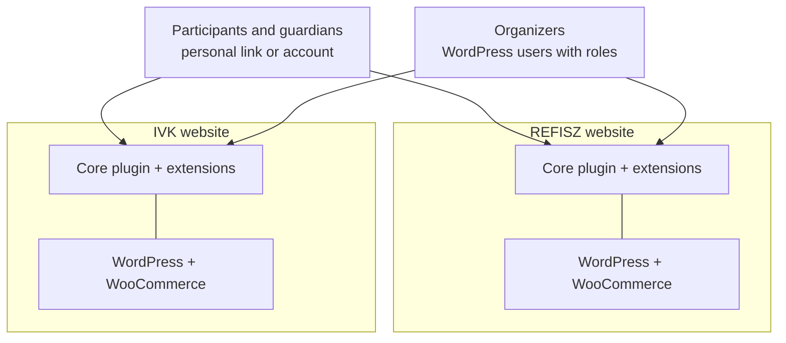

# Overview and principles

These pages are the authoritative record of how Kaláka is built. A change to
the architecture is a pull request that edits them; the owner's merge is the
approval. Git history keeps the earlier sequential decision log.

An architecture pull request that adds, renames or removes a section updates
the topic map in the root [`AGENTS.md`](../../AGENTS.md) in the same pull
request.

| Page | Contents |
|---|---|
| [Overview and principles](overview.md) | Purpose, organizations, fixed inputs, guiding principles, the big decisions |
| [Foundation](foundation.md) | Layers, views and grants, the use-case runner, errors, entities, audit, deferred work and evaluation, facts, decisions and computed values, cross-cutting rules |
| [Modules and extensions](modules-and-extensions.md) | Packaging, core modules, assignment sets, extensions in view, schema ownership, identifiers, the extension surface |
| [Events and forms](events-and-forms.md) | Event lifecycle, dates, the registration slot, prefill, form links, fields, conditions |
| [Registrations and identity](registrations-and-identity.md) | Accounts and presets, submissions and drafts, status and waitlist, reference codes, access, attribution |
| [Money](money.md) | Ledger and payers, recording payments, confirmation, withdrawal, congregation share, sponsor and church support, money settings apply, materializer, payments, refunds |
| [Mail](mail.md) | Kinds of mail, deliveries, the sender, configuration, content |
| [Engineering](engineering.md) | Platform, repository layout, tooling, code style, tests and CI |
| [Release plan](release-plan.md) | What each release contains |
| [Deferred](deferred.md) | What is decided later, and when |

## How to read these pages

Each page is an overview of how the system works now and why. A section
states the design, the rules that bind it, the reason for each rule, and what
a change would touch. Step-by-step mechanics, class names and the full lists
of edge cases live in the code and in each module's `AGENTS.md`, which name
the sections they implement.

- **A rule stated here is binding,** whether or not the code has reached it
  yet. Where a page and the code disagree, the owner decides which is right
  ([`AGENTS.md`](../../AGENTS.md)).
- **"Not built yet"** marks a rule that is decided but has no code on `main`.
  It stays here because this page is its only record.

## Purpose

Kaláka is event and camp registration for WordPress. It replaces a setup of
several Google spreadsheets, Forms and Apps Script projects used today by two
organizations: **REFISZ** and **Ifjúságépítők (IVK**, ifjusagepitok.com). In
that setup the parallel K/FF column blocks were a data-entry workaround; in
Kaláka events are created dynamically.

**Build, don't buy:** no existing product met at least 3 of 7 hard criteria.
The architecture was planned from first principles; earlier exploratory
analyses serve only as background.

## Fixed inputs

- **Scale:** 500–2,000 registrations per season, kept for many years. Measured
  in 2026: about 200 per organization and season. Target hosting is low-end
  shared hosting: good to 500 registrants, functional to 1,000. This is why
  there is no job queue, no per-request heavy work and a strict per-event
  query cost.
- **Organizations are completely separate.** Two organizations from day one,
  more possible later. One organization-agnostic codebase, one WordPress
  install per organization; no shared people or data, only the plugin code.
  Both deployments must work at the same time, and deployment should be
  automated.
- **The event is the top-level unit.** There is no grouping layer above
  events; seasons are grouped by dates, labels and filters.
- **WordPress + WooCommerce.** Payments already run online through
  WooCommerce (today Stripe via WooPayments on store.refisz.hu); WooCommerce
  stays the payment engine. The goal is smoother payment, not a replacement.
- **Admins are a team with distinct roles,** so permissions are role-based.
- **Platform minimums:** WordPress 7.0, PHP 8.3, MariaDB 10.3 (details in
  [Engineering](engineering.md#platform)).

## Guiding principles

1. **Layered, with strict separations between core and features,** so parts
   can later be published one by one as open source, which is the eventual
   intention.
2. **Lean on WordPress core as much as possible:** its reactive UI, REST API,
   permissions, block editor, Interactivity API, abilities, Site Health,
   privacy tools and `WP_Error`. The plugin need not be portable, so domain
   code may use WordPress wherever that makes sense.
3. **No paywalled key features and no bending around a form plugin.** Forms
   are our own implementation on WordPress's building blocks.
4. **Today's behavior is the default reference.** There is no blanket
   "reproduce the old system first" rule: every deviation is decided
   explicitly and recorded in these pages.
5. **Use cases before systems.** A mechanism is designed from the concrete
   needs it must serve, as the smallest thing that covers them, with no two
   ways to do the same thing.
6. **Per-event cost does not grow with the number of events.** Listing,
   sorting and searching one event's registrations depends only on that
   event's registrations ([Foundation](foundation.md#entities-repositories-and-queries)).
7. **Never build for SQLite.** MariaDB is the target. SQLite (WordPress
   Playground) gets no design attention and no adaptive code; where it
   differs, it is not supported, and we may simply avoid depending on things
   it lacks when that costs nothing.
8. **Hungarian only.** The UI is Hungarian, written directly in the code with
   no translation layer. The one exception: a plugin's declared field names
   and labels may be overridden in that plugin's own settings, kept in its one
   names option ([Foundation](foundation.md#cross-cutting-rules)).
   Internationalization is far off and can be added later. Code identifiers
   and comments are in English.
9. **Nothing reaches the UI unapproved.** UI text and behavior are approved by
   the owner when the UI is built ([Deferred](deferred.md#ui-text-approved-when-built)).

## The big decisions

A few choices shape almost everything else. Each is explained on its page;
this list is where to start when a change seems to need one of them bent.

| Decision | What follows from it |
|---|---|
| **Every write is a use case** run by one runner: one transaction, the audit entry inside it ([Foundation](foundation.md#the-use-case-runner)) | No code writes a table directly; anything a person or the system does is audited, refused as a whole or done as a whole |
| **Access to data is a view; holding it is a grant** ([Foundation](foundation.md#views-and-grants)) | Admin screens never read registrations around the view query; a new admin feature is a column, a filter or a grant action, never its own permission check |
| **Facts, decisions and computed values** are separate kinds of state ([Foundation](foundation.md#facts-decisions-and-computed-values)) | Nobody sets a decision; nothing stores what can be computed; a view filters only on what is stored |
| **No person records;** a registration is the identity ([Registrations](registrations-and-identity.md#identity-no-person-records)) | Two events are two registrations with their own data and money; accounts only own registrations |
| **Participant fields belong to the event, and forms ask for them** ([Fields](events-and-forms.md#fields)) | Mails, views, conditions and money read fields by key, whatever form wrote them; a form can never quietly create a second copy of a field |
| **One condition format and one evaluator** decide everything that is shown or offered ([Conditions](events-and-forms.md#conditions)) | Price tiers, offers, charges and set options carry no conditions of their own; who sees what is set up on the form, and the server re-checks it at submit |
| **One seat rule** for every limited pool ([Foundation](foundation.md#facts-decisions-and-computed-values)) | A seat is taken only inside a registration's own act and never moves by itself; only the registrant's own submit is refused by a full pool |
| **No tariff snapshot:** money is always computed from the current settings ([Money](money.md#money-settings-apply)) | Changing a price is a preview and an apply that reaches every open registration; the ledger records only differences |
| **An append-only ledger per registration, with payers** ([Money](money.md#ledger)) | Money is never edited, only corrected by new lines; each payer's balance and confirmation are separate |
| **No job queue;** each kind of deferred work gets the guarantee it needs ([Foundation](foundation.md#deferred-work)) | Mail is queued as deliveries and sent by one sender; time-based work waits for the 5-minute periodic run |
| **Any load failure closes every event** ([Modules](modules-and-extensions.md#failure-isolation)) | A missing extension or a failed upgrade never runs half a site; there is no per-event dependency analysis |

## Context

