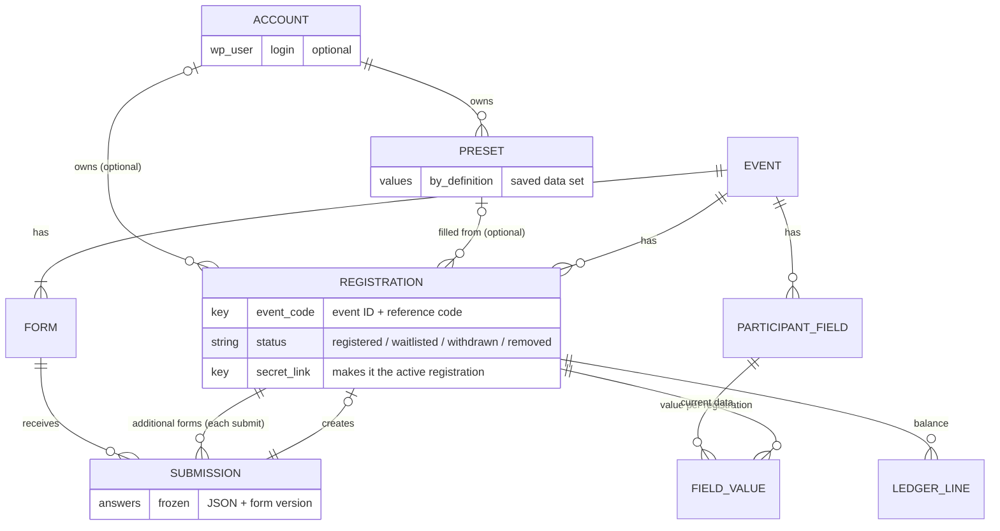

# Registrations and identity

## Registrations

- **A registration is one participant for one event.** Attending two events
  (e.g. both REFISZ camps) means registering twice; the registrations are
  fully separate: own reference code, status, secret link and ledger.
- **A registration's only identity is (event ID, reference code).** There is
  no numeric registration ID. Every per-event table refers to a registration
  by that pair, and **neither part ever changes**. Because InnoDB stores rows
  in primary-key order, each event's registrations sit together on disk.
- Records without a reference code, such as events and presets, keep a normal
  numeric primary key. Where something must point at records of any type, it
  uses record type, event ID and key (as audit subjects do,
  [Foundation](foundation.md#audit)). WooCommerce order-line metadata stores
  the composed form `12:47K3`, composed and parsed only in the payments code.

**What follows:** nothing may ever renumber or re-code a registration, and a
registration cannot move to another event; "moving" someone is a new
registration plus a withdrawal.

## Identity: no person records

- **Registration-centric identity.** Each registration holds its own personal
  data; the same real person's data may differ between events. Year-to-year
  tracking is a later, heuristic add-on built from preset links: the system is
  not an outreach CRM.
- **Registration does not require a WordPress account,** unless the event's
  account mode is mandatory
  ([below](#accounts-on-the-registration-form)). Without one, a personal
  secret link makes the registration active and shows its status, including
  its payment status. Guest registration is deliberately semi-anonymous;
  guests are never matched, and organizers get no manual linking tool.
- **An account is an extra layer** that **owns** registrations and
  **presets**. It can hold registrations for several people (a guardian, a
  youth leader registering a group), for several events; it sees all
  outstanding balances together and can **pay them at once**
  ([Money](money.md#paying-several-registrations-at-once)). The owner is set
  once, by the submit of a logged-in person, and nothing changes or clears
  it.
- **A guest can attach a registration to an account** through its secret
  link, with the same side effects as registering with a new account (e.g.
  creating a preset). Not built yet.
- **Default flows are seamless:** guest registration where the event's account
  mode allows it, and registration with an account created on WordPress's
  registration page, opened from the form. Flows with several registrations
  under one account may ask more of the user, with short explanations.

**What follows:** there is no "person" to merge, deduplicate or look up.
Anything that seems to need one (history across years, a family view) is
built on accounts and presets, or not at all.

## Accounts on the registration form

- **Each event has one account mode:** mandatory, optional or off, for all its
  registration forms. In mandatory and optional mode the whole form shows to
  everyone, with an account block
  ([Forms implementation](events-and-forms.md#forms-implementation)) whose
  button opens WordPress's own login page in a window of its own, linked to
  its registration page. Logging in or signing up there returns to the form
  in place, keeping what was typed; so does logging in after the password is
  set through the registration mail's link. Logging in is WordPress's own,
  and any WordPress user counts. In mandatory mode the form cannot be sent
  without an account. In optional mode sending without logging in lands the
  registration with no account, as a guest's. Off is the form without
  accounts. Additional forms never ask anyone to sign up.
- In optional mode the account block says signing up is for people aged 16
  or over (Hungary's age of digital consent), and that younger people
  continue without an account. Nobody's age is checked.
- **Kaláka never asks for or handles a password.** Signing up creates the
  account and logs it in at once. It is verified when its password is set
  through WordPress's own link, which travels in the registration's mail
  ([Mail](mail.md#configuration)); until then it is marked unverified, which
  limits only what Kaláka does with it.
- **The registration does not wait for the account's verification:** it lands
  at submit, takes its place in capacity and gets its reference code before
  the set-password link is used.
- **If the person is logged in,** the registration attaches to their account,
  unless the event's account mode is off.
- **If the email already has an account,** WordPress's registration page says
  so, with a link to log in that returns to the form.
- **WordPress's login page refuses a cross-site POST,** and participant
  accounts' names are never listed through author archives.
- At first the account area may show only a "coming soon" page
  ([Release plan](release-plan.md)).

**What follows:** the account flow depends on WordPress's own pages and the
CAPTCHA plugin there; Kaláka extends them through their hooks and never
replaces them. An event that turns accounts on must carry the set-password
link in its "registered" mail, or new accounts could never be verified.

## Presets

Not built yet.

- A **preset** is a saved data set, like a webshop's saved addresses. A
  registration records the preset it was filled from.
- **Values are stored by field definition**
  ([Fields](events-and-forms.md#fields)).
- **Saving is the default and can be cancelled.** Creating a new preset (when
  an account is created, or a guest registration is attached) and saving
  changes back to an existing preset both happen by default, each with an
  info box that offers to cancel.
- **Editing a preset never changes existing registrations,** and editing an
  account's profile never changes a registration.
- Privacy export and erase will cover presets when the privacy tools come
  ([Deferred](deferred.md)).

## Submissions and values

- A **submission** is the frozen original: the answers as JSON plus the form
  version, never changed. A view of it comes later, at low priority.
- **A registration has one or more submissions.** A registration form's
  submission creates it; each submit of an additional form appends another
  ([Forms](events-and-forms.md#forms-and-the-registration-slot)). A
  submission creates zero or one registration, never more.
- **At submit the answers are copied** into the registration's **field
  values**, one per participant field of the event
  ([Fields](events-and-forms.md#fields)), whichever form they came from.
  **Field values hold the current state;** they are what admins work with and
  what mails, views, conditions and fee components read.
- **A participant field of source "system" has no field value.** Reading it
  reads the current decision record
  ([Foundation](foundation.md#facts-decisions-and-computed-values)).
- **One row per field,** keyed by event, reference code and field. Loading a
  registration is one index range read; filtering and sorting by a field stay
  within the event. Estimated at about a million rows over ten years.
- **A field with no value for a registration reads as none,** e.g. a field
  only another form holds.
- **A repeated submit creates nothing.** The form page carries a submit token
  (128 random bits, a secret like the secret link), and is never cached. A
  submit whose token the event's submissions already hold, with the same
  answers, creates nothing and is answered with the after-submit content of
  the registration it made; the same token with other answers is refused.
- **Drafts.** A draft keeps a registration form's answers before its submit,
  in its own table, in a submission's shape. **A draft never creates a
  registration and holds no place.**
  - A logged-in person's draft is saved as they type, one per event and form,
    and opens on any device.
  - A **guest draft**, in every account mode, holds what a link or the quiz
    handed over and the guest's own typing, under a claim token in a cookie
    (never stored itself: only its hash). Once its holder logs in it becomes
    their draft, or, when they have one and the link changes one of its
    values, they choose: merge (the link's answers win), keep the draft, or
    keep the link.
  - A handover never overwrites what the browser holds: it waits in a guest
    draft of its own until the next page load settles it
    ([Prefill from a link](events-and-forms.md#prefill-from-a-link)). A save
    from a page opened before a claim or a choice changed the draft is
    refused, never written over it.
  - **A draft lives until the form is sent** (the submit deletes it in its
    transaction) **or the event's registration closes** (the periodic run
    deletes it; owner ruling 2026-11-26). It has no other expiry.

**What follows:** what admins see and edit is the field values, never the
submissions; a correction never rewrites history. A draft holds personal data
before any registration exists, so it is kept no longer than the
registration period.

## Status, capacity and waitlist

- **Status and the "full" latch are facts,** stored and changed only by
  people's acts, never recomputed
  ([Foundation](foundation.md#facts-decisions-and-computed-values)). Status is
  `registered`, `waitlisted`, `withdrawn` (by the participant or staff) or
  `removed` (by staff).
- It is **set at registration by capacity**, then changes only by explicit
  acts: withdraw, remove, admit from the waitlist, restore. **Nothing cancels
  or expires a registration automatically:** a `registered` registration that
  has not paid stays `registered` until someone acts. **A withdrawal never
  automatically admits anyone from the waitlist;** changes to the list after
  it filled up are explicit admin acts. No status act needs a reason.
- **Restore is full access only** and returns the registration to the status
  it left from: `registered` (at the end of the list) when it was ever
  registered, `waitlisted` (at its place by submit time) when it never was.
- **Admission and a restore to `registered` take the registration's seats
  again,** over the limit when a pool is full, with the "full" warning, and
  leave the "full" latch as it is; only the registrant's own submit is refused
  by a full pool. Staff see each act's effect first: seats, the money each
  payer would owe, and the retention rule.
- **The participant may withdraw their own registration** from `registered`
  or `waitlisted` until the event's registration closes; after that only
  staff can. It takes one confirmation step, sends no mail and moves nobody up
  the waitlist. (Built; the owner's approval of its rules and texts is still
  open.)
- **Only capacity (waitlisted) and withdrawal or removal keep a registration
  from being `registered`.** Deposit or aid status never makes a registration
  invalid.
- **A live registration is a registered one** (owner ruling 2026-11-27): a
  waitlisted, withdrawn or removed registration is not live. One test in code
  decides it, for counts, seats and every rule that applies to live
  registrations.
- **A waitlisted registration is inactive:** it holds no seats, has no
  additional forms, is not answered, gets no action mail but the waitlist one,
  and its registrant's page shows only that it is waitlisted (owner ruling
  2026-11-25).
- **Confirmation sits beside status, not in it:** it is defined only for
  `registered` registrations, a system decision recorded from payments or a
  manual flag ([Money](money.md#confirmation)). Participants are meant to see
  one phase sequence (waitlisted → awaiting payment → confirmed, or withdrawn
  / removed) through the phase tracker.
- **Withdrawal and removal have the same effect on money:** the event's
  retention rule ([Money](money.md#withdrawal-removal-and-substitution)).
- **One capacity per event.** Every form in the registration slot counts
  toward it. **The event's seats are its counted `registered`
  registrations:** no seat row is written for the event's places.
- **"Not counted"** registrations (e.g. children under 13 at the event's
  start, who come with a parent) bypass capacity and the "full" latch: never
  waitlisted, never setting the latch. It is decided once, at registration,
  by the event's condition on field values, stored as a fact, and afterwards
  changed only by staff. Not built yet.
- **The "full" latch:** the first counted registration that does not fit sets
  it; from then on new registrations are waitlisted even if a place frees up,
  until an admin explicitly clears it (reopens the event). Editing the
  registration dates or the capacity does not clear it.
- **The capacity check locks the event row** inside the submit transaction,
  as its first lock.
- **Quota places are held while a registration is `registered`**
  ([Money](money.md#quota-places)).
- The **sorszám** (order within `registered`, and within `waitlisted`) is
  derived and renumbers; there is no stored serial. Within `registered` it
  follows the time the registration last became `registered` (at submit,
  admission or restore), so someone admitted from the waitlist goes to the
  end; within `waitlisted` it follows the submit time.
- A form link can bypass capacity and the latch
  ([Forms](events-and-forms.md#form-links-and-admin-submissions)).

**What follows:** the waitlist is a list staff work through by hand, and the
latch keeps it fair: a place freed by a withdrawal goes to whoever staff
admit, never to the next person who happens to submit. Every rule that says
"active", "counted" or "live" means `registered` and must use the one test.

## Reference codes

The **reference code** is the short public identifier: bank-transfer
reference and check-in barcode.

- **Format:** digit, digit, letter, digit. Letters `A K B E G J T Z F L R S X
  I` (indexes 0–13).
- **Validity:** `(9·d1 + 5·d2 + 9·L + 9·d4) mod 14 < 5`, giving **5,000 codes
  per event**. It catches 70% of single wrong characters (the maximum for
  5,000 codes) and 69% of swapped leading digits; swapping a letter and a
  digit always fails the format.
- **Unique per event,** chosen at random (CSPRNG), avoiding codes used in
  other events where possible. A collision is a retryable error. A
  registration filled from a preset is meant to reuse the code of that
  preset's previous registration if it is free (not built yet).
- **When an event runs out,** codes are extended by appending digits, and
  admins get a warning. An extended code still never changes.
- No lookalike mapping, no accent folding, no blocked prefixes.
- **The code grants no access.** Anyone may know it; it appears on bank
  statements.

## Access

- **Access to a registration** is granted by its **secret link** (that one
  registration) or by being logged in as its **owner account** (all owned
  registrations, plus account-level actions). Organizers and outside partners
  are admin-side users who reach registrations through the views granted to
  them ([Foundation](foundation.md#views-and-grants)).
- **The active registration** is the one registration the site currently acts
  for on the participant side. It is never called "logged in": an account may
  own several registrations, and a guest has no account.
  - **A secret link** makes its registration active: the site remembers it in
    a signed cookie, then redirects to the same page without the token, so the
    token does not stay in the address bar or the history. A link that does
    not match clears the cookie.
  - **An account** picks the active registration among the registrations it
    owns. Until the account picker is built, being logged in sets nothing:
    only a secret link makes a registration active.
  - The active registration **expires** 24 hours after its link was followed
    (following it again starts anew). A new secret revokes every earlier
    cookie. The **„kijelentkezés”** block clears it and logs a logged-in
    account out.
- **The participant side is built from blocks** that admins place on any
  page, not from a fixed portal page: the registration's status with its
  money table and card payment, its bank-transfer details, the registrant's
  withdrawal, „kijelentkezés”, and later a picker among an account's
  registrations and small additional forms. They show the active
  registration, and every block has a shortcode that renders the same. The
  exact set of blocks is agreed with the owner.
- **A page holding a participant block is never cached,** nor is any request
  that carries the active-registration cookie.
- **Showing a registration writes nothing.** What the registrant may do (pay
  by card, withdraw) is decided on the server and carried by the read; the
  page decides nothing.
- **Forms start from the active registration:** an additional form writes to
  it, and a registration form may prefill from it
  ([Forms](events-and-forms.md#prefill-from-a-link)).
- **Secret links:** 128 random bits, URL-safe (22 characters), compared in PHP
  and never looked up in SQL. They are **stored readable,** so every email can
  carry the registrant's link. They are treated as secrets: our own code never
  writes one into a log line, an audit entry or an exception message, and they
  are masked in exports.
- **The contact email is not unique.** "Resend my link" mails the links of
  every registration with that address. When a second guest registration with
  the same email is submitted to the same event, the registrant sees a soft
  notice, not a rejection. Not built yet.

**What follows:** a secret link is as strong as a password for one
registration, and it travels in every mail. Anything a registrant can do from
the page (withdraw, pay) is therefore limited to that one registration and
never reaches personal data of others or money of other payers.

## Attribution and erasure

- **The form link a registration came through is stored as a fact**
  ([Forms](events-and-forms.md#form-links-and-admin-submissions)), filterable
  in views.
- **A hidden attribution field** can carry a key from another site, e.g. the
  submission ID of IVK's quiz, which keeps the quiz's answers there. Erasing
  the registration deletes the field value, so those answers stay, unlinked
  and anonymous, for statistics.
- **An erasure anonymises** the registration's personal field values and
  submissions. The reference code, ledger lines and decision records are
  kept. **Ledger lines are kept at least 8 years** (the Hungarian
  accounting-law period), to be confirmed with the organisations'
  bookkeepers; so a ledger line holds no free text and no personal data.
- **The privacy tools are deferred until a wide release**
  ([Deferred](deferred.md)): WordPress's privacy export and eraser for
  registrations and presets, the audit-diff scrub, self-service erasure and
  the other GDPR features. The rules above still hold, so personal data stays
  where a later eraser can reach it.
