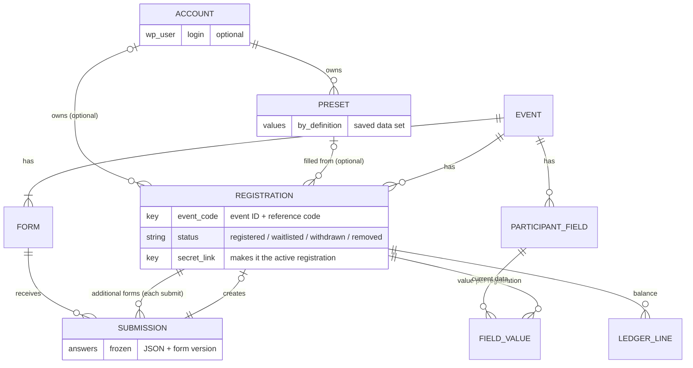

# Registrations and identity

## Registrations

- **A registration is one participant for one event.** Attending two events
  (e.g. both REFISZ camps) means registering twice; the registrations are fully
  separate: own reference code, status, secret link and ledger.
- **A registration's only identity is (event ID, reference code).** There is
  no numeric registration ID; every per-event table refers to a registration by
  that pair, and **neither part ever changes**. InnoDB keeps each event's
  registrations together on disk, in primary-key order.
- Records without a reference code (events, presets) keep a numeric key. A
  pointer to records of any type uses record type, event ID and key, as audit
  subjects do ([Foundation](foundation.md#audit)). WooCommerce order lines
  store the composed `12:47K3`, composed and parsed only in the payments code.

**What follows:** nothing may renumber or re-code a registration, and none can
move to another event; "moving" someone is a new registration plus a
withdrawal.

## Identity: no person records

- **Registration-centric identity.** Each registration holds its own personal
  data, which may differ between events for the same person. Year-to-year
  tracking is a later, heuristic add-on built from preset links: the system is
  not an outreach CRM.
- **No WordPress account is required,** unless the event's account mode is
  mandatory ([below](#accounts-on-the-registration-form)). A personal secret
  link makes a guest's registration active and shows its status and payment
  status. Guest registration is deliberately semi-anonymous: guests are never
  matched, and organizers get no manual linking tool.
- **An account is an extra layer** that **owns** registrations and
  **presets**: several people (a guardian, a youth leader's group), several
  events, all outstanding balances together, **paid at once**
  ([Money](money.md#paying-several-registrations-at-once)). The owner is set
  once, by a logged-in person's submit, and nothing changes it.
- **A guest can attach a registration to an account** through its secret link,
  with the same side effects as registering with a new account (e.g. creating a
  preset). Not built yet.
- **Default flows are seamless:** guest registration where allowed, and an
  account created on WordPress's registration page opened from the form. Flows
  with several registrations under one account may ask more, with short
  explanations.

**What follows:** there is no "person" to merge or look up; anything that
seems to need one (history across years, a family view) is built on accounts
and presets, or not at all.

## Accounts on the registration form

- **Each event has one account mode:** mandatory, optional or off. With
  accounts, the whole form shows to everyone with an account block
  ([Forms implementation](events-and-forms.md#forms-implementation)) that opens
  WordPress's own login page, linked to its registration page, in a window of
  its own. Logging in or signing up returns to the form in place, keeping what
  was typed; so does logging in after setting the password from the
  registration mail. Any WordPress user counts. Mandatory: no send without an
  account. Optional: sending logged out lands a guest registration. Off: no
  accounts. Additional forms never ask anyone to sign up.
- In optional mode the block says signing up is for people aged 16 or over
  (Hungary's age of digital consent), and younger people continue without one.
  Nobody's age is checked.
- **Kaláka never asks for or handles a password.** Signing up creates the
  account and logs it in. It is verified when its password is set through
  WordPress's own link in the registration's mail ([Mail](mail.md#configuration));
  until then it is unverified, which limits only what Kaláka does with it.
- **The registration does not wait for verification:** it lands, takes its
  place and gets its code at submit.
- **A logged-in person's registration attaches to their account,** unless the
  mode is off. **An email that already has an account** is told so on
  WordPress's registration page, with a login link back to the form.
- **WordPress's login page refuses a cross-site POST,** and participant
  accounts' names are never listed through author archives.
- At first the account area may show only "coming soon"
  ([Release plan](release-plan.md)).

**What follows:** the account flow lives on WordPress's own pages (and the
CAPTCHA plugin there), which Kaláka extends through hooks and never replaces.

## Presets

Not built yet.

- A **preset** is a saved data set, like a webshop's saved addresses; a
  registration records the preset it was filled from. **Values are stored by
  field definition** ([Fields](events-and-forms.md#fields)).
- **Saving is the default and can be cancelled:** creating a preset (when an
  account is created or a guest registration attached) and saving changes back
  both happen by default, each with an info box offering to cancel.
- **Editing a preset never changes existing registrations,** and editing an
  account's profile never changes a registration.
- The privacy tools will cover presets when they come ([Deferred](deferred.md)).

## Submissions and values

- A **submission** is the frozen original: the answers as JSON plus the form
  version, never changed. A view of it comes later, at low priority.
- **A registration has one or more submissions:** a registration form's creates
  it, each additional form's submit appends one
  ([Forms](events-and-forms.md#forms-and-the-registration-slot)). A submission
  creates zero or one registration.
- **At submit the answers are copied into field values,** one per participant
  field ([Fields](events-and-forms.md#fields)), whichever form they came from.
  **Field values hold the current state:** what admins work with and what mails,
  views, conditions and fee components read. A field of source "system" has no
  value; reading it reads the decision
  ([Foundation](foundation.md#facts-decisions-and-computed-values)).
- **One row per field,** keyed by event, code and field: one index range read
  per registration, filters and sorts within the event; about a million rows in
  ten years. A field with no value reads as none.
- **A repeated submit creates nothing.** The form page carries a submit token
  (128 random bits, a secret) and is never cached. A token the event's
  submissions already hold, with the same answers, is answered with the
  original registration's after-submit content; with other answers it is
  refused.
- **Drafts** keep a registration form's answers before the submit, in a
  submission's shape, and **never create a registration or hold a place.** A
  logged-in person's draft is saved as they type, one per form, and opens on any
  device. A **guest draft**, in every account mode, holds what a link or the quiz
  handed over and the guest's typing, under a claim token in a cookie (only its
  hash is stored); after login it becomes their draft, or they choose as for a
  handover (merge, keep the draft, keep the link). A save from a page opened
  before such a choice is refused, never written over it. **A draft lives until
  the form is sent or the event's registration closes** (owner ruling
  2026-11-26); it has no other expiry.

**What follows:** admins see and edit field values, never submissions; a
correction never rewrites history.

## Status, capacity and waitlist

- **Status and the "full" latch are facts,** changed only by people's acts,
  never recomputed ([Foundation](foundation.md#facts-decisions-and-computed-values)).
  Status is `registered`, `waitlisted`, `withdrawn` (by the participant or
  staff) or `removed` (by staff). [UNAPPROVED R388]
- **Set at registration by capacity,** it then changes only by explicit acts:
  withdraw, remove, admit, restore. **Nothing cancels or expires a registration
  automatically:** an unpaid `registered` registration stays so until someone
  acts. **A withdrawal never admits anyone from the waitlist;** changes to the
  list after it filled up are explicit admin acts. No status act needs a reason.
- **Restore is full access only** and returns to the status left from:
  `registered` (at the end of the list) if it was ever registered, else
  `waitlisted` (at its place by submit time).
- **Admission and a restore to `registered` take the seats again,** over the
  limit with the "full" warning where a pool is full, and leave the latch as it
  is. Staff see each act's effect first: seats, each payer's money, retention.
- **The participant may withdraw their own registration** from `registered` or
  `waitlisted` until the event's registration closes; after that only staff
  can. One confirmation step, no mail, nobody moves up. (Built; the owner's
  approval of its rules and texts is still open.)
- **Only capacity (waitlisted) and withdrawal or removal keep a registration
  from being `registered`.** Deposit or aid status never makes it invalid.
- **A live registration is a registered one** (owner ruling 2026-11-27), decided
  by one test in code for counts, seats and every rule about live registrations.
- **A waitlisted registration is inactive:** it holds no seats, has no
  additional forms, is not answered, gets no action mail but the waitlist one,
  and its page shows only that it is waitlisted (owner ruling 2026-11-25).
  [UNAPPROVED R394]
- **Confirmation sits beside status:** a system decision for `registered`
  registrations only, from payments or a manual flag ([Money](money.md#confirmation)).
  Participants are meant to see one phase sequence (waitlisted → awaiting
  payment → confirmed, or withdrawn / removed) through the phase tracker.
- **Withdrawal and removal have the same effect on money:** the event's
  retention rule ([Money](money.md#withdrawal-removal-and-substitution)).
- **One capacity per event,** counted from every registration form. **The
  event's seats are its counted `registered` registrations;** no seat row is
  written for them.
- **"Not counted"** registrations (e.g. children under 13 at the event's start,
  who come with a parent) bypass capacity and the latch: never waitlisted, never
  setting it. Decided once at registration by the event's condition on field
  values, stored as a fact, then changed only by staff. Not built yet.
- **The "full" latch:** the first counted registration that does not fit sets
  it; from then on new registrations are waitlisted even if a place frees up,
  until an admin clears it (reopens the event). Editing dates or capacity does
  not clear it. **The capacity check locks the event row** first in the submit.
- **Quota places are held while `registered`** ([Money](money.md#quota-places)).
- The **sorszám** (order within `registered`, and within `waitlisted`) is
  derived and renumbers: by when the registration last became `registered` (so
  an admitted one goes to the end), and within `waitlisted` by submit time.
- A form link can bypass capacity and the latch
  ([Forms](events-and-forms.md#form-links-and-admin-submissions)).

**What follows:** the waitlist is a list staff work through by hand, and the
latch keeps it fair: a freed place goes to whoever staff admit, never to the
next person who happens to submit. Every rule meaning "live" or "counted" uses
the one test.

## Reference codes

The **reference code** is the short public identifier: bank-transfer reference
and check-in barcode.

- **Format:** digit, digit, letter, digit. Letters `A K B E G J T Z F L R S X
  I` (indexes 0–13).
- **Validity:** `(9·d1 + 5·d2 + 9·L + 9·d4) mod 14 < 5`, giving **5,000 codes
  per event**. It catches 70% of single wrong characters (the maximum for 5,000
  codes) and 69% of swapped leading digits; swapping a letter and a digit always
  fails the format.
- **Unique per event,** random (CSPRNG), avoiding other events' codes where
  possible; a collision is a retryable error. A registration filled from a
  preset is meant to reuse that preset's previous code if free (not built yet).
- **When an event runs out,** codes are extended by appending digits, and
  admins get a warning. An extended code still never changes.
- No lookalike mapping, no accent folding, no blocked prefixes.
- **The code grants no access;** it appears on bank statements.

## Access

- **Access to a registration** comes from its **secret link** (that one) or its
  **owner account** (all owned, plus account-level actions). Organizers and
  partners are admin-side users with views
  ([Foundation](foundation.md#views-and-grants)).
- **The active registration** is the one the site acts for on the participant
  side. It is never called "logged in": an account may own several, and a guest
  has none.
  - **A secret link** makes it active: remembered in a signed cookie, then a
    redirect to the same page without the token, so it leaves the address bar
    and history. A link that does not match clears the cookie.
  - **An account** picks the active registration among those it owns; when it
    owns the one a cookie names, the account wins. Until the picker is built,
    being logged in sets nothing.
  - It **expires** 24 hours after the link was followed; a new secret revokes
    every earlier cookie. The **„kijelentkezés”** block clears it and logs a
    logged-in account out.
- **The participant side is built from blocks** admins place on any page, each
  with a shortcode that renders the same: the status with its money table and
  card payment, the bank-transfer details, the registrant's withdrawal,
  „kijelentkezés”, and later an account's registration picker and small
  additional forms. The exact set is still to be agreed with the owner.
- **A page holding a participant block is never cached,** nor any request
  carrying the cookie. **Showing a registration writes nothing;** what the
  registrant may do (pay, withdraw) is decided on the server and carried by the
  read.
- **Forms start from the active registration:** an additional form writes to
  it, and a registration form may prefill from it
  ([Forms](events-and-forms.md#prefill-from-a-link)).
- **Secret links:** 128 random bits, URL-safe (22 characters), compared in PHP,
  never looked up in SQL. **Stored readable,** so every email can carry the
  link, and treated as secrets: never in a log line, audit entry or exception
  message, masked in exports.
- **The contact email is not unique.** "Resend my link" mails the links of every
  registration with that address; a second guest registration with the same
  email in one event gets a soft notice, not a rejection. Not built yet.

**What follows:** a secret link is a password for one registration that
travels in every mail, so what a registrant can do from the page stays within
that registration and never shows another payer's money.

## Attribution and erasure

- **The form link a registration came through is stored as a fact**
  ([Forms](events-and-forms.md#form-links-and-admin-submissions)), filterable in
  views.
- **A hidden attribution field** can carry a key from another site, e.g. the
  submission ID of IVK's quiz, which keeps the quiz's answers there. Erasing the
  registration deletes the field value, so those answers stay, unlinked and
  anonymous, for statistics.
- **An erasure anonymises** the personal field values and submissions; the
  reference code, ledger lines and decision records stay. **Ledger lines are
  kept at least 8 years** (the Hungarian accounting-law period, to be confirmed
  with the bookkeepers), so a line holds no personal data.
- **The privacy tools are deferred until a wide release**
  ([Deferred](deferred.md)): WordPress's export and eraser for registrations and
  presets, the audit-diff scrub, self-service erasure and the other GDPR
  features. The rules above still hold, so personal data stays where a later
  eraser can reach it.
