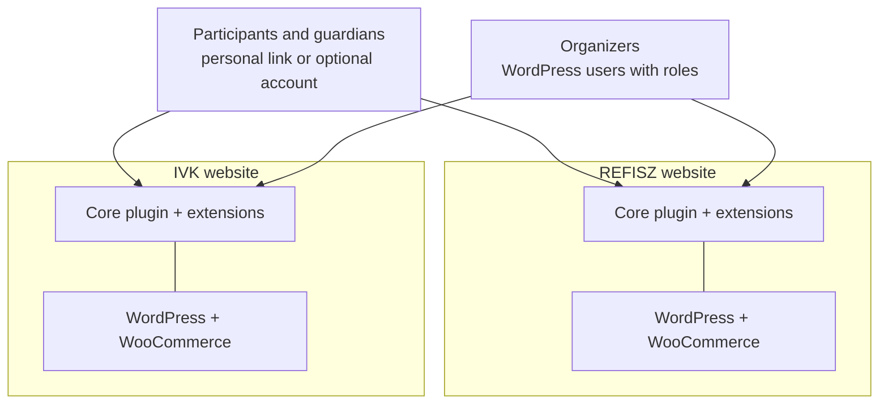
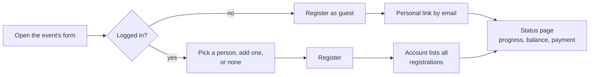

# wp-campmanager

*Working name. All plugin, module and code names are placeholders.*

Event and camp registration for REFISZ and Ifjúságépítők (IVK), replacing
today's Google Sheets, Forms and Apps Script setup with WordPress plugins.

**Status (2026-10-23):** core architecture decided; implementation not
started.

## Pages

- [Core architecture](architecture.md): layers, packaging, identity, money,
  extension surface, cross-cutting rules.
- [Decision log](decisions.md): every decision with its date and reasoning.

## Context

Both websites run the same plugin code; they share no data.

## Registering

## At a glance

- **One codebase, separate installs.** Each organization runs its own
  WordPress site; no data is shared between them.
- **Events are the top-level unit.** A registration is one participant for
  one event, with its own status, link and balance. Each event's budget is
  separate.
- **No account needed to register.** Every registration has a personal link
  to its status page. A WordPress account is optional: it collects
  registrations, can hold several people (family, youth group) and can pay
  everything at once.
- **Money is an append-only ledger.** Every change is a new, explained line.
  Price changes after registration apply only through an explicit,
  previewed re-pricing.
- **Core plus extensions.** The core plugin covers events, forms,
  registrations, rules, ledger, status pages and administration. Payments
  through WooCommerce, financial aid, sponsor support, programs, lodging,
  check-in, buffet wallet and donations are separate extension plugins.
- **Built on WordPress itself:** its admin components, REST API,
  permissions, block editor (for forms and mail templates) and interactive
  front end, rather than third-party form or admin plugins.
